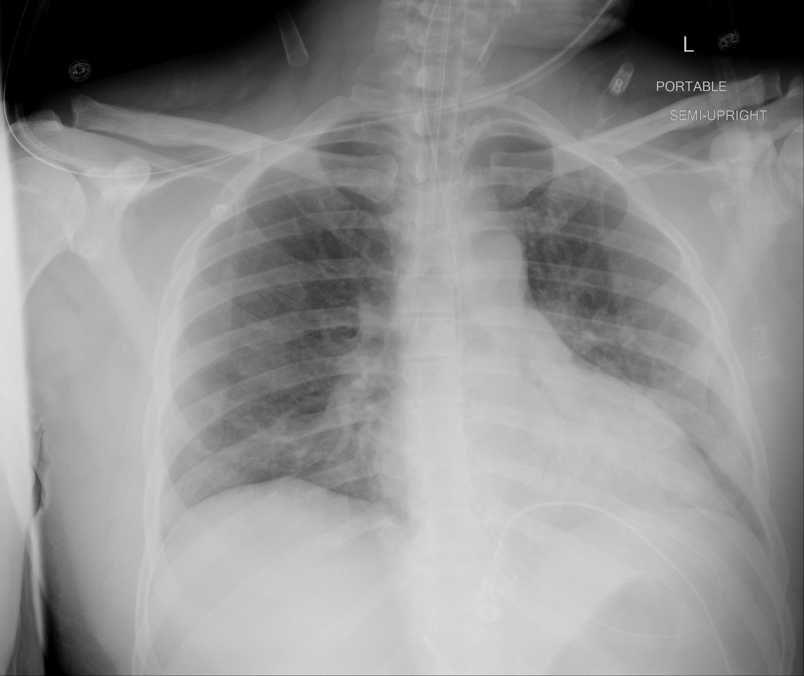

## 문제
43세 남자가 5일 전부터 열과 기침이 있다가 이틀 전부터 숨이 차서 왔다. 비인두 검체의 SARS-CoV-2 PCR 은 양성이다. 고유량 산소에도 산소포화도가 85 % 로 떨어져 기관 삽관 후 인공호흡을 시작하였다. 키는 175 cm 이다. 인공호흡기 설정은 일회호흡량 600 mL, PEEP 8 cmH2O, 흡입산소분율 0.8 이고, 동맥혈 산소분압은 72 mmHg 이다. 심장초음파에서 좌심실 박출률은 60 % 이다. 삽관 후 흉부 X선 사진은 그림과 같다. 인공호흡 방법으로 가장 적절한 것은?

- A. 예측체중 kg 당 6 mL 의 일회호흡량
- B. 실제 체중 kg 당 10 mL 의 일회호흡량
- C. PEEP 를 0 cmH2O 로 낮춤
- D. 흡입산소분율 1.0 을 계속 유지
- E. 호흡수를 분당 8회로 줄임

_이동식 반좌위 흉부 전후면 X선, 글자·좌우 표지는 원본의 것, 크기 조정만 (The Cancer Imaging Archive, CC BY 4.0 — 크롭·창 조절 없음)_

## 정답 및 해설
> 정답: A

- **정답 핵심**: 흉부 X선에서 기관내관·위관이 있고 왼쪽 하폐야의 짙은 경화가 왼쪽 횡격막을 지우며 오른쪽 폐문 주위·하폐야에도 반점상 음영이 있다 — <b>양측 음영</b>이다. 발병 1주 이내, 좌심실 박출률 정상, PaO2/FiO2 = 72/0.8 = 90(PEEP 8)으로 중등도~중증 급성호흡곤란증후군이다. 폐 보호 환기로 예측체중 kg 당 6 mL 의 일회호흡량과 고원압 30 cmH2O 이하를 목표로 한다. 이 환자의 600 mL 는 예측체중(약 70 kg) 기준 8.6 mL/kg 로 너무 크다.
- **원리**: <b>왜 일회호흡량을 줄이는가</b>: 급성호흡곤란증후군의 폐는 균일하게 굳지 않는다. 중력 쪽 폐포는 물·염증으로 닫혀 있고, 실제로 환기되는 정상 폐는 「아기 폐」만큼 작다. 그래서 건강한 사람에게 적당한 일회호흡량도 남은 정상 폐포를 과팽창시켜(용적 손상) 염증을 키운다. 일회호흡량을 <b>예측체중</b> kg 당 6 mL 로 줄였을 때 사망률이 낮아졌다(ARMA 연구).  <b>왜 실제 체중이 아니라 예측체중인가</b>: 폐의 크기는 키와 성별로 정해지고 체중이 늘어도 폐는 커지지 않는다. 남자 예측체중 = 50 + 0.91 × (키 cm − 152.4) — 175 cm 면 약 70.6 kg 이므로 6 mL/kg 은 약 420 mL 다.  <b>PEEP 와 산소</b>: 닫힌 폐포를 열어 두고(무기폐 손상 방지) 산소화를 개선하려고 적정 PEEP 를 유지·증량하고, 산소 독성을 피하려고 흡입산소분율은 목표 산소포화도(88~95 %)를 지키는 최저로 낮춘다. 일회호흡량을 줄이면 이산화탄소가 쌓이므로 호흡수를 늘려 보상하고, 어느 정도의 고탄산혈증은 허용한다.
- **비교**: <table><thead><tr><th style="width:24%">항목</th><th style="width:38%">예측체중 6 mL/kg(정답)</th><th>실제 체중 10 mL/kg(가장 가까운 오답)</th></tr></thead><tbody> <tr><td>기준 체중</td><td><b>키·성별로 계산</b>(폐 크기 반영)</td><td>측정 체중(지방·부종 포함)</td></tr> <tr><td>이 환자의 양</td><td>약 420 mL</td><td>체중에 따라 700 mL 이상</td></tr> <tr><td>고원압</td><td>30 cmH2O 이하 목표</td><td>쉽게 30 을 넘음</td></tr> <tr><td>결과</td><td>용적 손상 감소, 사망률 감소</td><td>남은 정상 폐포 과팽창</td></tr> </tbody></table> 급성호흡곤란증후군이면 「작은 일회호흡량 + 충분한 PEEP + 늘린 호흡수」가 한 묶음이다 — 셋 중 하나를 반대로 바꾼 보기는 모두 틀린다.
- **오답 이유**:
  - ② 실제 체중 10 mL/kg 은 폐가 정상인 수술 중 단기 환기에서 예전에 쓰던 설정일 뿐, 급성호흡곤란증후군에서는 어느 조건에서도 권하지 않는다.
  - ③ PEEP 0 은 PEEP 가 저혈압을 일으키거나 기흉 위험이 큰 상황에서 일시적으로 줄일 때라면 고려되지만, 산소화가 나쁜 급성호흡곤란증후군에서는 폐포를 닫히게 한다.
  - ④ 흡입산소분율 1.0 유지는 산소화 목표를 못 채운 첫 몇 분의 안정화 단계라면 정답이 되며, 지속하면 산소 독성과 흡수 무기폐를 부른다.
  - ⑤ 호흡수를 분당 8회로 줄이는 것은 만성폐쇄폐질환처럼 호기 시간이 부족해 자가 PEEP 가 쌓일 때라면 정답이 되며, 저일회량 환기에서는 호흡수를 늘린다.
- **함정**: 체중을 실제 체중으로 계산하거나, 산소화가 나쁘다는 이유로 PEEP·산소만 조정하고 일회호흡량을 그대로 두는 것.
- **학습목표**: 바이러스 폐렴 뒤 삽관한 환자의 양측 폐 음영과 P/F 비 저하를 급성호흡곤란증후군으로 판단하고 예측체중 기준 저일회호흡량 환기를 고른다
- **근거·출처**: Loscalzo J, Fauci AS, Kasper DL, et al., eds. Harrison's Principles of Internal Medicine, 22nd ed. McGraw Hill; 2025. Chapter 312: Acute Respiratory Distress Syndrome · Acute Respiratory Distress Syndrome Network. Ventilation with lower tidal volumes as compared with traditional tidal volumes for acute lung injury and the acute respiratory distress syndrome. N Engl J Med. 2000;342(18):1301-1308 · Desai S, Baghal A, Wongsurawat T, et al. Chest imaging representing a COVID-19 positive rural U.S. population. Sci Data. 2020;7:414

## 출처
- COVID-19-AR, The Cancer Imaging Archive (CC BY 4.0) · series …32803522 · Creative Commons Attribution 4.0 International · https://www.cancerimagingarchive.net/data-usage-policies-and-restrictions/
