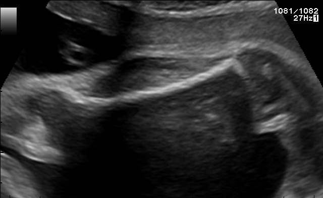

## 문제
A woman at 20 weeks' gestation comes for a routine second-trimester anatomy ultrasound. She has had no bleeding or abdominal pain, and she feels the fetus move. Her blood pressure is 112/70 mm Hg. A first-trimester ultrasound confirmed a single intrauterine pregnancy. During fetal biometry, the sonographer obtains the still image shown. The caliper for the measurement taken in this plane is placed along the brightest straight echogenic structure. Which of the following measurements is obtained in this plane?

- A. Femur length
- B. Biparietal diameter
- C. Abdominal circumference
- D. Head circumference
- E. Crown-rump length

_Fetal ultrasound still image; text at the upper right is the machine setting, unaltered apart from scaling (FETAL_PLANES_DB, Zenodo, CC BY 4.0) ※ The clinical scenario in the stem is an authoring assumption — the source dataset has no age or clinical history_

## 정답 및 해설
> 정답: A

- **정답 핵심**: The image shows a long, straight, brightly echogenic linear structure crossing the fetal soft tissue with an acoustic shadow behind it: the ossified diaphysis of a long bone seen along its long axis. This is the standard plane for femur length, measured from one end of the ossified shaft to the other along the long axis, excluding the cartilaginous epiphyses and the distal femoral epiphyseal point.
- **원리**: <b>Why bone looks bright with a shadow</b>: Ultrasound is almost completely reflected at the interface between soft tissue and calcified bone because their acoustic impedances differ greatly. The ossified femoral shaft therefore appears as a very bright line, and little sound passes beyond it, leaving a dark acoustic shadow. The cartilaginous ends of the bone transmit sound and appear hypoechoic, which is why the measurement covers only the ossified diaphysis.  <b>Why the long axis matters</b>: The femur must be imaged with the transducer aligned to the whole shaft, ideally nearly perpendicular to the beam. An oblique cut foreshortens the bone and underestimates the femur length, which can falsely suggest skeletal dysplasia or growth restriction.  <b>How femur length is used</b>: Together with biparietal diameter, head circumference, and abdominal circumference, it enters the Hadlock formula to estimate fetal weight. A femur that is short relative to the head and abdomen prompts evaluation for skeletal dysplasia or aneuploidy.
- **비교**: <table><thead><tr><th style="width:24%">Feature</th><th style="width:38%">Femur length plane (answer)</th><th>Abdominal circumference plane (closest distractor)</th></tr></thead><tbody> <tr><td>Section</td><td><b>Long axis of a single long bone</b></td><td>True transverse section of the abdomen</td></tr> <tr><td>Key landmarks</td><td>Straight bright diaphysis with acoustic shadow</td><td>Spine in cross-section, stomach bubble, umbilical vein in the liver</td></tr> <tr><td>Shape of the measured outline</td><td>Straight line, end to end of ossified shaft</td><td>Ellipse around the skin line</td></tr> <tr><td>This image</td><td>Bright linear shaft with shadow — fits</td><td>No round outline, stomach, or spine section — does not fit</td></tr> </tbody></table> Linear measurements (femur length, crown-rump length) follow one structure end to end; circumferences (head and abdomen) trace an ellipse in a transverse plane.
- **오답 이유**:
  - (B) Biparietal diameter would be correct if the image were a transverse section of the head at the level of the thalami and cavum septi pellucidi.
  - (C) Abdominal circumference would be correct if the image showed a round transverse section of the abdomen with the spine, stomach bubble, and intrahepatic umbilical vein.
  - (D) Head circumference would be correct if an ellipse were traced around the outer skull in the same transverse plane used for the biparietal diameter.
  - (E) Crown-rump length would be correct in the first trimester if the whole embryo were seen in a midsagittal section from head to rump.
- **함정**: Choosing a head or abdominal measurement because it is the most familiar biometry, without checking that the image is a single straight bone rather than a transverse section.
- **제작 가정**: FETAL_PLANES_DB 는 표준 단면 분류만 있고 산모 나이·임신 주수·병력이 없다 — 임신 중기 정밀 초음파 상황을 가정했다 (가정한 정보: 20 weeks' gestation · routine second-trimester anatomy ultrasound)
- **학습목표**: Recognize a straight, brightly echogenic long-bone diaphysis with acoustic shadowing as the femur-length plane, and distinguish it from head and abdominal biometry planes
- **근거·출처**: Salomon LJ, Alfirevic Z, Da Silva Costa F, et al. ISUOG Practice Guidelines: ultrasound assessment of fetal biometry and growth. Ultrasound Obstet Gynecol. 2019;53(6):715-723 · Burgos-Artizzu XP, Coronado-Gutiérrez D, Valenzuela-Alcaraz B, et al. Evaluation of deep convolutional neural networks for automatic classification of common maternal fetal ultrasound planes. Sci Rep. 2020;10:10200

## 출처
- FETAL_PLANES_DB (Zenodo 3904280, CC BY 4.0) · Patient00739_Plane5_1_of_1 · Creative Commons Attribution 4.0 International · https://creativecommons.org/licenses/by/4.0/
