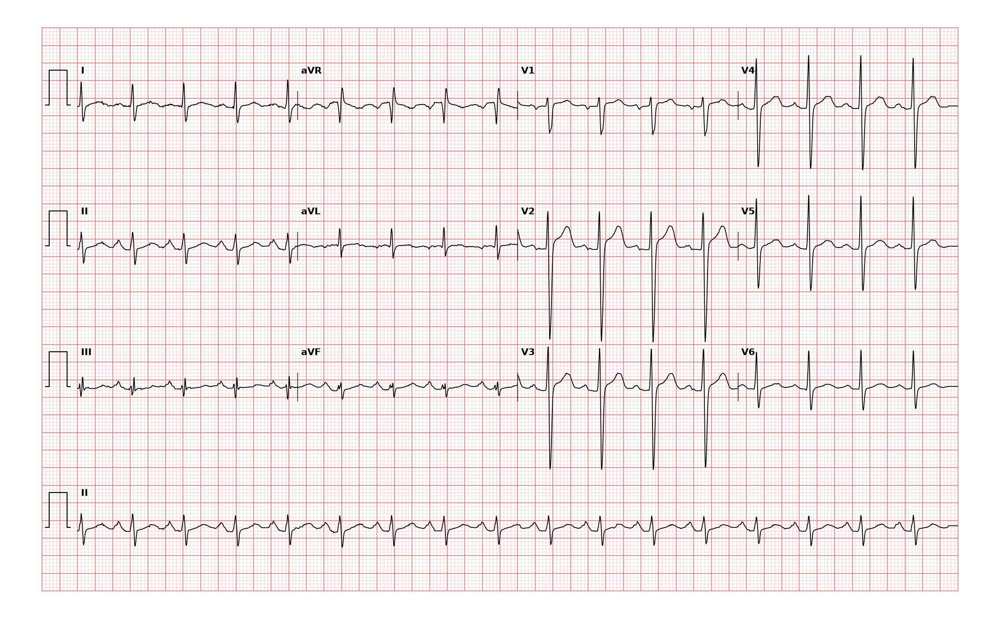

## 문제
52세 남자가 이틀 전부터 하루 여섯 번 이상의 물설사와 열이 있어 기운이 없다며 왔다. 가슴 통증이나 두근거림은 없다. 체온 38.3℃, 혈압 108/68 mmHg, 맥박 102회/분, 호흡 18회/분이다. 혀가 말라 있고 복부는 부드럽다. 혈청 나트륨 136 mEq/L, 칼륨 3.6 mEq/L 이다. 12유도 심전도는 그림과 같다. 심전도 판독으로 가장 적절한 것은?

- A. 다소성 심방빈맥
- B. 동빈맥
- C. 2:1 전도의 심방조동
- D. 발작성 상심실빈맥
- E. 심방세동

_12유도 심전도, 25 mm/s · 10 mm/mV, 3×4 + II 리듬 스트립 (PTB-XL ECG dataset, PhysioNet, CC BY 4.0 — 원신호 그대로 작도)_

## 정답 및 해설
> 정답: B

- **정답 핵심**: II 리듬 스트립에서 10초 동안 약 17개의 QRS 가 규칙적으로 나와 심박수는 약 100회/분이다. 모든 QRS 앞에 <b>II 유도에서 양성인 같은 모양의 P파</b>가 있고 PR 간격이 일정하며 QRS 는 좁다 — 동결절에서 시작한 리듬이 빨라진 <b>동빈맥</b>이다. 열과 탈수(혀 마름·낮은 혈압)라는 분명한 원인이 있다.
- **원리**: <b>왜 P파의 방향이 동결절을 알려 주는가</b>: 동결절은 오른심방 위쪽 바깥에 있어 심방 탈분극이 위에서 아래로, 오른쪽에서 왼쪽으로 퍼진다. 그 방향은 II 유도의 축과 거의 같으므로 동리듬의 P파는 <b>II·I·aVF 에서 양성, aVR 에서 음성</b>이다. 같은 모양의 P파가 매 QRS 앞에 일정한 PR 로 있으면 리듬의 출발점은 동결절이다.  <b>왜 빨라지는가</b>: 열은 체온 1℃ 상승마다 심박수를 약 10회/분 올리고, 탈수는 혈량 감소 → 압수용체 반사 → 교감신경 항진으로 심박수를 올린다. 동빈맥은 「진단」이라기보다 「몸의 반응」이므로 치료는 리듬이 아니라 원인(수액·해열)이다.  <b>시작과 끝</b>: 동빈맥은 서서히 빨라지고 서서히 느려진다. 갑자기 시작해 갑자기 끝나는 규칙적 좁은 QRS 빈맥(발작성 상심실빈맥)과 다른 점이다.
- **비교**: <table><thead><tr><th style="width:24%">항목</th><th style="width:38%">동빈맥(정답)</th><th>2:1 심방조동(가장 가까운 오답)</th></tr></thead><tbody> <tr><td>심박수</td><td>100~150회/분, 원인에 따라 변함</td><td><b>약 150회/분에 고정</b>(심방 약 300 ÷ 2)</td></tr> <tr><td>심방 파형</td><td>QRS 마다 P파 하나, II 양성</td><td>II·III·aVF 의 <b>톱니 모양 F파</b>, 하나는 QRS·T 에 숨음</td></tr> <tr><td>미주신경 자극</td><td>서서히 잠깐 느려짐</td><td>방실 전도가 줄어 톱니파가 드러남</td></tr> <tr><td>이 기록</td><td>약 100회/분, 일정한 PR 의 P파 — 일치</td><td>150회/분도 톱니파도 없음 — 불일치</td></tr> </tbody></table> 심박수가 정확히 150 근처에서 꿈쩍하지 않으면 심방조동을 먼저 의심하고, 원인과 함께 오르내리는 100~140 은 동빈맥 쪽이다.
- **오답 이유**:
  - ① 다소성 심방빈맥은 한 유도에서 모양이 다른 P파가 세 가지 이상이고 PR·RR 이 불규칙하며 흔히 중증 폐질환이 있을 때라면 정답이 된다.
  - ③ 2:1 심방조동은 심박수가 150회/분 근처에 고정되고 II·III·aVF 에 톱니 모양 F파가 보일 때라면 정답이 된다.
  - ④ 발작성 상심실빈맥은 150~250회/분의 규칙적 좁은 QRS 빈맥이 갑자기 시작하고 P파가 QRS 안에 숨거나 뒤에 거꾸로 보일 때라면 정답이 된다.
  - ⑤ 심방세동은 P파 대신 잔물결 같은 기선이 보이고 RR 간격이 전혀 규칙 없이 불규칙할 때라면 정답이 된다.
- **함정**: 빈맥이라는 이유로 부정맥 이름을 고르면서 매 QRS 앞의 정상 P파와 분명한 원인(열·탈수)을 놓치는 것.
- **학습목표**: 분당 100회 남짓의 규칙적인 빈맥에서 매 QRS 앞에 II 유도 양성 P파가 일정한 PR 로 있으면 동빈맥으로 판독하고 심방조동·발작성 상심실빈맥과 가른다
- **근거·출처**: Loscalzo J, Fauci AS, Kasper DL, et al., eds. Harrison's Principles of Internal Medicine, 22nd ed. McGraw Hill; 2025. Chapter 253: Approach to Supraventricular Arrhythmias · Wagner P, Strodthoff N, Bousseljot RD, et al. PTB-XL, a large publicly available electrocardiography dataset. Sci Data. 2020;7:154

## 출처
- PTB-XL ECG dataset v1.0.3 (PhysioNet, CC BY 4.0) · record 9398 · Creative Commons Attribution 4.0 International · https://physionet.org/content/ptb-xl/1.0.3/LICENSE.txt
