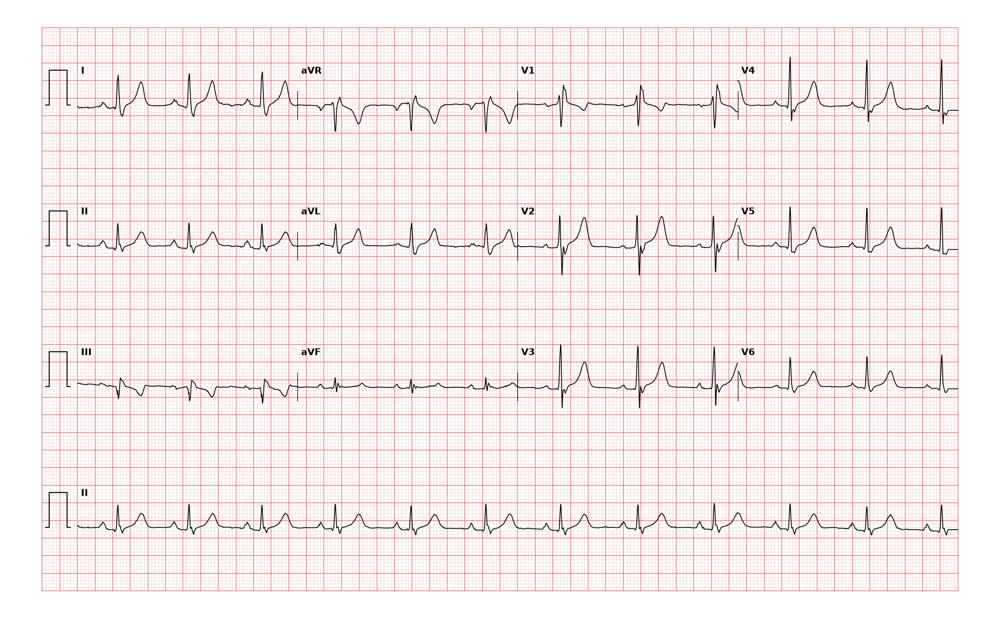

## 문제
A 76-year-old woman comes for a routine health examination. She walks daily and has no chest pain, dyspnea, palpitations, or syncope. She has hypertension controlled with amlodipine. There is no family history of sudden death. Blood pressure is 128/76 mm Hg, and pulse is 72/min and regular. The second heart sound is normally split, and no murmurs are heard. Serum potassium concentration is 4.3 mEq/L. A 12-lead ECG is shown. Which of the following is the most likely interpretation of this ECG?

- A. Incomplete right bundle branch block
- B. Complete right bundle branch block
- C. Brugada pattern
- D. Left posterior fascicular block
- E. Right ventricular hypertrophy

_12-lead ECG, 25 mm/s, 10 mm/mV, 3×4 + lead II rhythm strip (PTB-XL, PhysioNet, CC BY 4.0; raw signal, no filtering)_

## 정답 및 해설
> 정답: A

- **정답 핵심**: The rhythm is sinus at about 72/min. Lead V1 shows an rSR' (M-shaped) complex, but the QRS duration is about 100 ms, shorter than 120 ms. Leads I and V6 have only small S waves, and the frontal axis is normal. An rSR' pattern in V1 with a QRS under 120 ms is incomplete right bundle branch block.
- **원리**: <b>왜 V1 에 R' 가 생기는가</b>: 정상에서는 왼쪽·오른쪽 심실이 거의 동시에 탈분극하고, 큰 좌심실의 힘이 이겨서 V1 은 작은 r 뒤 깊은 S 가 된다. 우각의 전도가 늦어지면 좌심실이 먼저 끝나고 우심실이 뒤늦게 탈분극하는데, 이때는 맞서는 좌심실 힘이 없어 오른쪽·앞쪽(V1 쪽)을 향하는 힘이 그대로 드러난다 — 이것이 뒤늦은 R' 다. 같은 늦은 힘이 I·V6 에서는 뒤쪽 S 로 보인다.  <b>완전과 불완전의 차이</b>: 우각이 완전히 막히면 우심실은 좌심실 쪽에서 근육을 타고 느리게 넘어온 흥분으로 탈분극해 QRS 가 120 ms 이상으로 넓어진다. 전도가 늦어지기만 하면 같은 모양이 나타나지만 QRS 는 120 ms 미만이다.  <b>임상적 뜻</b>: 불완전 우각차단은 건강한 사람에게 흔한 정상 변이일 수 있다. 다만 우심실 용적 과부하(심방중격결손 — 고정 분열된 둘째 심음)나 우심실 압력 과부하의 단서일 수 있어 진찰 소견과 함께 본다.
- **비교**: <table><thead><tr><th style="width:24%">Feature</th><th style="width:38%">Incomplete RBBB (answer)</th><th>Complete RBBB (closest distractor)</th></tr></thead><tbody> <tr><td>QRS duration</td><td><b>Less than 120 ms</b> (about 100 ms here)</td><td><b>120 ms or longer</b></td></tr> <tr><td>V1</td><td>rSR'</td><td>rsR' with a broad, tall R'</td></tr> <tr><td>I and V6</td><td>Small S waves</td><td>Wide, slurred S waves (≥ 40 ms)</td></tr> <tr><td>Secondary ST-T change in V1–V3</td><td>Minimal</td><td>T inversion opposite the terminal QRS</td></tr> </tbody></table> Same morphology, different width: measure the QRS duration before naming the block.
- **오답 이유**:
  - (B) Complete right bundle branch block would be correct if the QRS were 120 ms or longer with a broad R' in V1 and wide slurred S waves in I and V6.
  - (C) The Brugada pattern would be correct if V1 and V2 showed coved ST elevation of 2 mm or more descending into an inverted T wave, especially with syncope or a family history of sudden death.
  - (D) Left posterior fascicular block would be correct if there were right axis deviation (about +90° to +180°) with qR in III and aVF and rS in I, after excluding right ventricular hypertrophy.
  - (E) Right ventricular hypertrophy would be correct if V1 showed a dominant tall R wave (R/S > 1) with right axis deviation and right atrial enlargement.
- **함정**: Calling any rSR' in V1 complete right bundle branch block without measuring the QRS duration.
- **학습목표**: Read an rSR' pattern in V1 with a QRS duration under 120 ms as incomplete right bundle branch block and distinguish it from complete right bundle branch block and the Brugada pattern
- **근거·출처**: Loscalzo J, Fauci AS, Kasper DL, et al., eds. Harrison's Principles of Internal Medicine, 22nd ed. McGraw Hill; 2025. Chapter 247: Electrocardiography · Surawicz B, Childers R, Deal BJ, et al. AHA/ACCF/HRS recommendations for the standardization and interpretation of the electrocardiogram: part III: intraventricular conduction disturbances. J Am Coll Cardiol. 2009;53(11):976-981 · Wagner P, Strodthoff N, Bousseljot RD, et al. PTB-XL, a large publicly available electrocardiography dataset. Sci Data. 2020;7:154

## 출처
- PTB-XL ECG dataset v1.0.3 (PhysioNet, CC BY 4.0) · record 950 · Creative Commons Attribution 4.0 International · https://physionet.org/content/ptb-xl/1.0.3/LICENSE.txt
