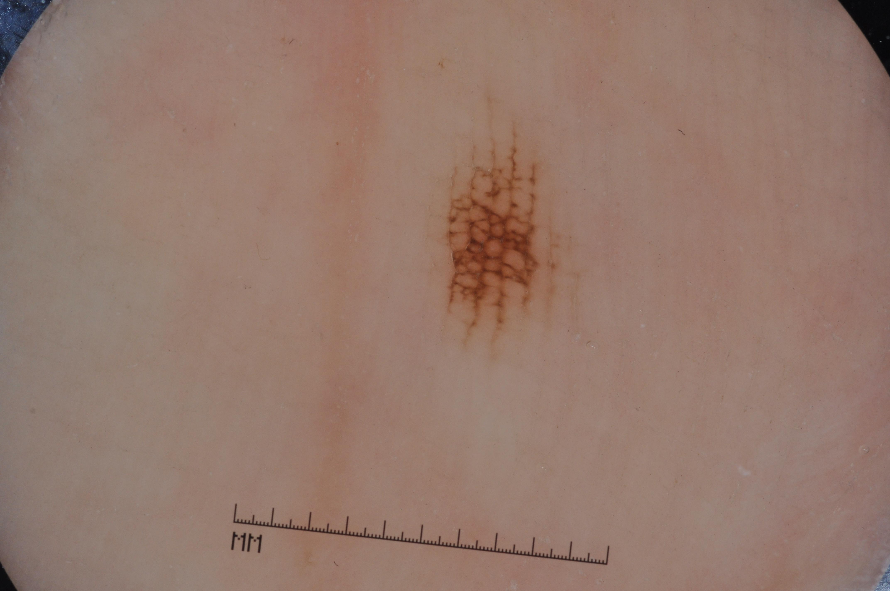

## 문제
60세 남자가 건강검진에서 손에 있는 갈색 반점을 봐 달라며 왔다. 반점은 10년 전부터 있었고 크기와 색의 변화는 없었으며 가렵거나 피가 난 적은 없다. 흑색종의 가족력은 없다. 반점은 지름 약 4 mm 의 평평한 갈색 반이고 경계가 고르다. 몸의 다른 곳에 비슷한 모양의 점이 몇 개 있다. 피부경 사진은 그림과 같다. 가장 적절한 처치는?

- A. 이미퀴모드 크림을 6주간 바른다
- B. 사진을 남기고 정기적으로 관찰한다
- C. 병변 전체를 2 mm 경계로 절제생검한다
- D. 액화질소 냉동치료로 없앤다
- E. 1 cm 경계로 넓게 절제한다

_피부경(dermoscopy) 사진, 아래 눈금자(mm)는 원본의 것 — 크기 조정만 (ISIC Archive, CC0)_

## 정답 및 해설
> 정답: B

- **정답 핵심**: 피부경에서 가늘고 고른 갈색 선이 규칙적인 그물(색소망)을 이루고, 그물이 <b>가장자리로 갈수록 옅어지며 병변이 대칭</b>이다. 청백색 베일, 불규칙한 점·덩이, 가장자리 줄무늬, 퇴행 구조 같은 흑색종 소견이 없다. 10년간 변화가 없고 몸의 다른 점과 모양이 비슷하다(「미운 오리 새끼」 징후 없음) — 양성 멜라닌세포 모반이므로 사진을 남기고 관찰한다.
- **원리**: <b>왜 그물 모양이 보이는가</b>: 표피 아래쪽 경계는 진피유두와 표피능선이 맞물린 물결 모양이다. 멜라닌세포와 멜라닌은 표피능선(아래로 내려간 부분)에 많이 모이므로 위에서 보면 능선은 갈색 선, 그 사이 진피유두 꼭대기는 밝은 구멍으로 보여 <b>그물(색소망)</b>이 된다. 정상 구조를 따라 멜라닌이 고르게 늘어난 양성 모반은 선 굵기와 구멍 크기가 고르고 가장자리로 갈수록 옅어진다.  <b>흑색종은 왜 그물이 깨지는가</b>: 악성 멜라닌세포는 능선에 머물지 않고 표피 위쪽과 진피로 흩어지며 자라므로 선이 굵고 끊기며(비정형 색소망), 진피 깊이 들어간 멜라닌은 청회색(청백색 베일)으로 보인다. 면역반응으로 일부가 사라지면 흰 흉터 모양의 퇴행 구조가 남는다.  <b>처치의 원칙</b>: 피부경 소견이 양성이고 병력상 변화가 없으면 불필요한 절제를 피하고 기준 사진을 남겨 비교 관찰한다. 변화(크기·모양·색), 새로 생김, 비정형 소견이 있을 때 전층 절제생검으로 두께를 잰다.
- **비교**: <table><thead><tr><th style="width:24%">항목</th><th style="width:38%">양성 모반 — 관찰(정답)</th><th>흑색종 의심 — 절제생검(가장 가까운 오답)</th></tr></thead><tbody> <tr><td>색소망</td><td><b>가늘고 고르며 가장자리로 옅어짐</b></td><td>굵고 끊기며 가장자리에서 갑자기 끝남</td></tr> <tr><td>대칭·색</td><td>대칭, 갈색 한두 가지</td><td>비대칭, 갈색·검정·청회색·흰색 여러 가지</td></tr> <tr><td>특이 구조</td><td>없음</td><td>청백색 베일, 불규칙 점, 가장자리 줄무늬, 퇴행 구조</td></tr> <tr><td>병력</td><td>오래 변화 없음, 다른 점과 비슷</td><td>새로 생기거나 변함, 다른 점과 다름</td></tr> </tbody></table> 60세라는 나이만으로 절제하지 않는다 — 소견(피부경)과 변화(병력)가 둘 다 양성이면 관찰, 어느 하나라도 의심스러우면 절제생검이다.
- **오답 이유**:
  - ① 이미퀴모드는 수술이 어려운 표재성 기저세포암이나 악성 흑자 같은 상황이라면 고려하는 국소 면역조절제다.
  - ③ 2 mm 경계 절제생검은 피부경에서 비정형 색소망·청백색 베일이 보이거나 최근 크기·색이 변한 병변이라면 정답이 된다.
  - ④ 냉동치료는 지루각화증·광선각화증처럼 조직 확인이 필요 없는 표피 병변이라면 쓰지만, 멜라닌세포 병변은 조직을 없애 진단을 놓치므로 쓰지 않는다.
  - ⑤ 1 cm 경계 넓은 절제는 생검으로 두께 1 mm 이하의 흑색종이 확진된 뒤의 근치 수술이라면 정답이 된다.
- **함정**: 고령의 색소 병변이라는 이유만으로 피부경의 양성 소견과 10년간 변화 없음을 무시하고 절제를 고르는 것.
- **학습목표**: 피부경에서 대칭적이고 가장자리로 옅어지는 규칙적 색소망만 보이는 작은 색소 병변을 양성 멜라닌세포 모반으로 읽고, 절제생검이 필요한 흑색종 소견과 가른다
- **근거·출처**: Loscalzo J, Fauci AS, Kasper DL, et al., eds. Harrison's Principles of Internal Medicine, 22nd ed. McGraw Hill; 2025. Chapter 81: Cancer of the Skin · Argenziano G, Soyer HP, Chimenti S, et al. Dermoscopy of pigmented skin lesions: results of a consensus meeting via the Internet. J Am Acad Dermatol. 2003;48(5):679-693 · Codella NCF, Gutman D, Celebi ME, et al. Skin lesion analysis toward melanoma detection: a challenge at the 2017 ISBI, hosted by the ISIC. arXiv:1710.05006

## 출처
- ISIC Archive ISIC_0001111 (CC-0) · CC0 1.0 Universal · https://creativecommons.org/publicdomain/zero/1.0/
