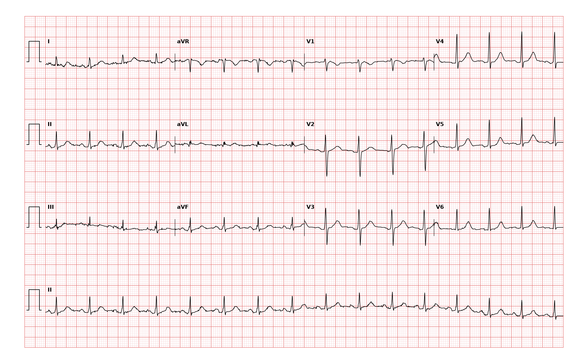

## 문제
A 48-year-old woman comes to the office because of intermittent palpitations for 2 months. The episodes last a few seconds, occur mostly after she drinks several cups of coffee, and are not associated with chest pain, dyspnea, or syncope. She takes no medications. Pulse is 92/min and regular, and blood pressure is 122/78 mm Hg. Cardiac examination shows no murmurs. Serum TSH concentration is within the reference range. A resting 12-lead ECG is shown. Which of the following best describes this ECG?

- A. Normal sinus rhythm without conduction or repolarization abnormalities
- B. Sinus tachycardia
- C. First-degree atrioventricular block
- D. Ventricular preexcitation (Wolff-Parkinson-White pattern)
- E. Incomplete right bundle branch block

_12-lead ECG, 25 mm/s, 10 mm/mV, 3×4 + lead II rhythm strip (PTB-XL, PhysioNet, CC BY 4.0; raw signal, no filtering)_

## 정답 및 해설
> 정답: A

- **정답 핵심**: The lead II rhythm strip shows about 16 regular QRS complexes in 10 seconds (rate about 95/min). Every QRS is preceded by the same upright P wave in lead II with a constant PR interval of about 0.16 s. The QRS is narrow without a delta wave or an rSR' pattern in V1, the axis is normal, and the ST segments and T waves are normal. The baseline wander in leads I and III is artifact. This is a normal ECG; a rate under 100/min is sinus rhythm, not sinus tachycardia.
- **원리**: <b>왜 이 순서로 읽는가</b>: 심전도는 <b>박동수 → 리듬 → 간격(PR·QRS·QT) → 축 → 파형(ST-T)</b>의 순서로 읽어야 놓치는 곳이 없다. 동리듬의 정의는 매 QRS 앞에 II 에서 양성인 같은 모양의 P파가 일정한 PR 로 있는 것이고, 박동수 60~100회/분이 정상 범위다. 100을 넘을 때만 동빈맥이다 — 92~95회/분은 정상 상한에 가깝지만 정상이다.  <b>왜 두근거림이 있어도 정상일 수 있는가</b>: 짧은 두근거림의 흔한 원인은 카페인 같은 자극에 의한 심방·심실 기외수축이며, 증상이 없는 순간의 10초 기록에는 잡히지 않는다. 휴식 심전도가 정상이면 구조적 심질환·조기흥분·QT 연장 같은 기질이 없다는 뜻이고, 증상이 잦으면 증상과 기록을 맞추는 보행 기록(홀터·사건기록기)으로 잡는다.  <b>잡음 구별</b>: 유도 I·III 의 거친 기저선 흔들림은 전극 접촉·근육 떨림의 인공물이다. 같은 순간의 다른 유도에서 박동이 규칙적이면 리듬 이상으로 읽지 않는다.
- **비교**: <table><thead><tr><th style="width:24%">Feature</th><th style="width:38%">Normal sinus rhythm (answer)</th><th>WPW pattern (closest look-alike for a normal-width tracing)</th></tr></thead><tbody> <tr><td>PR interval</td><td><b>0.12–0.20 s</b> (here about 0.16 s)</td><td><b>&lt; 0.12 s</b></td></tr> <tr><td>QRS onset</td><td>Sharp upstroke</td><td>Slurred delta wave</td></tr> <tr><td>QRS width</td><td>Narrow</td><td>Mildly widened by the delta wave</td></tr> <tr><td>Rate rule</td><td>60–100/min (here about 95)</td><td>Any rate; tachycardia during reentry</td></tr> </tbody></table> A rate in the 90s is still normal; preexcitation is diagnosed from a short PR and a delta wave, not from palpitations.
- **오답 이유**:
  - (B) Sinus tachycardia would be correct if the same sinus P waves were present but the rate exceeded 100/min, as with fever, anemia, or hyperthyroidism.
  - (C) First-degree AV block would be correct if every P wave conducted but the PR interval were longer than 0.20 s (more than one large box).
  - (D) WPW pattern would be correct if the PR interval were shorter than 0.12 s with a slurred delta wave at the start of a slightly widened QRS.
  - (E) Incomplete RBBB would be correct if V1 showed an rSR' pattern with a QRS of 100 to 120 ms and slurred S waves in I and V6.
- **함정**: Calling a heart rate in the 90s sinus tachycardia, or reading baseline wander in leads I and III as an arrhythmia.
- **학습목표**: Read a regular rhythm at about 95/min with an upright P wave before every QRS, a normal PR interval, a narrow QRS, and normal ST-T waves as a normal sinus rhythm ECG, and distinguish it from sinus tachycardia and preexcitation
- **근거·출처**: Loscalzo J, Fauci AS, Kasper DL, et al., eds. Harrison's Principles of Internal Medicine, 22nd ed. McGraw Hill; 2025. Chapter 247: Electrocardiography · Kligfield P, Gettes LS, Bailey JJ, et al. Recommendations for the standardization and interpretation of the electrocardiogram: part I. J Am Coll Cardiol. 2007;49(10):1109-1127 · Wagner P, Strodthoff N, Bousseljot RD, et al. PTB-XL, a large publicly available electrocardiography dataset. Sci Data. 2020;7:154

## 출처
- PTB-XL ECG dataset v1.0.3 (PhysioNet, CC BY 4.0) · record 19277 · Creative Commons Attribution 4.0 International · https://physionet.org/content/ptb-xl/1.0.3/LICENSE.txt
