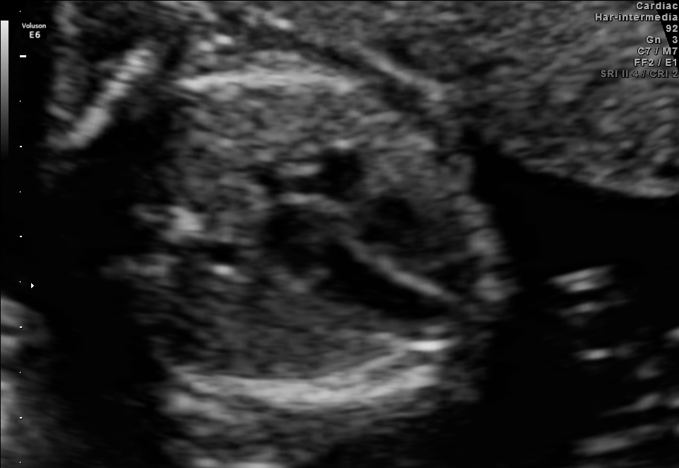

## 문제
임신 20주 임신부가 정밀 초음파를 받으러 왔다. 특별한 증상은 없고 지금까지의 산전 검사는 정상이었다. 혈압 114/70 mmHg 이고 태아 심박은 규칙적이다. 정밀 초음파에서 얻은 태아 가슴의 가로단면은 그림과 같다. 이 단면에서 평가하는 것으로 가장 적절한 것은?

- A. 넙다리뼈 골간의 길이
- B. 목덜미 투명대 두께
- C. 가쪽뇌실 뒤뿔의 너비
- D. 심장의 위치와 축, 네 방의 크기 대칭
- E. 위 거품과 제대정맥 위치로 정한 복부둘레

_태아 초음파 정지 영상, 오른쪽 위 글자는 기기 설정 — 크기 조정만 (FETAL_PLANES_DB, Zenodo, CC BY 4.0) ※ 발문의 임상 상황은 문항 구성을 위한 가정이다 — 원 데이터에는 나이·병력이 없다_

## 정답 및 해설
> 정답: D

- **정답 핵심**: 갈비뼈의 곡선형 강한 반사가 <b>가슴 전체를 둘러싸고</b> 그 안 가운데에 저에코의 방들로 나뉜 심장이, 뒤쪽에 척추가 보인다 — 태아 가슴의 가로단면(심장 4방 단면)이다. 이 단면에서는 심장이 가슴의 왼쪽에 있고 심장축이 왼쪽으로 약 45° 기울었는지, 심장이 가슴 넓이의 약 1/3 을 차지하는지, 두 심방·두 심실의 크기가 비슷한지를 본다.
- **원리**: <b>왜 4방 단면을 보는가</b>: 선천 심장질환은 가장 흔한 주요 선천 기형인데 산전 선별의 기본이 임신 중기(18~22주)의 <b>심장 4방 단면</b>이다. 태아의 가슴을 가로로 자르면 심장 대부분이 한 단면에 들어와 두 심방·두 심실·심실중격·방실판막을 한 번에 볼 수 있다. 여기서 한쪽 심실이 작으면(좌심형성부전), 중격이 끊기면(방실중격결손), 축이 크게 틀어지면(원추동맥간 기형) 정밀 심장초음파로 넘긴다.  <b>위치와 축이 왜 중요한가</b>: 정상 심장은 가슴 왼쪽에 있고 첨부가 왼쪽 앞을 향해 축이 약 45°(±20°)다. 축이 벗어나면 심장 기형이나, 가슴 안 공간을 차지하는 다른 병변(선천 횡격막 탈장 — 같은 단면에 위나 장이 올라옴)이 있을 수 있다.  <b>단면을 구분하는 표지</b>: 같은 가로단면이라도 갈비뼈가 둘레 전체를 두르면 가슴, 갈비뼈가 일부만 걸리고 위 거품과 제대정맥이 보이면 배(복부둘레 단면)다.
- **비교**: <table><thead><tr><th style="width:22%">항목</th><th style="width:39%">가슴 가로단면 — 4방 단면(정답)</th><th>복부 가로단면 — 복부둘레(가장 가까운 오답)</th></tr></thead><tbody> <tr><td>갈비뼈</td><td><b>둘레 전체를 감쌈</b></td><td>짧은 조각 1~2개만</td></tr> <tr><td>가운데 구조</td><td>네 방으로 나뉜 심장</td><td><b>위 거품</b>, 간 속 제대정맥(J 모양)</td></tr> <tr><td>평가</td><td>심장 위치·축·크기·네 방 대칭</td><td>복부둘레 → 태아 체중 추정·성장</td></tr> </tbody></table> 같은 「가로단면」이라도 갈비뼈의 범위와 가운데 구조로 높이를 정한다 — 심장이 보이면 가슴, 위 거품과 제대정맥이 보이면 배다.
- **오답 이유**:
  - ① 넙다리뼈 길이는 곧은 긴뼈의 긴축이 음향그림자와 함께 보이는 단면이라면 정답이 된다.
  - ② 목덜미 투명대는 임신 11~13주에 태아의 정중시상단면에서 목 뒤 저에코 층을 재는 경우라면 정답이 된다.
  - ③ 가쪽뇌실 너비는 머리의 가로단면에서 맥락얼기가 있는 뇌실 뒤뿔을 재는 경우라면 정답이 된다.
  - ⑤ 복부둘레는 갈비뼈가 일부만 걸리고 위 거품과 간 속 제대정맥이 보이는 배의 가로단면이라면 정답이 된다.
- **함정**: 둥근 가로단면을 모두 복부둘레 단면으로 보고 갈비뼈가 둘레 전체를 두르는지, 가운데가 심장인지를 확인하지 않는 것.
- **제작 가정**: FETAL_PLANES_DB 는 표준 단면 분류만 있고 산모 나이·임신 주수·병력이 없다 — 임신 중기 정밀 초음파 상황을 가정했다 (가정한 정보: 임신 20주 임신부가 · 지금까지의 산전 검사는 정상이었다)
- **학습목표**: 임신 중기 태아 가슴 가로단면(심장 4방 단면)을 읽고, 이 단면에서 선별하는 항목(심장의 위치·축·네 방의 대칭)을 복부둘레 단면의 항목과 가른다
- **근거·출처**: Carvalho JS, Axt-Fliedner R, Chaoui R, et al. ISUOG Practice Guidelines (updated): fetal cardiac screening. Ultrasound Obstet Gynecol. 2023;61(6):788-803 · Salomon LJ, Alfirevic Z, Berghella V, et al. ISUOG Practice Guidelines (updated): performance of the routine mid-trimester fetal ultrasound scan. Ultrasound Obstet Gynecol. 2022;59(6):840-856 · Burgos-Artizzu XP, Coronado-Gutiérrez D, Valenzuela-Alcaraz B, et al. Evaluation of deep convolutional neural networks for automatic classification of common maternal fetal ultrasound planes. Sci Rep. 2020;10:10200

## 출처
- FETAL_PLANES_DB (Zenodo 3904280, CC BY 4.0) · Patient00901_Plane6_3_of_5 · Creative Commons Attribution 4.0 International · https://creativecommons.org/licenses/by/4.0/
