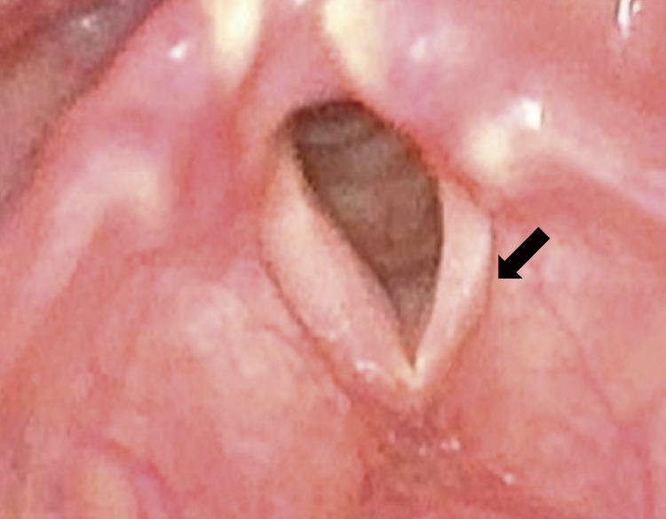

## 문제
A 47-year-old man comes to the physician because of progressive hoarseness and a breathy voice for 6 months. He occasionally coughs while drinking water. He has never smoked and has had no neck or chest surgery or endotracheal intubation. Vital signs are within normal limits. There is no palpable neck mass or lymphadenopathy, and the palate elevates symmetrically. Flexible laryngoscopy shows that the left vocal fold does not move during phonation. A laryngoscopic image is shown; the arrow indicates the left vocal fold. Which of the following is the most appropriate next step in diagnosis?

- A. CT of the neck and chest from the skull base to the aortic arch
- B. Direct laryngoscopy with biopsy of the left vocal fold
- C. Voice therapy and repeat laryngoscopy in 6 months
- D. MRI of the brain with attention to the brainstem
- E. Barium swallow study

_Flexible laryngoscopy still image; the black arrow is from the original figure — one panel cropped, no other change (PMC Open Access Subset, CC BY)_

## 정답 및 해설
> 정답: A

- **정답 핵심**: The image shows a thin, bowed (atrophic) left vocal fold that is shorter than the right, with an asymmetric glottic gap and no mass or mucosal lesion. With the immobile left fold, this is left vocal fold paralysis. The palate elevates symmetrically, so the lesion is distal to the pharyngeal branches of the vagus — along the recurrent laryngeal nerve. The left nerve loops under the aortic arch, so imaging must cover the whole course from the skull base to the aortic arch to find a compressive lesion (in this patient's case, a mediastinal mass).
- **원리**: <b>왜 왼쪽이 더 잘 마비되는가</b>: 미주신경에서 갈라진 되돌이후두신경은 오른쪽은 빗장밑동맥을, <b>왼쪽은 대동맥활을 돌아</b> 다시 위로 올라가 기관과 식도 사이 홈을 따라 후두로 들어간다. 왼쪽 신경은 가슴 안까지 내려가므로 경로가 훨씬 길고, 종격동 종괴·폐암·대동맥류·좌심방 확장(Ortner 증후군)에 눌릴 기회가 많다.  <b>왜 목소리가 새고 사레가 드는가</b>: 되돌이후두신경은 성대를 벌리고 모으는 후두 내근(윤상갑상근 제외)을 지배한다. 마비된 성대는 가운데 가까이에 멈추고 시간이 지나면 근육이 위축돼 얇고 활처럼 휜다. 발성 때 양쪽 성대가 맞닿지 못해 공기가 새는 숨찬 목소리가 되고, 삼킬 때 성문이 덜 닫혀 묽은 액체에 사레가 든다.  <b>왜 영상이 다음 단계인가</b>: 성대 자체에 종괴가 없으므로 원인은 신경 경로 어딘가에 있다. 목젖 올림이 대칭이면 미주신경 위쪽(인두 가지 위)은 괜찮으므로, 두개저부터 대동맥활까지 신경 경로 전체를 조영 CT 로 찍어 압박 병변을 찾는다.
- **비교**: <table><thead><tr><th style="width:24%">Feature</th><th style="width:38%">Vocal fold paralysis → image the nerve (answer)</th><th>Vocal fold lesion → biopsy (closest distractor)</th></tr></thead><tbody> <tr><td>Laryngoscopic appearance</td><td><b>Thin, bowed fold; smooth mucosa; no mass</b></td><td>Exophytic, ulcerated, or leukoplakic mass</td></tr> <tr><td>Motion</td><td>Immobile fold</td><td>Usually mobile unless deeply invasive</td></tr> <tr><td>Where the cause lies</td><td>Along the nerve: skull base, neck, mediastinum</td><td>In the fold itself</td></tr> <tr><td>Next test</td><td>Contrast CT skull base → aortic arch</td><td>Direct laryngoscopy with biopsy</td></tr> </tbody></table> Biopsy the fold only when the fold itself is abnormal; when it is merely paralyzed, look for what is compressing its nerve.
- **오답 이유**:
  - (B) Biopsy would be correct if laryngoscopy showed an exophytic or ulcerated mass on the fold, especially in a smoker.
  - (C) Voice therapy with observation would be reasonable after a known recent cause such as thyroid surgery or intubation, when imaging is unrevealing.
  - (D) Brain MRI would be correct if there were other cranial nerve findings, such as palatal deviation, tongue weakness, or dysarthria, suggesting a brainstem or skull-base lesion.
  - (E) Barium swallow would be correct if the main problem were solid-food dysphagia suggesting an esophageal lesion rather than an immobile vocal fold.
- **함정**: Choosing a biopsy for any hoarseness without noticing that the fold is paralyzed and atrophic but has no mass.
- **학습목표**: Read an atrophic, bowed vocal fold without a mass on laryngoscopy as unilateral vocal fold paralysis, and choose imaging of the entire course of the recurrent laryngeal nerve rather than biopsy
- **근거·출처**: Loscalzo J, Fauci AS, Kasper DL, et al., eds. Harrison's Principles of Internal Medicine, 22nd ed. McGraw Hill; 2025. Chapter 306: Disorders of the Mediastinum · Stachler RJ, Francis DO, Schwartz SR, et al. Clinical practice guideline: hoarseness (dysphonia) (update). Otolaryngol Head Neck Surg. 2018;158(1 Suppl):S1-S42 · Improvement in recurrent laryngeal nerve paralysis and tracheal deviation after surgical resection of a mediastinal parathyroid cyst: a case report. Surg Case Rep. 2025;11(1):24-0083

## 출처
- Improvement in Recurrent Laryngeal Nerve Paralysis and Tracheal Deviation after Surgical Resection of a Mediastinal Parathyroid Cyst: A Case Report. Surg Case Rep. 2025 Jan 31;11(1):24-0083. doi: 10.70352/scrj.cr.24-0083 (CC BY) — Fig. 3 · CC BY · https://creativecommons.org/licenses/
