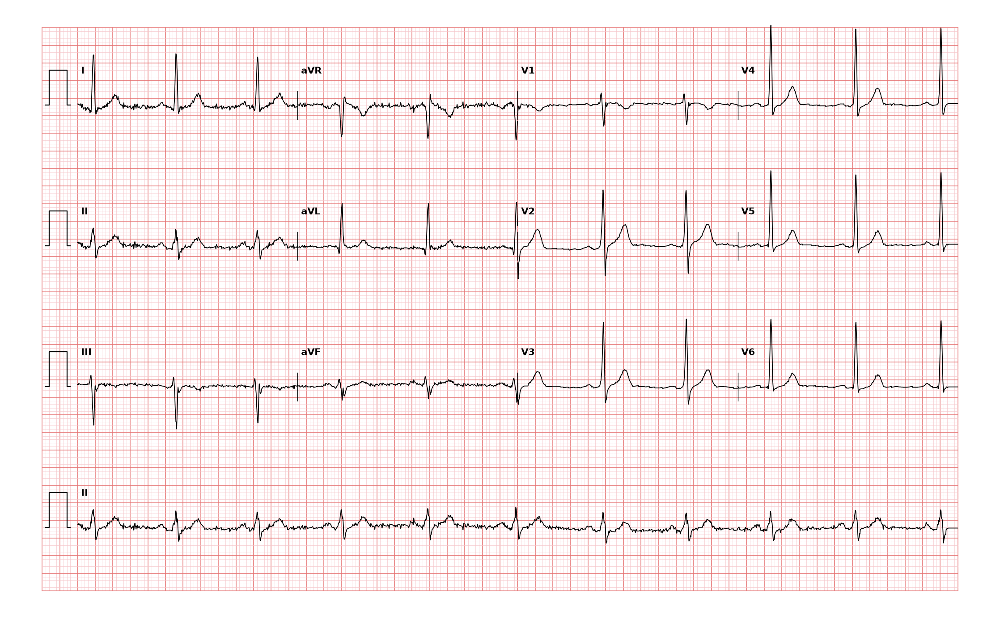

## 문제
56세 남자가 직장 건강검진에서 받은 심전도에 이상이 있다는 말을 듣고 왔다. 가슴 통증, 숨참, 두근거림은 없고 일주일에 세 번 한 시간씩 달리기를 한다. 고혈압이나 당뇨병은 없고 먹는 약은 없다. 키 183 cm, 몸무게 91 kg 이다. 혈압 124/78 mmHg, 맥박 64회/분이고 심잡음은 들리지 않는다. 혈청 전해질은 정상이다. 12유도 심전도는 그림과 같다. 심전도 판독으로 가장 적절한 것은?

- A. 급성 측벽 심근경색
- B. ST-T 변화가 없는 QRS 고전압
- C. 재분극 이상(strain)을 동반한 좌심실 비대
- D. 좌전섬유속차단
- E. 완전 좌각차단

_12유도 심전도, 25 mm/s · 10 mm/mV, 3×4 + II 리듬 스트립 (PTB-XL ECG dataset, PhysioNet, CC BY 4.0 — 원신호 그대로 작도)_

## 정답 및 해설
> 정답: B

- **정답 핵심**: II 리듬 스트립에서 약 63회/분의 규칙적인 동리듬이다. <b>I 유도의 R 이 약 14 mm, aVL 의 R 이 약 12 mm</b>이고 V4·V5 의 R 은 20 mm 를 넘어 사지·흉부 유도 모두 전압이 크다. 그런데 R 이 큰 I·aVL·V5·V6 에서 <b>ST 는 등전위이고 T 는 양성</b>이며 QRS 폭은 좁다 — 재분극 이상 없는 고전압이다. 운동을 꾸준히 하는 정상 혈압의 남자에서 흔한 정상 변이다.
- **원리**: <b>전압이 크다는 것과 비대는 다르다</b>: QRS 전압은 심근의 양뿐 아니라 심장과 전극 사이의 거리·조직(가슴벽 두께, 폐 공기, 지방)에 좌우된다. 꾸준히 운동하는 사람은 좌심실이 생리적으로 약간 커지고 미주신경 긴장이 높아 큰 전압과 느린 동리듬이 함께 나타나는데, 이는 병이 아니라 적응이다.  <b>왜 ST-T 를 먼저 보는가</b>: 고혈압·대동맥판 협착 같은 압력 과부하로 생긴 병적 비대에서는 두꺼워진 벽의 재분극이 늦고 심내막하가 상대적으로 허혈해져 R 이 큰 유도에 <b>내리막 ST 하강과 비대칭 T 역위(strain)</b>가 생긴다. 이 소견이 있으면 심혈관 사건 위험이 실제로 높고, 없으면 전압만으로 비대를 단정하지 않는다.  <b>축과 차단</b>: III 에 깊은 S 가 있어 축은 약 -20° 로 왼쪽에 치우쳤지만, 좌전섬유속차단은 축이 -45° 이하이고 II·III·aVF 가 모두 rS 일 때 진단한다. 의심되면 심장초음파로 벽 두께를 재고, 증상·고혈압이 없으면 대개 추가 조치가 필요 없다.
- **비교**: <table><thead><tr><th style="width:24%">항목</th><th style="width:38%">재분극 이상 없는 고전압(정답)</th><th>strain 동반 좌심실 비대(가장 가까운 오답)</th></tr></thead><tbody> <tr><td>QRS 전압</td><td>큼(I·aVL·V4·V5)</td><td>큼</td></tr> <tr><td>I·aVL·V5·V6 의 ST-T</td><td><b>ST 등전위, T 양성</b></td><td><b>내리막 ST 하강, 비대칭 T 역위</b></td></tr> <tr><td>흔한 배경</td><td>운동선수, 마른·젊은 사람</td><td>오래된 고혈압, 대동맥판 협착</td></tr> <tr><td>이 환자</td><td>정상 혈압, 운동, 정상 재분극 — 일치</td><td>재분극 이상 없음 — 불일치</td></tr> </tbody></table> 전압은 「QRS 가 얼마나 큰가」, ST-T 는 「심근이 버거운가」를 말한다 — 둘을 함께 읽고 나서 비대라고 부른다.
- **오답 이유**:
  - ① 급성 측벽 심근경색은 가슴 통증과 함께 I·aVL·V5·V6 에 ST 상승, 하벽 유도에 거울상 ST 하강이 있을 때라면 정답이 된다.
  - ③ strain 동반 좌심실 비대는 R 이 큰 I·aVL·V5·V6 에서 내리막 ST 하강과 비대칭 T 역위가 있고 오래된 고혈압이 있을 때라면 정답이 된다.
  - ④ 좌전섬유속차단은 축이 -45° 이하로 더 왼쪽이고 II·III·aVF 가 모두 작은 r 과 깊은 S 의 rS 모양일 때라면 정답이 된다.
  - ⑤ 완전 좌각차단은 QRS 가 120 ms 이상으로 넓고 I·V6 에 넓게 갈라진 R, V1 에 깊고 넓은 QS 가 있을 때라면 정답이 된다.
- **함정**: R 이 크다는 이유만으로 좌심실 비대를 고르고, 같은 유도의 ST-T 가 정상이라는 것과 운동·정상 혈압이라는 배경을 놓치는 것.
- **학습목표**: 사지·흉부 유도의 큰 QRS 전압이 있지만 ST 분절과 T파가 정상인 심전도를 재분극 이상 없는 고전압으로 판독하고, strain 을 동반한 좌심실 비대·좌전섬유속차단과 가른다
- **근거·출처**: Loscalzo J, Fauci AS, Kasper DL, et al., eds. Harrison's Principles of Internal Medicine, 22nd ed. McGraw Hill; 2025. Chapter 247: Electrocardiography · Hancock EW, Deal BJ, Mirvis DM, et al. AHA/ACCF/HRS recommendations for the standardization and interpretation of the electrocardiogram: part V: electrocardiogram changes associated with cardiac chamber hypertrophy. J Am Coll Cardiol. 2009;53(11):992-1002 · Sharma S, Drezner JA, Baggish A, et al. International recommendations for electrocardiographic interpretation in athletes. J Am Coll Cardiol. 2017;69(8):1057-1075 · Wagner P, Strodthoff N, Bousseljot RD, et al. PTB-XL, a large publicly available electrocardiography dataset. Sci Data. 2020;7:154

## 출처
- PTB-XL ECG dataset v1.0.3 (PhysioNet, CC BY 4.0) · record 8541 · Creative Commons Attribution 4.0 International · https://physionet.org/content/ptb-xl/1.0.3/LICENSE.txt
