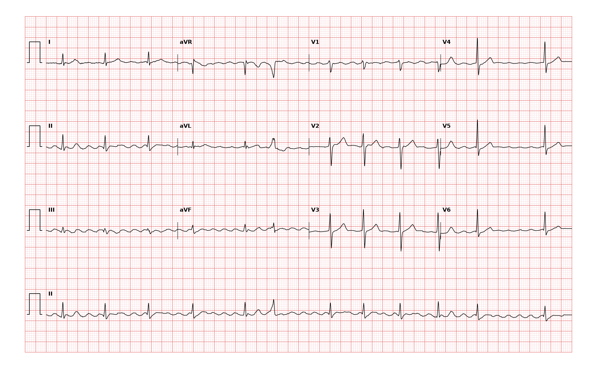

## 문제
66세 남자가 일주일 전부터 가끔 가슴이 두근거린다며 왔다. 가슴 통증, 숨참, 어지러움, 실신은 없다. 10년 전부터 고혈압으로 암로디핀을 먹고 있으며 당뇨병, 심부전, 뇌졸중의 병력은 없다. 혈압 134/82 mmHg, 맥박 84회/분이고 불규칙하다. 호흡음은 깨끗하고 다리 부종은 없다. 혈색소 14.1 g/dL, 혈소판 23만/mm³, 크레아티닌 0.9 mg/dL, 갑상샘자극호르몬은 정상이다. 12유도 심전도는 그림과 같다. 다음 처치로 가장 적절한 것은?

- A. 경구 항응고제(아픽사반) 시작
- B. 아스피린 시작
- C. 즉시 동기화 전기 심율동전환
- D. 아데노신 정맥주사
- E. 아미오다론 정맥 부하

_12유도 심전도, 25 mm/s · 10 mm/mV, 3×4 + II 리듬 스트립 (PTB-XL ECG dataset, PhysioNet, CC BY 4.0 — 원신호 그대로 작도)_

## 정답 및 해설
> 정답: A

- **정답 핵심**: II 리듬 스트립의 <b>RR 간격이 일정한 규칙 없이 불규칙</b>하고 QRS 앞에 일정한 P파가 없으며 기저선이 잔물결 모양이다 — 심방세동이다(넓은 조기 박동 1개는 심실 기외수축). 평균 심박수가 약 84회/분으로 조절돼 있고 혈역학이 안정적이다. CHA₂DS₂-VASc 는 나이 65~74세 1점 + 고혈압 1점 = 2점이고 출혈 위험 요인(빈혈·혈소판 감소·신기능 저하)이 없으므로 <b>경구 항응고제(DOAC)</b>를 시작한다.
- **원리**: <b>왜 항응고가 먼저인가</b>: 심방세동에서는 심방이 수축하지 못해 좌심방귀에 피가 고이고 혈전이 생겨 뇌로 날아간다 — 심방세동 뇌졸중은 크고 장애가 심하다. 증상이 가볍더라도 환자를 살리는 처치는 리듬보다 <b>색전 예방</b>이다. 위험은 CHA₂DS₂-VASc(심부전·고혈압·나이 ≥75[2점]·당뇨병·뇌졸중[2점]·혈관질환·65~74세·여성)로 매기며, 남자 2점 이상이면 경구 항응고제를 권한다. 판막성(중등도 이상 승모판 협착·기계판막)이 아니면 와파린보다 출혈이 적은 DOAC 를 먼저 쓴다.  <b>왜 아스피린이 아닌가</b>: 심방세동의 혈전은 느린 혈류에서 생기는 피브린 위주의 「적색 혈전」이라 혈소판 억제로는 거의 막지 못하고, 출혈은 항응고제와 비슷하게 늘린다.  <b>왜 지금 리듬을 바꾸지 않는가</b>: 심방세동이 48시간 넘게(또는 언제 시작했는지 모르게) 지속됐으면 이미 혈전이 있을 수 있어, 심율동전환(전기·약물) 순간 정상 수축이 돌아오며 혈전이 떨어질 수 있다. 3주 이상 항응고 후 또는 경식도 초음파로 혈전이 없음을 확인한 뒤에 한다. 박동수가 이미 조절돼 있어 급한 박동수 조절도 필요 없다.
- **비교**: <table><thead><tr><th style="width:24%">항목</th><th style="width:38%">경구 항응고제 시작(정답)</th><th>즉시 전기 심율동전환(가장 가까운 오답)</th></tr></thead><tbody> <tr><td>혈역학</td><td><b>안정</b>(혈압 134/82, 증상 경미)</td><td>저혈압·쇼크·폐부종·진행 중인 허혈</td></tr> <tr><td>지속 시간</td><td>일주일(&gt; 48시간)</td><td>48시간 미만이 확실하거나 불안정해 기다릴 수 없음</td></tr> <tr><td>혈전 위험</td><td>CHA₂DS₂-VASc 2점 → 항응고</td><td>전환 전 3주 항응고 또는 경식도 초음파 필요</td></tr> <tr><td>심박수</td><td>약 84회/분 — 조절됨</td><td>조절 안 되는 빠른 심실 반응</td></tr> </tbody></table> 안정된 심방세동의 순서는 「항응고 필요성 → 박동수 → (필요하면) 리듬」이다. 불안정할 때만 이 순서를 건너뛰고 바로 전기 심율동전환한다.
- **오답 이유**:
  - ② 아스피린은 예전에 저위험 심방세동에 쓰였으나 뇌졸중 예방 효과가 거의 없어, 항응고제를 절대 쓸 수 없는 경우에도 권하지 않는다.
  - ③ 즉시 동기화 전기 심율동전환은 저혈압·폐부종·허혈성 흉통처럼 혈역학이 불안정한 심방세동이라면 정답이 된다.
  - ④ 아데노신은 규칙적인 좁은 QRS 빈맥(방실결절 회귀성 빈맥)을 끊거나 진단할 때라면 정답이 되지만 심방세동은 끊지 못한다.
  - ⑤ 아미오다론 정맥 부하는 심부전이 있는 환자에서 빠른 심실 반응을 조절하거나 리듬을 되돌려야 할 때라면 고려된다.
- **함정**: 심방세동을 보면 리듬을 되돌리는 처치부터 고르고, 48시간 넘게 지속된 안정 환자에서 가장 중요한 뇌졸중 예방(항응고)을 놓치는 것.
- **학습목표**: 불규칙하게 불규칙한 RR 과 P파 소실을 심방세동으로 판독하고, 심박수가 조절되고 혈역학이 안정된 고령·고혈압 환자에서 뇌졸중 위험 점수에 따라 경구 항응고제를 시작하는 처치를 고른다
- **근거·출처**: Loscalzo J, Fauci AS, Kasper DL, et al., eds. Harrison's Principles of Internal Medicine, 22nd ed. McGraw Hill; 2025. Chapter 258: Atrial Fibrillation · Joglar JA, Chung MK, Armbruster AL, et al. 2023 ACC/AHA/ACCP/HRS guideline for the diagnosis and management of atrial fibrillation. Circulation. 2024;149(1):e1-e156 · Van Gelder IC, Rienstra M, Bunting KV, et al. 2024 ESC guidelines for the management of atrial fibrillation. Eur Heart J. 2024;45(36):3314-3414 · Wagner P, Strodthoff N, Bousseljot RD, et al. PTB-XL, a large publicly available electrocardiography dataset. Sci Data. 2020;7:154

## 출처
- PTB-XL ECG dataset v1.0.3 (PhysioNet, CC BY 4.0) · record 12205 · Creative Commons Attribution 4.0 International · https://physionet.org/content/ptb-xl/1.0.3/LICENSE.txt
