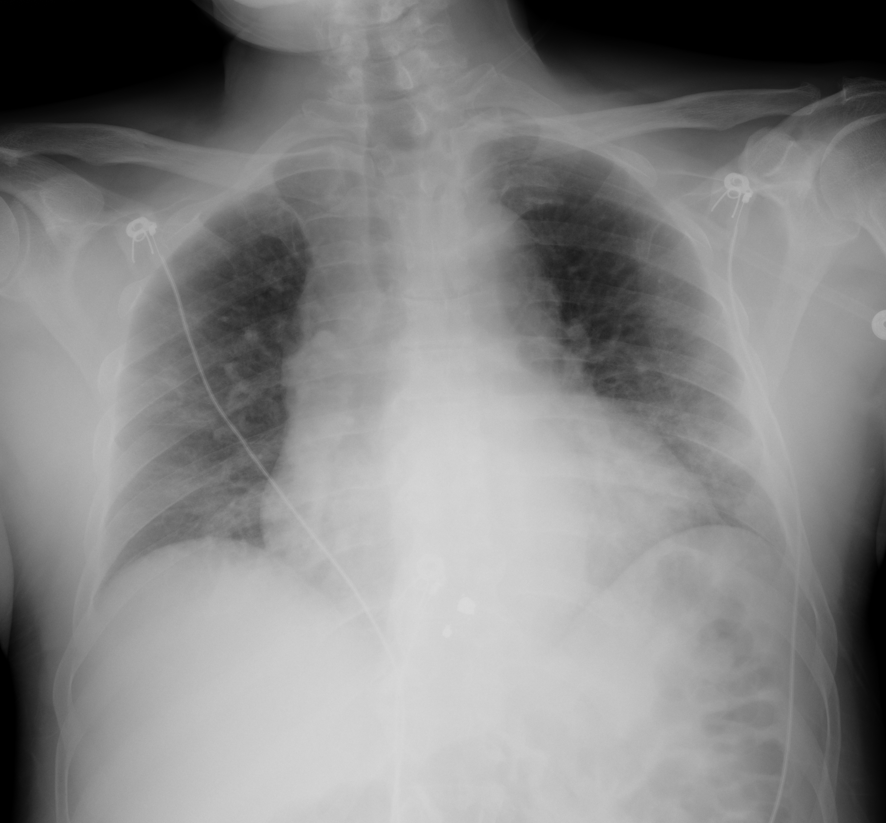

## 문제
A 57-year-old man is brought to the emergency department because of fever, cough, and worsening shortness of breath for 8 days. A nasopharyngeal RT-PCR test for SARS-CoV-2 was positive 6 days ago. He has hypertension treated with amlodipine. Temperature is 38.4°C, pulse is 104/min, respirations are 28/min, and blood pressure is 132/80 mm Hg. Pulse oximetry shows 86% on room air and 93% with 4 L/min of oxygen by nasal cannula. Crackles are heard at both lung bases. Serum creatinine and aminotransferase concentrations are within the reference ranges. A portable chest x-ray is shown. In addition to supplemental oxygen, which of the following is the most appropriate pharmacotherapy?

- A. Ivermectin
- B. Nirmatrelvir-ritonavir
- C. Dexamethasone
- D. Hydroxychloroquine
- E. Azithromycin

_Portable anteroposterior chest radiograph; monitoring leads are from the original, resized only (The Cancer Imaging Archive, CC BY 4.0; no crop or window adjustment)_

## 정답 및 해설
> 정답: C

- **정답 핵심**: The radiograph shows low lung volumes with <b>hazy bilateral opacities in the lower and perihilar zones</b> (including a retrocardiac opacity on the left) without pneumothorax or a large effusion. With confirmed SARS-CoV-2 infection on day 8 and <b>hypoxemia requiring supplemental oxygen</b>, this is COVID-19 pneumonia in its inflammatory phase. Dexamethasone 6 mg daily for up to 10 days lowered mortality in patients receiving oxygen or ventilation (RECOVERY trial).
- **원리**: <b>Why a steroid helps late but not early</b>: COVID-19 has two overlapping phases. In the first week, viral replication drives illness, so antivirals work best and only when started within about 5 days of symptoms. After that, damage is driven mainly by the host's inflammatory response — alveolar injury, capillary leak, and microthrombi — and the viral load is already falling. A glucocorticoid dampens this response; it helped only patients who needed oxygen and harmed or did not help those who did not.  <b>Why oxygen need is the switch</b>: Hypoxemia means the lung injury is already established. That is the point at which an anti-inflammatory benefit outweighs the risk of slowing viral clearance, so guidelines tie dexamethasone to oxygen requirement, not to the radiograph alone.  <b>What the radiograph adds</b>: Bilateral, peripheral and lower-zone ground-glass or consolidative opacities are typical of COVID-19 pneumonia; a lobar consolidation or large effusion would raise concern for bacterial superinfection.
- **비교**: <table><thead><tr><th style="width:26%">Feature</th><th style="width:37%">Dexamethasone (answer)</th><th>Nirmatrelvir-ritonavir (closest distractor)</th></tr></thead><tbody> <tr><td>Target</td><td>Host inflammatory phase</td><td>Viral replication (3CL protease)</td></tr> <tr><td>Who benefits</td><td><b>Hospitalized, needs oxygen</b></td><td>Not hospitalized, no oxygen need, high risk of progression</td></tr> <tr><td>Timing</td><td>Any time oxygen is required</td><td><b>Within 5 days</b> of symptom onset</td></tr> <tr><td>Main cautions</td><td>Hyperglycemia, secondary infection</td><td>CYP3A drug interactions</td></tr> </tbody></table> The day of illness and the oxygen requirement decide between the two, not the PCR result.
- **오답 이유**:
  - (A) Ivermectin would be correct for strongyloidiasis, which should be treated before high-dose immunosuppression in patients from endemic areas.
  - (B) Nirmatrelvir-ritonavir would be correct for an outpatient at high risk who is within 5 days of onset and does not need oxygen.
  - (D) Hydroxychloroquine showed no benefit in randomized trials; it would be correct only for a different question, such as lupus or malaria prophylaxis.
  - (E) Azithromycin would be appropriate if a lobar consolidation, purulent sputum, or a high procalcitonin suggested bacterial pneumonia.
- **함정**: Choosing an antiviral because the patient has a positive PCR test, ignoring that he is on day 8 and hypoxemic.
- **학습목표**: Recognize bilateral lung opacities on a chest radiograph of a patient with laboratory-confirmed COVID-19 who needs supplemental oxygen and choose dexamethasone over antivirals intended for early, nonhypoxemic disease
- **근거·출처**: Loscalzo J, Fauci AS, Kasper DL, et al., eds. Harrison's Principles of Internal Medicine, 22nd ed. McGraw Hill; 2025. Chapter 205: SARS-CoV-2 and COVID-19 · RECOVERY Collaborative Group. Dexamethasone in hospitalized patients with Covid-19. N Engl J Med. 2021;384(8):693-704

## 출처
- COVID-19-AR, The Cancer Imaging Archive (CC BY 4.0) · series …73568772 · Creative Commons Attribution 4.0 International · https://www.cancerimagingarchive.net/data-usage-policies-and-restrictions/
