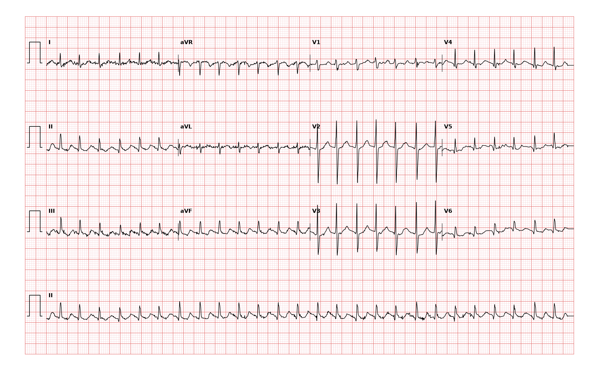

## 문제
87세 여자가 3시간 전부터 가슴이 두근거리고 숨이 조금 차서 응급실에 왔다. 고혈압으로 약을 먹고 있으며 가슴 통증과 실신은 없었다. 의식은 명료하다. 혈압 128/76 mmHg, 맥박 152회/분으로 규칙적이고, 호흡 20회/분, 체온 36.6℃, 산소포화도 96% 이다. 폐 청진은 정상이고 다리 부종은 없다. 혈청 칼륨 4.2 mEq/L, 갑상샘자극호르몬은 정상이다. 12유도 심전도는 그림과 같다. 심전도 판독으로 가장 적절한 것은?

- A. 방실결절 회귀빈맥
- B. 심방세동
- C. 심실빈맥
- D. 2:1 방실전도의 심방조동
- E. 동빈맥

_12유도 심전도, 25 mm/s · 10 mm/mV, 3×4 + II 리듬 스트립 (PTB-XL ECG dataset, PhysioNet, CC BY 4.0 — 원신호 그대로 작도)_

## 정답 및 해설
> 정답: D

- **정답 핵심**: II 리듬 스트립에서 10초에 약 26개의 QRS 가 <b>완전히 규칙적</b>으로 나온다(약 155회/분). QRS 는 좁다. 각 QRS 앞에 따로 떨어진 P파가 없고, <b>II·III·aVF 의 기저선이 쉬지 않고 톱니처럼 물결친다</b> — 심방이 약 300회/분으로 뛰고 그중 하나 걸러 하나만 심실로 전도되는 2:1 심방조동이다. 「약 150회/분으로 고정된 규칙적 좁은 QRS 빈맥」은 심방조동을 먼저 떠올린다.
- **원리**: <b>왜 150회/분인가</b>: 전형적 심방조동은 우심방의 삼첨판륜을 도는 큰 회귀회로다. 한 바퀴에 약 200 ms 가 걸려 심방은 분당 약 300회 흥분한다. 방실결절은 이 속도를 다 통과시키지 못해 보통 둘 중 하나만 전도하므로 심실은 <b>약 150회/분</b>으로 규칙적으로 뛴다. 전도 비율이 4:1 이면 약 75회/분이 된다.  <b>왜 하벽 유도에서 톱니가 보이는가</b>: 반시계방향 회로에서는 심방 중격을 아래에서 위로 흥분이 올라가므로 아래쪽을 보는 II·III·aVF 에서 음성의 톱니 모양 F파가 등전위선 없이 이어진다. 2:1 전도에서는 F파 하나가 QRS·T 에 묻혀 잘 안 보이므로 기저선 전체를 훑어보아야 한다.  <b>임상 함의</b>: 심방조동도 심방세동처럼 혈전색전 위험이 있어 같은 기준으로 항응고를 판단하고, 혈역학이 안정되면 박동수 조절, 불안정하면 동기화 심율동전환을 한다. 삼첨판륜-하대정맥 협부 고주파 절제로 근치율이 높다.
- **비교**: <table><thead><tr><th style="width:22%">항목</th><th style="width:39%">2:1 심방조동 — 정답</th><th>방실결절 회귀빈맥 — 가장 가까운 오답</th></tr></thead><tbody> <tr><td>심실 박동수</td><td><b>약 150회/분으로 고정</b></td><td>140~250회/분으로 다양</td></tr> <tr><td>심방 활동</td><td>II·III·aVF 의 톱니 모양 F파(약 300회/분)</td><td>P파가 QRS 에 묻히거나 QRS 끝의 가성 r'·s</td></tr> <tr><td>시작·종료</td><td>점진적일 수 있음</td><td>갑자기 시작·종료</td></tr> <tr><td>아데노신</td><td>전도가 잠시 막혀 <b>F파가 드러남</b>, 빈맥은 지속</td><td>회로가 끊겨 <b>빈맥이 멈춤</b></td></tr> </tbody></table> 규칙적인 좁은 QRS 빈맥이 150 근처면 조동부터 의심하고 하벽 유도의 기저선을 확인한다.
- **오답 이유**:
  - ① 방실결절 회귀빈맥은 젊은 사람에서 갑자기 시작·종료하고 P파가 QRS 에 묻히며 기저선에 톱니가 없다면 정답이 된다.
  - ② 심방세동은 RR 간격이 불규칙하게 불규칙하고 기저선이 잔물결처럼 무질서하다면 정답이 된다.
  - ③ 심실빈맥은 QRS 가 120 ms 넘게 넓고 방실해리·융합 박동이 보인다면 정답이 된다.
  - ⑤ 동빈맥은 매 QRS 앞에 II 에서 양성인 P파가 일정한 PR 로 보이고 발열·탈수·통증 같은 원인이 있다면 정답이 된다.
- **함정**: P파가 안 보이는 규칙적 좁은 QRS 빈맥을 모두 방실결절 회귀빈맥으로 읽는 것.
- **학습목표**: 약 150회/분의 규칙적인 좁은 QRS 빈맥에서 하벽 유도의 톱니 모양 심방파를 읽어 2:1 전도 심방조동으로 판독하고 방실결절 회귀빈맥·동빈맥과 가른다
- **근거·출처**: Loscalzo J, Fauci AS, Kasper DL, et al., eds. Harrison's Principles of Internal Medicine, 22nd ed. McGraw Hill; 2025. Chapter 257: Common Atrial Flutter and Macroreentrant and Multifocal Atrial Tachycardias · Loscalzo J, Fauci AS, Kasper DL, et al., eds. Harrison's Principles of Internal Medicine, 22nd ed. McGraw Hill; 2025. Chapter 247: Electrocardiography · Wagner P, Strodthoff N, Bousseljot RD, et al. PTB-XL, a large publicly available electrocardiography dataset. Sci Data. 2020;7:154

## 출처
- PTB-XL ECG dataset v1.0.3 (PhysioNet, CC BY 4.0) · record 8265 · Creative Commons Attribution 4.0 International · https://physionet.org/content/ptb-xl/1.0.3/LICENSE.txt
