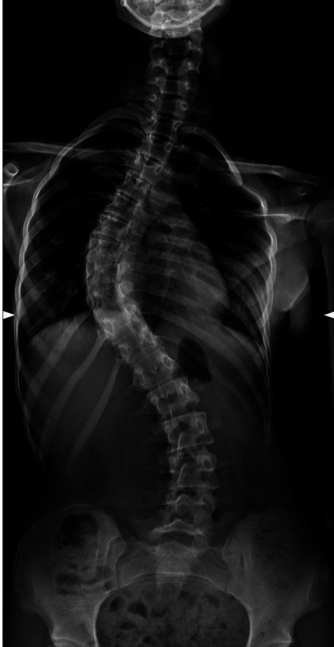

## 문제
13세 여자가 학교 검진에서 등이 휘었다는 말을 듣고 왔다. 6개월 전 초경을 했고 등 통증은 없다. 앞으로 숙이기 검사에서 오른쪽 등이 튀어나온다. 근력·감각·복부 반사·힘줄 반사는 정상이고 피부에 카페오레 반점이나 허리의 털 뭉치는 없다. 서서 찍은 전척추 전후면 X선은 그림과 같다. 주만곡의 Cobb 각은 65°이고 장골능 골화는 Risser 4 단계이다. 가장 적절한 처치는?

- A. 후방 척추 유합술
- B. 흉요천추 보조기 착용
- C. 6개월 뒤 X선 재촬영
- D. 수술 전 척추 전장 MRI
- E. 척추 교정 운동치료

_서서 찍은 전척추 전후면 X선, 양옆 흰 화살촉은 원 그림의 것 — 출판된 증례 그림에서 한 패널만 잘라냄 (PMC Open Access Subset, CC BY)_

## 정답 및 해설
> 정답: A

- **정답 핵심**: X선에서 <b>환자 오른쪽으로 볼록한 큰 흉추 만곡과 반대쪽 요추 보상 만곡</b>이 있고 반척추 같은 척추체 기형은 없다. 통증이 없고 신경학적 진찰이 정상인 13세 여자의 <b>전형적 우측 흉추 만곡</b> — 청소년 특발성 측만증이다. Cobb 각이 <b>65°로 50°를 넘으면</b> 성장이 끝난 뒤에도 해마다 진행하고 폐 기능이 떨어질 수 있으므로 후방 척추 유합술이 적응이다.
- **원리**: <b>왜 50°가 수술의 경계인가</b>: 골성숙이 끝난 뒤 30° 미만의 만곡은 거의 진행하지 않지만, <b>50°를 넘는 흉추 만곡은 성인이 되어서도 해마다 약 1°씩</b> 진행한다. 만곡이 커지면 흉곽이 회전·변형되어 폐활량이 줄고(특히 70~100° 이상), 외형 변화와 통증이 늘어난다. 그래서 45~50° 이상이면 유합술로 교정·고정한다.  <b>왜 보조기는 늦었는가</b>: 보조기는 성장이 많이 남은 시기(Risser 0~2)의 25~40° 만곡에서 진행을 막는 치료다. 뼈를 펴 주는 것이 아니라 성장하는 동안 더 휘지 않게 버티는 것이므로, Risser 4 로 성장이 거의 끝났고 이미 65°인 만곡에는 효과가 없다.  <b>언제 MRI 를 찍는가</b>: 특발성 측만증은 배제 진단이다. 좌측 흉추 만곡, 통증, 신경학적 이상(비대칭 복부 반사·병적 반사), 10세 이전 발병, 빠른 진행, 피부 표지가 있으면 척수공동증·척수견인·종양을 찾기 위해 MRI 를 찍는다. 이 환자는 그런 소견이 없다.
- **비교**: <table><thead><tr><th style="width:24%">항목</th><th style="width:38%">곧바로 유합술 — 정답</th><th>먼저 척추 전장 MRI — 가장 가까운 오답</th></tr></thead><tbody> <tr><td>만곡 방향</td><td><b>우측 흉추</b>(전형적)</td><td>좌측 흉추(비전형적)</td></tr> <tr><td>통증</td><td>없음</td><td>야간 통증·지속 통증</td></tr> <tr><td>신경학적 진찰</td><td>정상, 복부 반사 대칭</td><td>복부 반사 비대칭, 병적 반사, 근력 저하</td></tr> <tr><td>발병·진행</td><td>사춘기, 전형적 진행</td><td>10세 이전 발병, 매우 빠른 진행</td></tr> </tbody></table> 같은 65° 라도 오른쪽 열의 소견이 하나라도 있으면 수술 전에 MRI 로 척수 이상을 먼저 찾는다.
- **오답 이유**:
  - ② 흉요천추 보조기는 Risser 0~2 로 성장이 많이 남은 시기에 Cobb 각 25~40°인 만곡이라면 정답이 된다.
  - ③ 6개월 뒤 재촬영 관찰은 Cobb 각이 25° 미만인 성장기 청소년이라면 정답이 된다.
  - ④ 척추 전장 MRI 는 좌측 흉추 만곡·통증·비대칭 복부 반사 같은 비전형 소견이 있다면 수술 전 정답이 된다.
  - ⑤ 운동치료는 경미한 만곡에서 보조 수단일 뿐이며 단독으로 진행을 막는다는 근거가 약해 정답이 되기 어렵다.
- **함정**: 수술 전에는 늘 MRI 가 필요하다고 생각해, 만곡 방향과 정상 신경학적 진찰이라는 판단 근거를 놓치는 것.
- **학습목표**: 골성숙 무렵 청소년의 우측 흉추 만곡이 Cobb 각 50°를 넘으면 특발성 측만증의 수술 적응이며, 신경학적 이상이나 비전형 만곡이 없으면 MRI 가 꼭 필요하지 않음을 판단한다
- **근거·출처**: Weinstein SL, Dolan LA, Cheng JC, Danielsson A, Morcuende JA. Adolescent idiopathic scoliosis. Lancet. 2008;371(9623):1527-1537 · Weinstein SL, Dolan LA, Wright JG, Dobbs MB. Effects of bracing in adolescents with idiopathic scoliosis. N Engl J Med. 2013;369(16):1512-1521

## 출처
- Case Report: Surgical correction of Lenke 1 adolescent idiopathic scoliosis with a single rod instrumentation. Front Surg. 2026 Aug 3;13:1775018. doi: 10.3389/fsurg.2026.1775018 (CC BY) — Figure 1 · CC BY · https://creativecommons.org/licenses/
