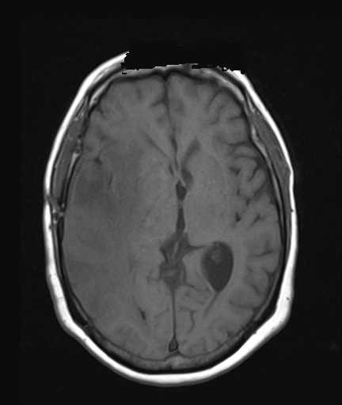

## 문제
A 75-year-old woman is brought to the emergency department because of headache and progressive weakness of the left arm and leg for 3 weeks. She has no fever and no history of trauma. Neurologic examination shows left hemiparesis with 4/5 strength and a left pronator drift. Serum glucose and sodium concentrations are within the reference ranges. MRI of the brain is performed with a standard tumor protocol, and one axial image is shown. Which of the following sequences is most likely shown?

- A. Fluid-attenuated inversion recovery (FLAIR)
- B. Diffusion-weighted imaging
- C. T1-weighted without contrast
- D. T1-weighted after gadolinium
- E. T2-weighted

_Axial brain MRI, single image from a standard clinical protocol; the black band at the front is the original de-identification mask, DICOM converted without cropping (The Cancer Imaging Archive, CC BY 4.0)_

## 정답 및 해설
> 정답: C

- **정답 핵심**: The ventricles and sulci are <b>dark</b>, the white matter is <b>brighter than the cortex</b>, and subcutaneous scalp fat is bright — a T1-weighted pattern. The right hemisphere shows an ill-defined low-signal region with mass effect and shift of the midline to the left, but <b>no bright enhancing rim</b>, and the choroid plexus and dural venous sinuses are not bright. A mass with these features would enhance after gadolinium, so this is the precontrast T1-weighted image. On FLAIR the edematous region would be bright, and on T2 the CSF would be bright.
- **원리**: <b>Why white matter is bright on T1</b>: T1 relaxation is fastest in tissue rich in lipid and macromolecules. Myelin makes white matter recover longitudinal magnetization faster than gray matter, so it appears brighter; free water, as in cerebrospinal fluid and edema, recovers slowly and is dark. Fat is very bright.  <b>What gadolinium changes</b>: Gadolinium shortens T1 wherever it leaks or pools. Normal structures without a blood-brain barrier — choroid plexus, dural sinuses, pituitary — become bright, and a high-grade glioma or metastasis shows a bright, often ring-shaped rim where the barrier is broken. Comparing pre- and postcontrast T1 is how true enhancement is distinguished from intrinsically bright material such as blood or fat.  <b>Why FLAIR differs</b>: FLAIR is T2-weighted with the CSF signal nulled. CSF is dark as on T1, but gray matter is brighter than white matter and edema is bright — the reverse of what is seen around this lesion.
- **비교**: <table><thead><tr><th style="width:26%">Feature</th><th style="width:37%">Precontrast T1 (answer)</th><th>Postcontrast T1 (closest distractor)</th></tr></thead><tbody> <tr><td>CSF</td><td>Dark</td><td>Dark</td></tr> <tr><td>White vs gray matter</td><td>White brighter</td><td>White brighter</td></tr> <tr><td>Choroid plexus, dural sinuses</td><td><b>Not bright</b></td><td><b>Bright</b></td></tr> <tr><td>High-grade tumor</td><td>Low or mixed signal, no rim</td><td><b>Bright irregular enhancing rim</b></td></tr> </tbody></table> Both T1 images share the gray-white pattern; only enhancing structures tell them apart.
- **오답 이유**:
  - (A) FLAIR would be correct if CSF were dark but the region of edema around the mass were bright and gray matter brighter than white matter.
  - (B) Diffusion-weighted imaging would be correct if the image had low spatial detail and the only bright areas were acute infarcts or abscess contents.
  - (D) Postcontrast T1 would be correct if the choroid plexus, dural sinuses, and an irregular rim around the right-sided mass were bright.
  - (E) T2-weighted would be correct if the CSF in the ventricles and sulci were bright and gray matter were brighter than white matter.
- **함정**: Assuming any T1 image in a tumor work-up is postcontrast, without checking whether normally enhancing structures are bright.
- **학습목표**: 축상 뇌 MRI 에서 뇌척수액이 어둡고 백색질이 회색질보다 밝으며 증강되는 구조가 없는 영상을 비조영 T1 강조영상으로 읽고 조영 T1·FLAIR 와 가른다
- **근거·출처**: Loscalzo J, Fauci AS, Kasper DL, et al., eds. Harrison's Principles of Internal Medicine, 22nd ed. McGraw Hill; 2025. Chapter 434: Neuroimaging in Neurologic Disorders · Loscalzo J, Fauci AS, Kasper DL, et al., eds. Harrison's Principles of Internal Medicine, 22nd ed. McGraw Hill; 2025. Chapter 95: Primary and Metastatic Tumors of the Nervous System

## 출처
- The Cancer Imaging Archive (CC BY 4.0) · series …56870017 · Creative Commons Attribution 4.0 International · https://www.cancerimagingarchive.net/data-usage-policies-and-restrictions/
