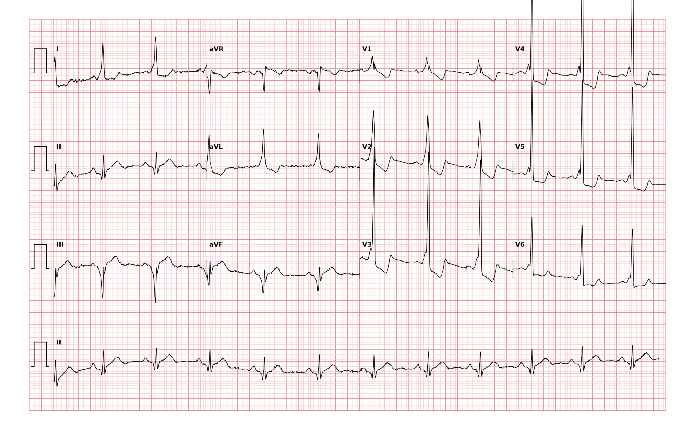

## 문제
34세 남자가 회사 건강검진 심전도에서 이상이 있다는 말을 듣고 왔다. 지난 몇 년 동안 1년에 한두 번 갑자기 심장이 빨리 뛰다가 몇 분 만에 저절로 멎은 적이 있다. 실신이나 가슴 통증은 없었고 먹는 약은 없다. 혈압 122/76 mmHg, 맥박 66회/분으로 규칙적이고 심잡음은 없다. 혈청 전해질과 갑상샘 기능은 정상이다. 12유도 심전도는 그림과 같다. 심전도 판독으로 가장 적절한 것은?

- A. 조기흥분(WPW 양상)
- B. 1도 방실차단
- C. 완전 우각차단
- D. 오래된 하벽 심근경색
- E. 좌심실 비대

_12유도 심전도, 25 mm/s · 10 mm/mV, 3×4 + II 리듬 스트립 (PTB-XL ECG dataset, PhysioNet, CC BY 4.0 — 원신호 그대로 작도)_

## 정답 및 해설
> 정답: A

- **정답 핵심**: II 리듬 스트립에서 약 65회/분의 동리듬이다. P파 끝과 QRS 사이가 거의 없어 <b>PR 이 0.12초보다 짧고</b>, QRS 가 <b>완만하게 비스듬히 시작(델타파)</b>해 폭이 넓어졌다. V1~V6 모두 R 이 크고, III·aVF 에서는 델타파가 음성이라 Q파처럼 보인다. 그 뒤의 ST-T 는 QRS 와 반대 방향인 이차성 변화다 — 부전도로를 통한 조기흥분(WPW 양상)이며, 반복된 빈맥 발작이 있으므로 WPW 증후군에 해당한다.
- **원리**: <b>왜 PR 이 짧아지는가</b>: 정상에서는 심방의 흥분이 방실결절에서 약 0.1초 지체된 뒤 심실로 내려간다. 부전도로(Kent 다발)는 이 지연 없이 심방과 심실을 직접 잇기 때문에 심실 일부가 일찍 흥분하기 시작해 PR 이 짧아진다.  <b>왜 델타파와 넓은 QRS 가 생기는가</b>: 부전도로로 먼저 들어간 흥분은 특수 전도계가 아닌 일반 심근을 따라 천천히 퍼지므로 QRS 시작이 완만하게 기운다(델타파). 곧이어 방실결절을 거친 흥분이 히스-푸르키니에계로 나머지 심실을 빠르게 흥분시켜 두 흥분이 합쳐진 융합파가 된다. 탈분극 순서가 바뀌었으니 재분극도 바뀌어 ST-T 가 QRS 와 반대 방향이 된다.  <b>왜 하벽 Q파처럼 보이는가</b>: 델타파의 방향은 부전도로 위치에 따라 정해진다. 흥분이 아래쪽에서 위로 퍼지면 III·aVF 에서 델타파가 음성이 되어 경색의 Q파를 흉내 낸다 — 가성 경색 양상이다. V1 의 큰 R 은 좌측 부전도로를 시사한다.
- **비교**: <table><thead><tr><th style="width:22%">항목</th><th style="width:39%">WPW 양상 — 정답</th><th>오래된 하벽 경색 — 가장 가까운 오답</th></tr></thead><tbody> <tr><td>PR</td><td><b>&lt; 0.12초</b></td><td>정상(0.12~0.20초)</td></tr> <tr><td>QRS 시작</td><td><b>완만한 델타파</b>, 넓은 QRS</td><td>날카로운 시작, 좁은 QRS</td></tr> <tr><td>III·aVF 의 음성 파</td><td>음성 델타파 — 거의 모든 유도에서 QRS 시작이 기움</td><td>그 유도에만 있는 폭 0.04초 이상의 진짜 Q파</td></tr> <tr><td>병력</td><td>갑자기 시작해 멎는 빈맥 발작</td><td>흉통·경색 병력</td></tr> </tbody></table> Q파처럼 보이는 파가 있으면 먼저 PR 길이와 다른 유도의 QRS 시작을 확인한다.
- **오답 이유**:
  - ② 1도 방실차단은 모든 P파가 전도되지만 PR 이 0.20초(큰 칸 하나)를 넘어 길어졌다면 정답이 된다 — 이 기록은 오히려 짧다.
  - ③ 완전 우각차단은 QRS 가 0.12초 이상이고 V1 에서 rsR' 와 I·V6 에서 넓은 S파가 있으면서 PR 은 정상이라면 정답이 된다.
  - ④ 오래된 하벽 경색은 PR 이 정상이고 QRS 시작이 날카로우며 III·aVF 에만 폭 넓은 Q파가 있다면 정답이 된다.
  - ⑤ 좌심실 비대는 PR 과 QRS 시작이 정상이고 흉부 유도의 큰 전압에 strain 형 ST-T 가 동반됐다면 정답이 된다.
- **함정**: III·aVF 의 음성 델타파를 경색의 Q파로 읽어 짧은 PR 과 델타파를 놓치는 것.
- **학습목표**: 짧은 PR 과 델타파로 넓어진 QRS 를 조기흥분(WPW 양상)으로 판독하고, 하벽 유도의 음성 델타파를 오래된 하벽 경색의 Q파로 오인하지 않는다
- **근거·출처**: Loscalzo J, Fauci AS, Kasper DL, et al., eds. Harrison's Principles of Internal Medicine, 22nd ed. McGraw Hill; 2025. Chapter 256: Paroxysmal Supraventricular Tachycardias · Loscalzo J, Fauci AS, Kasper DL, et al., eds. Harrison's Principles of Internal Medicine, 22nd ed. McGraw Hill; 2025. Chapter 247: Electrocardiography · Wagner P, Strodthoff N, Bousseljot RD, et al. PTB-XL, a large publicly available electrocardiography dataset. Sci Data. 2020;7:154

## 출처
- PTB-XL ECG dataset v1.0.3 (PhysioNet, CC BY 4.0) · record 5303 · Creative Commons Attribution 4.0 International · https://physionet.org/content/ptb-xl/1.0.3/LICENSE.txt
