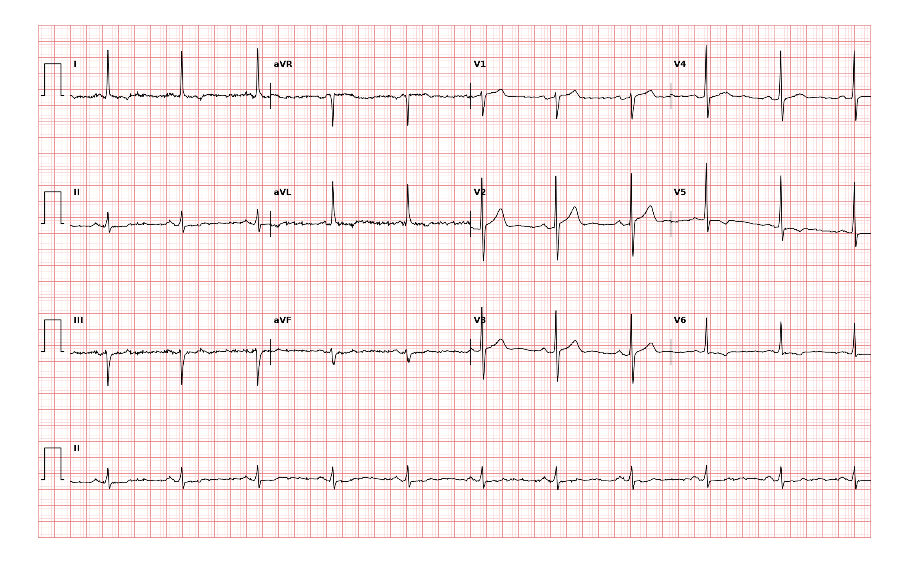

## 문제
76세 남자가 이틀 전부터 쉬고 있을 때 가슴을 조이는 통증이 20분쯤 이어지다 멎기를 세 번 겪어 응급실에 왔다. 지금은 통증이 없다. 고혈압과 이상지질혈증으로 약을 먹고 있다. 혈압 138/82 mmHg, 맥박 66회/분, 호흡 16회/분, 산소포화도 97% 이다. 폐 청진은 정상이고 심잡음은 없다. 고감도 트로포닌 I 는 3시간 간격의 두 번 모두 기준치 상한의 약 4배로 올라 있었다. 크레아티닌은 1.0 mg/dL 이다. 12유도 심전도는 그림과 같다. 가장 적절한 처치는?

- A. 아스피린만 처방하고 다음 날 외래 진료
- B. 항혈소판제·항응고제 투여 후 24시간 안 관상동맥조영술
- C. 즉시 혈전용해제 정맥 투여
- D. 2시간 안의 응급 관상동맥조영술
- E. 운동부하 심전도 검사 후 외래 추적

_12유도 심전도, 25 mm/s · 10 mm/mV, 3×4 + II 리듬 스트립 (PTB-XL ECG dataset, PhysioNet, CC BY 4.0 — 원신호 그대로 작도)_

## 정답 및 해설
> 정답: B

- **정답 핵심**: 심전도는 약 65회/분의 동리듬이고 <b>ST 상승은 어느 유도에도 없다</b>. <b>I·aVL·V5·V6 에서 T파가 편평해지고 ST 가 조금 내려가</b> 측벽 허혈성 변화가 있다. 안정 시 흉통이 반복되고 트로포닌이 올랐으므로 <b>비ST분절상승 심근경색</b>이다. 지금 통증이 없고 혈역학·리듬이 안정되어 초고위험군(2시간 안)은 아니지만, 트로포닌 상승은 고위험이므로 아스피린·P2Y12 억제제·헤파린을 시작하고 24시간 안에 관상동맥조영술을 한다.
- **원리**: <b>왜 ST 상승 여부로 갈리는가</b>: ST 상승은 관상동맥이 완전히 막혀 심근 전층이 허혈에 빠졌다는 표지다. 이때는 막힌 혈관을 몇 분이라도 빨리 여는 것이 목표라 혈전용해나 즉시 중재술을 한다. 비ST상승 급성관상동맥증후군은 대개 혈전이 혈관을 부분적으로 막아 심내막하만 허혈이 되므로 ST 하강·T파 변화로 나타나고, 혈전용해제는 이득이 없고 출혈만 늘린다.  <b>왜 항혈소판·항응고가 먼저인가</b>: 파열된 죽상판 위의 혈전은 혈소판이 중심이고 그 위에 피브린이 쌓인다. 아스피린과 P2Y12 억제제로 혈소판을, 헤파린으로 트롬빈을 막아 혈전이 자라 완전 폐색으로 가는 것을 막는다.  <b>왜 24시간인가</b>: 트로포닌 상승·동적 ST 변화 같은 고위험 소견이 있으면 조기(24시간 안) 침습적 전략이 재발 허혈·사망을 줄인다. 통증이 계속되거나, 혈역학이 불안정하거나, 심실성 부정맥·급성 심부전이 있는 초고위험군만 2시간 안에 한다.
- **비교**: <table><thead><tr><th style="width:22%">항목</th><th style="width:39%">NSTEMI — 항혈전 + 24시간 안 조영술(정답)</th><th>STEMI — 즉시 재관류(가장 가까운 오답)</th></tr></thead><tbody> <tr><td>심전도</td><td><b>ST 하강·T파 편평/역위</b>, ST 상승 없음</td><td><b>연속 두 유도 ST 상승</b> 또는 새 좌각차단</td></tr> <tr><td>병태</td><td>부분 폐색 · 심내막하 허혈</td><td>완전 폐색 · 전층 허혈</td></tr> <tr><td>혈전용해제</td><td>이득 없음, 출혈 증가</td><td>중재술을 120분 안에 못 하면 사용</td></tr> <tr><td>조영술 시점</td><td>고위험 24시간 · 초고위험 2시간</td><td>가능한 한 즉시</td></tr> </tbody></table> 같은 흉통·트로포닌 상승이라도 ST 가 올라가 있는지가 치료의 시계를 정한다.
- **오답 이유**:
  - ① 아스피린만 쓰고 귀가는 급성관상동맥증후군이 배제된 안정 협심증이라면 고려할 수 있으나 트로포닌이 오른 이 환자에게는 위험하다.
  - ③ 즉시 혈전용해제는 연속된 두 유도에서 ST 가 상승했는데 120분 안에 중재술을 할 수 없는 STEMI 라면 정답이 된다.
  - ④ 2시간 안 응급 조영술은 통증이 계속되거나 저혈압·심실성 부정맥·급성 심부전이 있는 초고위험 비ST상승 환자라면 정답이 된다.
  - ⑤ 운동부하 검사 후 외래 추적은 트로포닌이 반복 정상이고 심전도 변화도 없는 저위험 흉통이라면 정답에 가깝다.
- **함정**: 허혈성 심전도 변화와 트로포닌 상승만 보고 ST 상승이 없는데도 혈전용해제를 고르는 것.
- **학습목표**: 안정 시 흉통이 반복되고 트로포닌이 오른 고령 환자의 심전도에서 ST 상승 없이 측벽 ST-T 변화만 있으면 비ST분절상승 심근경색으로 보고 항혈전치료와 24시간 안의 관상동맥조영술을 택한다
- **근거·출처**: Loscalzo J, Fauci AS, Kasper DL, et al., eds. Harrison's Principles of Internal Medicine, 22nd ed. McGraw Hill; 2025. Chapter 285: Non-ST-Segment Elevation Acute Coronary Syndrome (Non-ST-Segment Elevation Myocardial Infarction and Unstable Angina) · Byrne RA, Rossello X, Coughlan JJ, et al. 2023 ESC Guidelines for the management of acute coronary syndromes. Eur Heart J. 2023;44(38):3720-3826 · Wagner P, Strodthoff N, Bousseljot RD, et al. PTB-XL, a large publicly available electrocardiography dataset. Sci Data. 2020;7:154

## 출처
- PTB-XL ECG dataset v1.0.3 (PhysioNet, CC BY 4.0) · record 672 · Creative Commons Attribution 4.0 International · https://physionet.org/content/ptb-xl/1.0.3/LICENSE.txt
