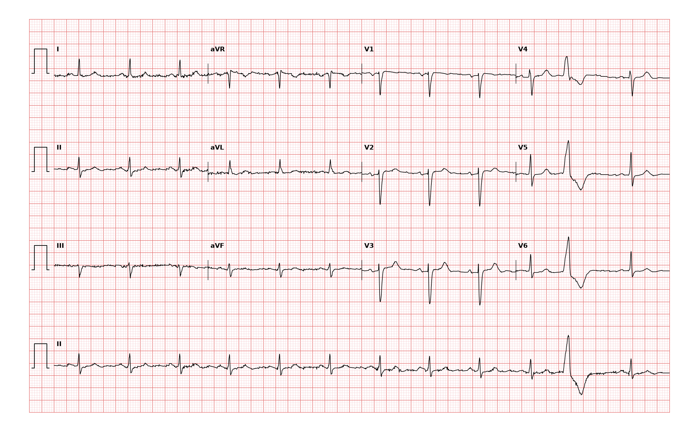

## 문제
A 78-year-old woman comes to the office because she has felt occasional skipped heartbeats for 3 weeks. The sensation lasts a second and is followed by a forceful beat. She has had no chest pain, dyspnea, dizziness, or syncope. She has hypertension treated with losartan. Pulse is 74/min with an occasional pause, and blood pressure is 136/80 mm Hg. Cardiac examination shows no murmurs. Serum potassium concentration is 4.1 mEq/L. Echocardiography 1 year ago showed a normal ejection fraction. A 12-lead ECG is shown. Which of the following is the most likely cause of the irregularity on the rhythm strip?

- A. Intermittent ventricular preexcitation
- B. Sinus arrhythmia
- C. Premature ventricular complex
- D. Premature atrial complex with aberrant conduction
- E. Mobitz type II second-degree atrioventricular block

_12-lead ECG, 25 mm/s, 10 mm/mV, 3×4 + lead II rhythm strip (PTB-XL, PhysioNet, CC BY 4.0; raw signal, no filtering)_

## 정답 및 해설
> 정답: C

- **정답 핵심**: The lead II rhythm strip shows regular sinus beats at about 75/min, interrupted by one <b>early, wide, bizarre QRS complex</b> (also seen in V4–V6) with a T wave pointing opposite to the QRS. <b>No premature P wave precedes it</b>, and the interval from the beat before to the beat after equals two normal RR intervals — a <b>full compensatory pause</b>, because the sinus node was not reset. These features identify a premature ventricular complex.
- **원리**: <b>Why the QRS is wide and bizarre</b>: A premature ventricular complex starts in ventricular muscle outside the His-Purkinje system. The impulse spreads cell to cell through working myocardium, which conducts far more slowly than Purkinje fibers, so the QRS is wide (often >120 ms) and its shape differs from the sinus beats. Repolarization follows the abnormal depolarization path, so the T wave points the opposite way.  <b>Why the pause is fully compensatory</b>: The ectopic ventricular impulse usually does not conduct back into the atria fast enough to reset the sinus node. The sinus node keeps firing on schedule; the sinus P wave that falls during the ventricular refractory period is blocked, and the next sinus beat conducts on time. The cycle containing the PVC therefore equals exactly two sinus cycles. A premature atrial complex enters and resets the sinus node, so the pause is usually less than compensatory.  <b>Why the next beat feels forceful</b>: The long pause allows extra ventricular filling, and by the Frank-Starling mechanism the post-pause beat has a larger stroke volume — the "thump" patients describe.
- **비교**: <table><thead><tr><th style="width:26%">Feature</th><th style="width:37%">PVC (answer)</th><th>PAC with aberrancy (closest distractor)</th></tr></thead><tbody> <tr><td>Premature P wave</td><td><b>Absent</b></td><td><b>Present</b>, often hidden in the preceding T wave</td></tr> <tr><td>QRS shape</td><td>Wide, bizarre, unlike any bundle branch block</td><td>Usually a typical RBBB or LBBB pattern</td></tr> <tr><td>Following pause</td><td><b>Fully compensatory</b> (2 × RR)</td><td>Usually less than compensatory (sinus node reset)</td></tr> <tr><td>Initial QRS vector</td><td>Different from sinus beats</td><td>Often same as sinus beats</td></tr> </tbody></table> Look first at the T wave before the early beat for a hidden P wave, then measure the pause.
- **오답 이유**:
  - (A) Intermittent preexcitation would be correct if a short PR and a delta wave appeared on some sinus beats without any change in timing.
  - (B) Sinus arrhythmia would be correct if the RR intervals varied gradually with breathing while every QRS stayed narrow and was preceded by a sinus P wave.
  - (D) A PAC with aberrant conduction would be correct if a premature P wave deformed the preceding T wave, the wide beat had a typical bundle branch block shape, and the pause were less than compensatory.
  - (E) Mobitz type II block would be correct if a sinus P wave appeared on time but was not followed by a QRS, producing a pause without any early beat.
- **함정**: Calling any wide early beat a PAC with aberrancy without checking for a premature P wave and measuring the pause, or the reverse.
- **학습목표**: Identify a premature, wide, bizarre QRS complex without a preceding premature P wave and with a full compensatory pause as a premature ventricular complex, and distinguish it from a premature atrial complex with aberrant conduction
- **근거·출처**: Loscalzo J, Fauci AS, Kasper DL, et al., eds. Harrison's Principles of Internal Medicine, 22nd ed. McGraw Hill; 2025. Chapter 260: Premature Ventricular Contractions, Nonsustained Ventricular Tachycardia, and Accelerated Idioventricular Rhythm · Loscalzo J, Fauci AS, Kasper DL, et al., eds. Harrison's Principles of Internal Medicine, 22nd ed. McGraw Hill; 2025. Chapter 247: Electrocardiography · Wagner P, Strodthoff N, Bousseljot RD, et al. PTB-XL, a large publicly available electrocardiography dataset. Sci Data. 2020;7:154

## 출처
- PTB-XL ECG dataset v1.0.3 (PhysioNet, CC BY 4.0) · record 219 · Creative Commons Attribution 4.0 International · https://physionet.org/content/ptb-xl/1.0.3/LICENSE.txt
