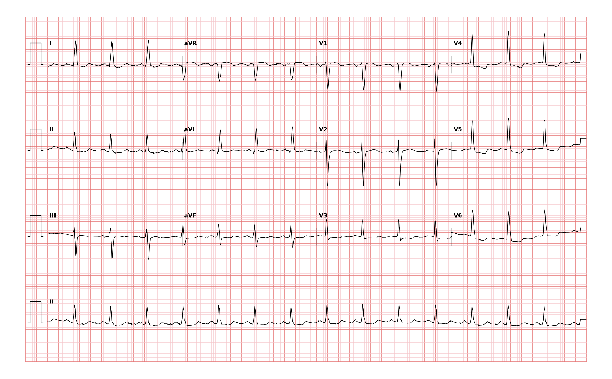

## 문제
86세 여자가 2시간 전 쉬던 중 시작된 가슴 답답함으로 응급실에 왔다. 통증은 왼팔로 뻗쳤고 식은땀이 났으며 지금은 조금 줄었다. 고혈압과 이상지질혈증으로 약을 먹고 있다. 혈압 148/82 mmHg, 맥박 90회/분, 호흡 18회/분이고 폐 청진에서 수포음은 없다. 혈청 고감도 트로포닌 I 는 도착 때 참고치 상한의 6배였고 1시간 뒤 더 올랐다. 12유도 심전도는 그림과 같다. 진단으로 가장 적절한 것은?

- A. ST분절상승 심근경색
- B. 불안정 협심증
- C. 급성 심낭염
- D. 변이형 협심증
- E. 비ST분절상승 심근경색

_12유도 심전도, 25 mm/s · 10 mm/mV, 3×4 + II 리듬 스트립 (PTB-XL ECG dataset, PhysioNet, CC BY 4.0 — 원신호 그대로 작도)_

## 정답 및 해설
> 정답: E

- **정답 핵심**: 심전도는 동리듬에 좁은 QRS 이고 <b>I·II·aVL·V4~V6 에서 수평형 ST 하강</b>과 V4~V6 T파 역위가 있으며 <b>ST 상승은 없다</b>. 쉴 때 생긴 허혈성 흉통에 <b>트로포닌이 참고치 상한을 넘고 1시간 뒤 더 올랐으므로</b> 급성 심근 손상이 있다. ST 상승 없이 심근 괴사가 증명된 급성 관상동맥증후군이므로 비ST분절상승 심근경색이다.
- **원리**: <b>왜 ST 가 내려가는가</b>: 관상동맥이 완전히 막히지 않으면 허혈은 심근의 가장 안쪽(심내막하층)에 먼저 생긴다. 심내막하 허혈 부위는 손상 전류를 만들어 그 위를 바라보는 유도에서 ST 분절을 끌어내린다. 반대로 관상동맥이 완전히 막혀 벽 전체가 허혈에 빠지면(전층 허혈) 손상 전류의 방향이 뒤집혀 그 부위를 보는 유도에서 ST 가 올라간다.  <b>왜 트로포닌이 가르는가</b>: 불안정 협심증과 비ST분절상승 심근경색은 같은 병태(불안정 죽상판의 파열과 비폐쇄성 혈전)이고 심전도로는 구별할 수 없다. 심근세포가 죽어 트로포닌이 혈중으로 새어 나왔는지, 그리고 그 값이 오르내리는지(급성 손상)가 둘을 가른다.  <b>무엇이 달라지나</b>: ST 상승이면 곧바로 재관류(일차 관상동맥중재술)가 목표지만, 비ST분절상승은 위험도를 평가해 침습적 관상동맥조영술의 시기를 정한다.
- **비교**: <table><thead><tr><th style="width:24%">구분</th><th style="width:38%">비ST분절상승 심근경색 — 정답</th><th>불안정 협심증 — 가장 가까운 오답</th></tr></thead><tbody> <tr><td>병태</td><td>비폐쇄성 혈전 + 심근 괴사</td><td>비폐쇄성 혈전, 괴사 없음</td></tr> <tr><td>심전도</td><td>ST 하강·T파 역위 또는 정상</td><td>같다 — 심전도로 못 가른다</td></tr> <tr><td>트로포닌</td><td><b>참고치 99 백분위수 초과 + 상승·하강</b></td><td>참고치 이내</td></tr> <tr><td>처치</td><td colspan="2">항혈소판제·항응고제, 위험도에 따라 침습적 조영술 시기 결정</td></tr> </tbody></table> ST 가 올라가면 ST분절상승 심근경색, ST 가 올라가지 않으면 트로포닌으로 비ST분절상승 심근경색과 불안정 협심증을 가른다.
- **오답 이유**:
  - ① ST분절상승 심근경색은 인접한 두 유도 이상에서 ST 가 올라가 있었다면 정답이 된다 — 이 심전도는 ST 가 내려가 있다.
  - ② 불안정 협심증은 같은 흉통과 ST 하강이 있어도 트로포닌이 참고치 이내로 오르지 않았다면 정답이 된다.
  - ③ 급성 심낭염은 여러 유도에서 오목한 ST 상승과 PR 하강이 있고 앉아서 숙이면 좋아지는 흉통이라면 정답이 된다.
  - ④ 변이형 협심증은 새벽 안정 시 흉통 동안 일시적인 ST 상승이 보이고 증상이 사라지면 정상화된다면 정답이 된다.
- **함정**: ST 하강과 T파 역위를 보고 심전도만으로 불안정 협심증과 비ST분절상승 심근경색을 가르려는 것.
- **학습목표**: 쉴 때 생긴 흉통과 여러 유도의 ST 하강·T파 역위, 상승한 트로포닌을 비ST분절상승 심근경색으로 판단하고 ST분절상승 심근경색·불안정 협심증과 가른다
- **근거·출처**: Loscalzo J, Fauci AS, Kasper DL, et al., eds. Harrison's Principles of Internal Medicine, 22nd ed. McGraw Hill; 2025. Chapter 285: Non-ST-Segment Elevation Acute Coronary Syndrome (Non-ST-Segment Elevation Myocardial Infarction and Unstable Angina) · Thygesen K, Alpert JS, Jaffe AS, et al. Fourth universal definition of myocardial infarction (2018). Circulation. 2018;138(20):e618-e651

## 출처
- PTB-XL ECG dataset v1.0.3 (PhysioNet, CC BY 4.0) · record 16900 · Creative Commons Attribution 4.0 International · https://physionet.org/content/ptb-xl/1.0.3/LICENSE.txt
