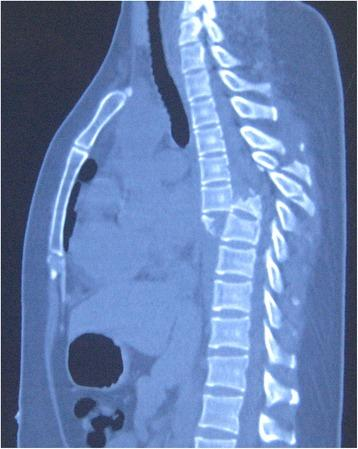

## 문제
A 35-year-old woman is brought to the emergency department 2 hours after a heavy truck tire fell onto her back at work. She reports severe midback pain. She has no other medical conditions. Pulse is 96/min, respirations are 20/min, and blood pressure is 124/76 mm Hg. There is tenderness and a palpable step-off over the midthoracic spinous processes. Motor strength is 5/5 in all extremities, sensation is intact throughout, and rectal tone is normal. FAST examination is negative. A sagittal CT of the thoracic spine is shown. Which of the following is the most appropriate next step in management?

- A. Bed rest and analgesia with follow-up radiographs in 2 weeks
- B. High-dose intravenous methylprednisolone infusion
- C. MRI of the brain to evaluate for occult head injury
- D. Surgical reduction with posterior instrumented fusion
- E. Thoracolumbosacral orthosis and early ambulation

_Sagittal reformatted CT of the thoracic spine, bone window; the blue tint is from the original published figure, used without cropping (PMC Open Access Subset, CC BY)_

## 정답 및 해설
> 정답: D

- **정답 핵심**: The CT shows the upper thoracic vertebra <b>translated anteriorly over the vertebra below</b> with loss of alignment of the vertebral bodies and spinal canal and a comminuted lower vertebral body. Translation means that the anterior, middle, and posterior columns are all disrupted — a <b>fracture-dislocation, the most unstable thoracolumbar injury</b>. Even with an intact neurologic examination, the spine cannot protect the cord, so reduction and posterior instrumented fusion are indicated.
- **원리**: <b>Why translation means instability</b>: The spine resists displacement through three load-bearing columns — the anterior vertebral body and anterior longitudinal ligament, the posterior half of the body and posterior longitudinal ligament, and the posterior elements with their ligaments and facet joints. A burst or compression fracture can leave at least the posterior ligamentous complex intact. When one vertebra slides on another, every column has failed, so there is nothing left to resist further movement.  <b>Why an intact cord does not change the plan</b>: The cord occupies a canal that is now malaligned. Any further displacement during transfer, sitting, or turning can produce a complete injury. Surgery is done to restore alignment and lock the segments before that happens, not to treat an existing deficit.  <b>Thoracic context</b>: The rib cage makes the thoracic spine stiff, so a fracture-dislocation here implies very high energy; associated chest and aortic injuries must also be sought.
- **비교**: <table><thead><tr><th style="width:24%">Feature</th><th style="width:38%">Fracture-dislocation (answer)</th><th>Stable burst fracture (closest distractor)</th></tr></thead><tbody> <tr><td>CT alignment</td><td><b>Translation</b> of one vertebra on another</td><td>Alignment preserved</td></tr> <tr><td>Columns injured</td><td>All three</td><td>Anterior and middle; posterior ligaments intact</td></tr> <tr><td>Neurologic risk</td><td>High, even if intact now</td><td>Low if intact</td></tr> <tr><td>Treatment</td><td>Reduction and instrumented fusion</td><td>Orthosis and early mobilization</td></tr> </tbody></table> Ask first whether the vertebrae are still stacked; if they are not, the injury is unstable regardless of the neurologic examination.
- **오답 이유**:
  - (A) Bed rest and analgesia would be appropriate for an isolated transverse or spinous process fracture, which does not affect stability.
  - (B) High-dose methylprednisolone is not recommended for blunt cord injury; it was once used for acute deficits, which this patient does not have.
  - (C) Brain MRI would be indicated if she had loss of consciousness, confusion, or focal deficits suggesting a head injury.
  - (E) An orthosis with early ambulation would be correct for a stable burst fracture with preserved alignment and an intact posterior ligamentous complex.
- **함정**: Choosing nonoperative care because the neurologic examination is normal, ignoring the translation on CT.
- **학습목표**: Recognize translational fracture-dislocation of the thoracic spine on CT as a three-column unstable injury requiring urgent surgical stabilization even when neurologic function is intact
- **근거·출처**: Loscalzo J, Fauci AS, Kasper DL, et al., eds. Harrison's Principles of Internal Medicine, 22nd ed. McGraw Hill; 2025. Chapter 453: Diseases of the Spinal Cord · Vaccaro AR, Oner C, Kepler CK, et al. AOSpine thoracolumbar spine injury classification system. Spine (Phila Pa 1976). 2013;38(23):2028-2037

## 출처
- Severe fracture-dislocation of the thoracic spine without any neurological deficit. World J Surg Oncol. 2017 Jan 5;15:3. doi: 10.1186/s12957-016-1070-7 (CC BY) — Fig. 2 · CC BY · https://creativecommons.org/licenses/
