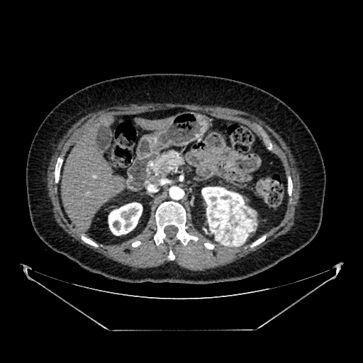

## 문제
56세 여자가 건강검진 복부 초음파에서 왼쪽 콩팥에 덩이가 있다는 말을 듣고 왔다. 혈뇨·옆구리 통증·체중 감소는 없다. 고혈압과 제2형 당뇨병으로 약을 먹고 있다. 혈압 134/82 mmHg 이고 진찰 소견은 정상이다. 소변검사에서 적혈구는 없다. 크레아티닌 1.0 mg/dL(eGFR 64 mL/min/1.73 m²)이다. 복부 조영증강 CT 는 그림과 같고, 판독에서 종괴의 가장 긴 지름은 6 cm 였다. 흉부 CT 에서 전이는 없고 콩팥정맥 안 종양 혈전도 없다. 치료로 가장 적절한 것은?

- A. 부분 신절제술
- B. 고주파 열소작술
- C. 6개월 뒤 CT 추적
- D. 면역관문억제제 치료
- E. 경피적 종괴 배액술

_조영증강 복부 CT, 동맥기 축상 단면 1장, 연부조직 창, 표준 표시 방향 (TCIA, CC BY 3.0 — 크롭·보정·분할 표시 없음)_

## 정답 및 해설
> 정답: A

- **정답 핵심**: CT 에서 <b>왼쪽 콩팥에서 생긴 둥근 고형 종괴가 콩팥 피질보다 강하고 불균질하게 조영 증강</b>되며 <b>지방 음영이 없다</b>. 조영 증강되는 고형 콩팥 종괴는 신세포암을 먼저 생각하고 수술로 떼어 조직을 확인한다. 전이가 없는 6 cm 종괴(T1b)이고 고혈압·당뇨로 신기능을 아껴야 하므로, 기술적으로 가능하면 콩팥을 남기는 부분 신절제술이 우선이다.
- **원리**: <b>왜 조영 증강 고형 종괴는 떼는가</b>: 콩팥 종괴는 내용물로 먼저 나눈다. 액체만 있는 단순 낭종은 조영되지 않고, 거시적 지방이 보이면 혈관근지방종을 생각한다. 지방 없이 조영제가 들어오는 고형 종괴는 약 80 % 가 신세포암이고, 나머지 양성 종양(호산성 과립세포종 등)도 영상으로는 신세포암과 가를 수 없다. 그래서 수술 대상이면 절제가 진단과 치료를 함께 한다.  <b>왜 콩팥을 남기는가</b>: 콩팥 하나를 통째로 떼면 남은 콩팥의 사구체에 과여과가 생기고, 고혈압·당뇨가 있는 환자에서는 만성 콩팥병과 심혈관 사건이 늘어난다. 4 cm 이하(T1a)는 물론 4~7 cm(T1b)도 종양 위치상 가능하면 부분 신절제술이 근치적 절제와 종양 결과가 비슷하면서 신기능을 더 지킨다.  <b>열소작·감시의 자리</b>: 열소작은 3 cm 이하 종양에서 효과가 좋고, 감시는 2 cm 이하이거나 기대 여명이 짧을 때 쓴다 — 크기가 커질수록 국소 재발과 진행 위험이 커진다.
- **비교**: <table><thead><tr><th style="width:24%">구분</th><th style="width:38%">부분 신절제술 — 정답</th><th>고주파 열소작술 — 가장 가까운 오답</th></tr></thead><tbody> <tr><td>알맞은 크기</td><td><b>T1(7 cm 이하)</b>, 특히 신기능을 아껴야 할 때</td><td><b>3 cm 이하</b> 작은 종괴</td></tr> <tr><td>환자</td><td>수술을 견딜 수 있는 환자</td><td>수술 위험이 큰 고령·동반 질환 환자</td></tr> <tr><td>조직 확인</td><td>절제 표본 전체</td><td>시술 전 조직검사가 필요</td></tr> <tr><td>국소 재발</td><td>낮다</td><td>3 cm 를 넘으면 크게 는다</td></tr> </tbody></table> 크기가 3 cm 를 넘으면 소작보다 절제, 7 cm 이하이고 콩팥을 아껴야 하면 부분 절제가 우선이다.
- **오답 이유**:
  - ② 고주파 열소작술은 종괴가 3 cm 이하로 작고 전신마취·수술 위험이 큰 고령 환자라면 정답이 된다.
  - ③ 6개월 뒤 CT 추적은 2 cm 이하의 작은 고형 종괴이거나 기대 여명이 짧은 환자라면 고려한다.
  - ④ 면역관문억제제 치료는 폐·뼈 같은 원격 전이가 있는 진행성 신세포암이라면 치료의 중심이 된다.
  - ⑤ 경피적 배액술은 조영 증강되지 않는 액체 저류인 콩팥 농양이라면 정답이 된다 — 고형 종괴에는 쓰지 않는다.
- **함정**: 신기능 보존을 위해 크기와 무관하게 열소작을 고르거나, 영상만으로 양성 종양이라 보고 추적만 하는 것.
- **학습목표**: 조영증강 CT 에서 지방이 없는 조영 증강 콩팥 고형 종괴를 수술 대상으로 판단하고, 4~7 cm 국소 종괴에서 신기능을 보존하는 부분 신절제술을 선택한다
- **근거·출처**: Loscalzo J, Fauci AS, Kasper DL, et al., eds. Harrison's Principles of Internal Medicine, 22nd ed. McGraw Hill; 2025. Chapter 90: Renal Cell Carcinoma · Campbell SC, Clark PE, Chang SS, et al. Renal mass and localized renal cancer: evaluation, management, and follow-up: AUA guideline: part I. J Urol. 2021;206(2):199-208

## 출처
- The Cancer Imaging Archive (CC BY 3.0) · KiTS-00202 · Creative Commons Attribution 3.0 Unported · https://www.cancerimagingarchive.net/data-usage-policies-and-restrictions/
