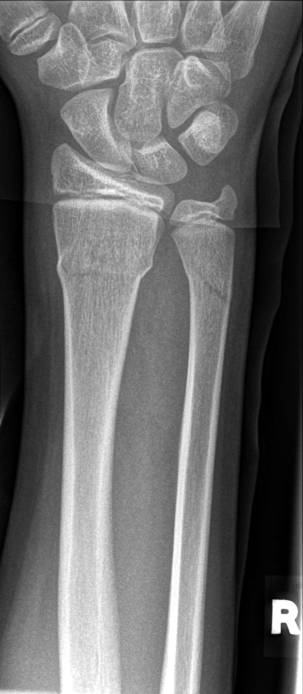

## 문제
A 13-year-old boy is brought to the emergency department 3 hours after he fell from his bicycle onto his outstretched right hand. He has pain and swelling over the distal forearm. He has no other injuries. Vital signs are within normal limits. There is tenderness over the distal radius and distal ulna, about 3 cm proximal to the wrist crease. There is no tenderness over the anatomic snuffbox. Radial pulse and capillary refill are normal, and sensation is intact in the median, ulnar, and radial nerve distributions. An anteroposterior radiograph of the right wrist is shown. Which of the following best describes this injury?

- A. Scaphoid waist fracture
- B. Salter-Harris type I injury of the distal ulna
- C. Metaphyseal fractures of the distal radius and ulna with intact physes
- D. Salter-Harris type II fracture of the distal radius
- E. Galeazzi fracture-dislocation

_Anteroposterior radiograph of the right wrist and distal forearm, unaltered apart from scaling (GRAZPEDWRI-DX, figshare, CC BY 4.0)_

## 정답 및 해설
> 정답: C

- **정답 핵심**: The radiograph shows a <b>transverse lucent line with a cortical step in the distal radial metaphysis</b> and an <b>oblique lucent line in the distal ulnar metaphysis</b>, both well above the growth plates. Both physes are open and uninvolved, alignment is nearly anatomic, and the distal radioulnar joint is congruent. These are metaphyseal fractures of both distal forearm bones.
- **원리**: <b>Why the metaphysis breaks in children</b>: The metaphysis is the transition zone between dense diaphyseal cortex and the cancellous bone near the growth plate. In children its cortex is thin and porous, so a fall on an outstretched hand usually fails there. Children's bone is also more elastic and has a thick periosteum, so fractures are often incomplete (buckle or greenstick) or minimally displaced.  <b>Why the physis matters</b>: The growth plate is cartilage and is weaker than the surrounding bone and ligaments, so it can also fail. Salter-Harris injuries pass through the physis and can disturb growth, which is why identifying whether a fracture line reaches the plate changes follow-up. A purely metaphyseal fracture does not threaten growth.  <b>Management link</b>: Nondisplaced or minimally angulated distal forearm metaphyseal fractures in a growing child remodel well and are treated with cast immobilization.
- **비교**: <table><thead><tr><th style="width:26%">Feature</th><th style="width:37%">Metaphyseal fracture (answer)</th><th>Salter-Harris II (closest distractor)</th></tr></thead><tbody> <tr><td>Fracture line</td><td>Entirely <b>above the physis</b></td><td>Through the physis, exiting the metaphysis</td></tr> <tr><td>Fragment</td><td>None attached to the epiphysis</td><td>Metaphyseal corner fragment (Thurston-Holland)</td></tr> <tr><td>Physeal width</td><td>Normal</td><td>Often widened or displaced epiphysis</td></tr> <tr><td>Growth risk</td><td>Very low</td><td>Low but needs follow-up</td></tr> </tbody></table> Trace each lucent line to see whether it touches the growth plate; that single question separates the two.
- **오답 이유**:
  - (A) A scaphoid waist fracture would be suspected with snuffbox tenderness and a lucent line across the scaphoid, which is absent here.
  - (B) Salter-Harris type I of the ulna would be correct if there were physeal widening or tenderness at the ulnar growth plate with no visible fracture line.
  - (D) Salter-Harris type II would be correct if the fracture line crossed the radial physis and exited through a metaphyseal corner fragment.
  - (E) Galeazzi fracture-dislocation would be correct for a distal radial shaft fracture with dislocation of the distal radioulnar joint.
- **함정**: Calling any distal forearm fracture in a child a Salter-Harris injury without checking whether the line reaches the physis.
- **학습목표**: Read a pediatric wrist radiograph to locate nondisplaced fractures in the distal radial and ulnar metaphyses that spare the physes, and distinguish them from physeal (Salter-Harris) and Galeazzi injuries
- **근거·출처**: Nagy E, Janisch M, Hržić F, Sorantin E, Tschauner S. A pediatric wrist trauma X-ray dataset (GRAZPEDWRI-DX) for machine learning. Sci Data. 2022;9:222 · Kliegman RM, St Geme JW, Blum NJ, et al., eds. Nelson Textbook of Pediatrics, 22nd ed. Elsevier; 2024. Chapter: Common Fractures

## 출처
- GRAZPEDWRI-DX (figshare, CC BY 4.0) · Creative Commons Attribution 4.0 International · https://creativecommons.org/licenses/by/4.0/
