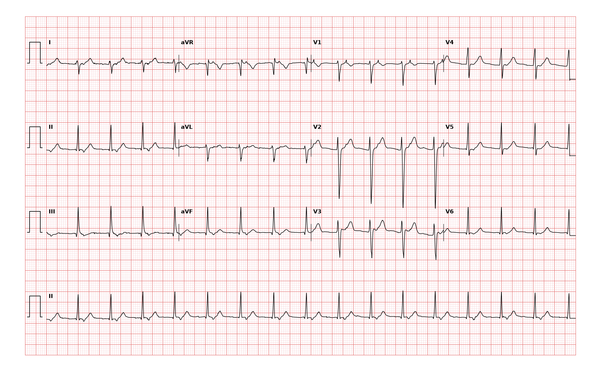

## 문제
17세 여자가 학교 건강검진 심전도에서 이상이 있다는 말을 듣고 왔다. 가슴 통증, 호흡곤란, 실신은 없고 운동도 잘한다. 먹는 약은 없다. 키 162 cm, 몸무게 54 kg 이다. 혈압 112/70 mmHg, 맥박 108회/분이고 진료실에 오느라 계단을 뛰어 올라왔다고 한다. 심잡음은 없다. 흉부 X선 사진은 정상이고, 심초음파에서 우심실 크기·벽 두께와 폐동맥압은 정상이다. 12유도 심전도는 그림과 같다. 심전도 판독으로 가장 적절한 것은?

- A. 좌심실 비대
- B. 좌후속지차단
- C. 좌전속지차단
- D. 우각차단
- E. 우심실 비대

_12유도 심전도, 25 mm/s · 10 mm/mV, 3×4 + II 리듬 스트립 (PTB-XL ECG dataset, PhysioNet, CC BY 4.0 — 원신호 그대로 작도)_

## 정답 및 해설
> 정답: B

- **정답 핵심**: QRS 는 좁고(120 ms 미만) <b>I·aVL 은 작은 r 뒤 깊은 S(rS)</b>, <b>II·III·aVF 는 큰 R</b> 이라 전두면 축이 약 +110° 로 오른쪽으로 치우쳐 있다. V1 에 큰 R 이 없고 심초음파에서 우심실 비대·폐고혈압이 없으며 체형도 마르지 않았다. 우축 편위의 다른 원인이 없으므로 좌후속지차단으로 판독한다. 리듬은 동빈맥으로, 방금 계단을 올라온 것과 맞는다.
- **원리**: <b>왜 축이 오른쪽으로 도는가</b>: 좌각은 앞쪽(전속지)과 뒤쪽(후속지) 두 갈래로 나뉜다. 후속지가 막히면 좌심실 아래·뒤쪽 벽은 전속지를 거쳐 늦게 흥분한다. 마지막 흥분이 아래·오른쪽을 향하므로 III·aVF 에 큰 R, I·aVL 에 깊은 S 가 생기고 축이 +90° 를 넘는다. 우회 경로가 심근이 아니라 전도계(전속지)이므로 QRS 는 넓어지지 않는다.  <b>왜 배제 진단인가</b>: 우축 편위는 우심실 비대, 폐질환·폐색전, 측벽 경색, 마른 체형의 수직 심장, 좌우 전극 바꿈에서도 생긴다. 이 원인이 모두 없을 때만 좌후속지차단이라 부른다. 후속지는 굵고 혈류를 두 관상동맥에서 받아 단독으로 막히는 일이 드물다.  <b>임상 의미</b>: 단독 좌후속지차단은 치료가 필요 없지만, 우각차단과 함께 나타나면(이속지차단) 진행성 전도 장애의 신호가 될 수 있다.
- **비교**: <table><thead><tr><th style="width:24%">소견</th><th style="width:38%">좌후속지차단 — 정답</th><th>좌전속지차단 — 가장 가까운 오답</th></tr></thead><tbody> <tr><td>전두면 축</td><td><b>+90° ~ +180°</b>(우축)</td><td>−45° ~ −90°(좌축)</td></tr> <tr><td>I · aVL</td><td><b>rS</b></td><td>qR</td></tr> <tr><td>II · III · aVF</td><td><b>큰 R(qR)</b></td><td>rS</td></tr> <tr><td>QRS 폭</td><td colspan="2">좁다(&lt; 120 ms) — 넓으면 각차단을 먼저 본다</td></tr> </tbody></table> 두 속지차단은 거울상이다. I 과 aVF 의 큰 파가 어느 쪽인지 보면 축 방향이 정해지고, 우축이면 우심실 비대를 먼저 배제한다.
- **오답 이유**:
  - ① 좌심실 비대는 V5·V6 의 큰 R 과 V1 의 깊은 S 로 전압 기준을 넘고 보통 좌축 쪽이었다면 정답이 된다.
  - ③ 좌전속지차단은 I·aVL 에 qR, II·III·aVF 에 rS 로 축이 −45° 보다 더 왼쪽으로 치우쳐 있었다면 정답이 된다.
  - ④ 우각차단은 QRS 가 120 ms 이상 넓고 V1 에 rsR′, I·V6 에 넓고 끌리는 S 가 있었다면 정답이 된다.
  - ⑤ 우심실 비대는 우축 편위에 V1 의 큰 R(R/S > 1)과 우측 흉부 유도의 ST-T 변화, 심초음파의 우심실 비대가 있었다면 정답이 된다.
- **함정**: 우축 편위만 보고 젊은 사람이라 정상 변이 또는 우심실 비대로 판독해 버리는 것.
- **학습목표**: 좁은 QRS 와 우축 편위(I·aVL rS, II·III·aVF 큰 R)를 우심실 비대 근거 없이 좌후속지차단으로 판독하고 좌전속지차단·우각차단과 가른다
- **근거·출처**: Loscalzo J, Fauci AS, Kasper DL, et al., eds. Harrison's Principles of Internal Medicine, 22nd ed. McGraw Hill; 2025. Chapter 247: Electrocardiography · Wagner P, Strodthoff N, Bousseljot RD, et al. PTB-XL, a large publicly available electrocardiography dataset. Sci Data. 2020;7:154

## 출처
- PTB-XL ECG dataset v1.0.3 (PhysioNet, CC BY 4.0) · record 377 · Creative Commons Attribution 4.0 International · https://physionet.org/content/ptb-xl/1.0.3/LICENSE.txt
