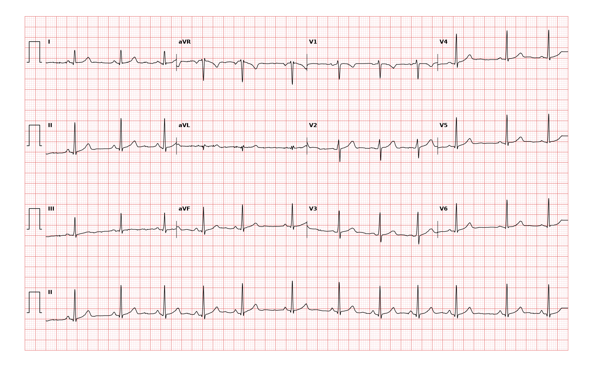

## 문제
18세 여자가 대학 입학 신체검사에서 맥이 고르지 않다는 말을 듣고 왔다. 고등학교 때부터 수영 선수로 매일 3시간씩 훈련한다. 두근거림, 어지럼, 실신, 운동 중 가슴 통증은 없다. 가족 중 젊은 나이에 갑자기 사망한 사람은 없다. 혈압 108/64 mmHg, 맥박 52회/분이고, 숨을 들이쉴 때 맥이 빨라지고 내쉴 때 느려진다. 심잡음은 없다. 혈청 전해질과 갑상샘 기능은 정상이다. 12유도 심전도는 그림과 같다. 다음 처치로 가장 적절한 것은?

- A. 영구 심박동기 삽입
- B. 전기생리검사
- C. 추가 검사 없이 설명
- D. 24시간 활동 심전도
- E. 베타차단제 투여

_12유도 심전도, 25 mm/s · 10 mm/mV, 3×4 + II 리듬 스트립 (PTB-XL ECG dataset, PhysioNet, CC BY 4.0 — 원신호 그대로 작도)_

## 정답 및 해설
> 정답: C

- **정답 핵심**: 모든 QRS 앞에 <b>같은 모양의 P파가 있고 PR 간격이 일정</b>한데 <b>RR 간격이 박동마다 점진적으로 길어졌다 짧아진다</b>. 맥이 들숨에 빨라지고 날숨에 느려지므로 호흡성 동성 부정맥이다. 느린 심박은 훈련된 운동선수의 미주신경 긴장으로 설명되고 증상이 없다. 정상 변이이므로 추가 검사나 치료 없이 설명한다.
- **원리**: <b>왜 숨에 따라 심박이 변하는가</b>: 들숨 때 흉강 압력이 내려가 정맥환류가 늘고, 폐의 신장 수용체와 압수용체 반사로 심장 미주신경 활동이 줄어 동결절이 빨라진다. 날숨에는 미주신경 활동이 회복되어 느려진다. 동결절 자체가 박동을 만들므로 P파 모양과 PR 은 그대로이고 간격만 부드럽게 변한다.  <b>왜 젊고 건강할수록 뚜렷한가</b>: 미주신경 긴장이 높을수록 이 변동이 크다. 그래서 어린이·청년·지구력 운동선수에서 흔하고, 나이가 들거나 자율신경병증(당뇨병)이 생기면 줄어든다 — 오히려 변동이 사라지는 것이 자율신경 기능 저하의 신호다.  <b>병적인 동성 리듬과의 차이</b>: 호흡과 무관한 갑작스러운 긴 휴지, 운동해도 오르지 않는 심박, 실신이 있으면 동기능 부전을 의심한다.
- **비교**: <table><thead><tr><th style="width:24%">구분</th><th style="width:38%">호흡성 동성 부정맥 — 정답</th><th>동기능 부전 — 가장 가까운 오답(활동 심전도·심박동기 쪽)</th></tr></thead><tbody> <tr><td>RR 변화</td><td><b>점진적</b>, 호흡 주기와 함께</td><td>갑작스러운 휴지(동정지·동방차단)</td></tr> <tr><td>P파·PR</td><td>모양·간격 일정</td><td>휴지 뒤 이탈 박동이 나올 수 있다</td></tr> <tr><td>증상</td><td><b>없음</b></td><td>어지럼·실신·운동 불내성</td></tr> <tr><td>처치</td><td>설명만</td><td>증상과 연관되면 심박동기</td></tr> </tbody></table> 간격 변화가 호흡을 따라 부드럽게 오르내리고 증상이 없으면 정상이고, 갑자기 끊기고 증상이 있으면 병적이다.
- **오답 이유**:
  - ① 영구 심박동기는 증상을 일으키는 동정지·동방차단 같은 동기능 부전이 기록되었다면 정답이 된다.
  - ② 전기생리검사는 원인을 모르는 실신에 구조적 심질환이 있거나 조기흥분 증후군 같은 부정맥 기질이 의심되면 고려한다.
  - ④ 24시간 활동 심전도는 어지럼·실신·두근거림이 있어 증상과 리듬의 관계를 확인해야 한다면 정답이 된다.
  - ⑤ 베타차단제는 증상이 있는 기외수축이나 상심실성 빈맥이라면 쓸 수 있지만 이미 느린 맥을 더 늦춘다.
- **함정**: 맥이 고르지 않다는 말에 동기능 부전을 떠올려 활동 심전도나 심박동기를 고르는 것.
- **학습목표**: 호흡에 따라 RR 간격이 점진적으로 변하고 P파 모양·PR 이 일정한 동성 부정맥을 정상 변이로 판단하고 불필요한 검사·치료를 하지 않는다
- **근거·출처**: Loscalzo J, Fauci AS, Kasper DL, et al., eds. Harrison's Principles of Internal Medicine, 22nd ed. McGraw Hill; 2025. Chapter 251: The Bradyarrhythmias: Disorders of the Sinoatrial Node · Wagner P, Strodthoff N, Bousseljot RD, et al. PTB-XL, a large publicly available electrocardiography dataset. Sci Data. 2020;7:154

## 출처
- PTB-XL ECG dataset v1.0.3 (PhysioNet, CC BY 4.0) · record 5778 · Creative Commons Attribution 4.0 International · https://physionet.org/content/ptb-xl/1.0.3/LICENSE.txt
