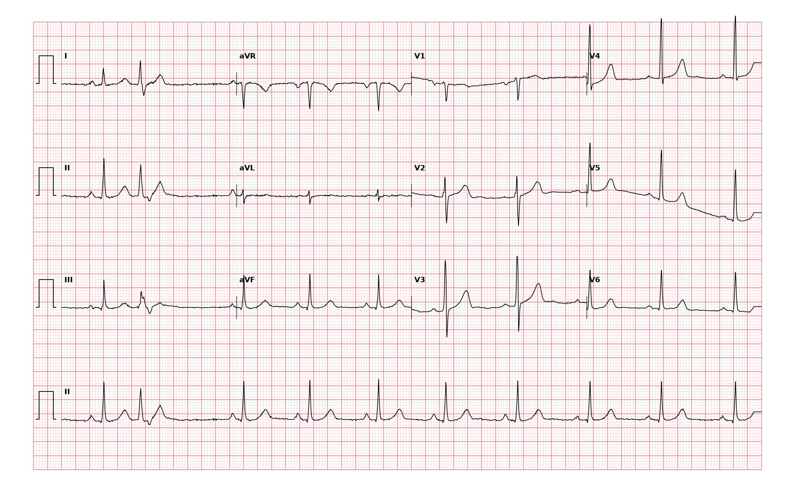

## 문제
A 53-year-old man comes to the physician because of occasional sensations that his heart "skips a beat" for the past month, especially after drinking several cups of coffee. He has no chest pain, dyspnea, or syncope. He takes no medications. Blood pressure is 134/84 mm Hg and pulse is 62/min and irregular at times. Cardiac examination shows no murmurs. Serum electrolyte concentrations and thyroid function tests are within the reference ranges. A 12-lead ECG is shown. Which of the following is the most likely diagnosis?

- A. Premature atrial contraction
- B. Premature ventricular contraction
- C. Mobitz type I second-degree AV block
- D. Sinus arrhythmia
- E. Atrial fibrillation

_12-lead ECG, 25 mm/s, 10 mm/mV, 3×4 + lead II rhythm strip (PTB-XL, PhysioNet, CC BY 4.0; raw signal, no filtering)_

## 정답 및 해설
> 정답: A

- **정답 핵심**: The rhythm strip shows sinus rhythm at about 60/min with <b>one beat arriving early</b>. Its <b>QRS is narrow and has the same shape as the sinus beats</b>, so ventricular activation used the normal conduction system; the premature P wave is hidden in the preceding T wave. A pause follows, and sinus rhythm resumes with regular P waves. This is a premature atrial contraction.
- **원리**: <b>Why the QRS stays narrow</b>: An ectopic focus in the atrium fires before the next sinus impulse. The impulse still passes through the AV node and His-Purkinje system, so the ventricles depolarize in the usual sequence and the QRS looks like the sinus beats. The early P wave often lands on the T wave and deforms it slightly.  <b>Why a pause follows</b>: The premature atrial impulse usually enters and resets the sinus node, so the next sinus beat comes one cycle after the PAC. The pause is therefore typically less than fully compensatory, whereas a ventricular ectopic beat usually does not reach the sinus node and leaves a fully compensatory pause.  <b>Clinical meaning</b>: Isolated PACs are common and benign; caffeine, alcohol, stress, and sleep deprivation increase them. Very frequent PACs can herald atrial fibrillation, but occasional ones need only reassurance and trigger reduction.
- **비교**: <table><thead><tr><th style="width:24%">Feature</th><th style="width:38%">PAC (answer)</th><th>PVC (closest distractor)</th></tr></thead><tbody> <tr><td>QRS</td><td><b>Narrow, same as sinus beats</b></td><td>Wide (≥ 120 ms), bizarre</td></tr> <tr><td>Preceding P wave</td><td>Premature, often hidden in T</td><td>None</td></tr> <tr><td>T wave of the ectopic beat</td><td>Same as sinus beats</td><td>Opposite to the QRS</td></tr> <tr><td>Pause</td><td>Usually less than compensatory</td><td>Usually fully compensatory</td></tr> </tbody></table> Look at the width and shape of the early QRS first; a normal-looking QRS means the impulse came from above the ventricles.
- **오답 이유**:
  - (B) A premature ventricular contraction would be correct if the early beat had a wide, bizarre QRS with a T wave pointing in the opposite direction.
  - (C) Mobitz I block would be correct if PR intervals lengthened progressively until a P wave failed to conduct, producing a dropped beat rather than an early one.
  - (D) Sinus arrhythmia would be correct if RR intervals changed gradually with respiration and every beat had a normal on-time P wave.
  - (E) Atrial fibrillation would be correct if there were no discrete P waves and the RR intervals were irregularly irregular throughout.
- **함정**: Calling any early beat a PVC without checking whether its QRS is wide or identical to the sinus beats.
- **학습목표**: Identify a premature narrow-complex beat with the same QRS morphology as sinus beats as a premature atrial contraction and distinguish it from a premature ventricular contraction and second-degree AV block
- **근거·출처**: Loscalzo J, Fauci AS, Kasper DL, et al., eds. Harrison's Principles of Internal Medicine, 22nd ed. McGraw Hill; 2025. Chapter 253: Approach to Supraventricular Arrhythmias · Wagner P, Strodthoff N, Bousseljot RD, et al. PTB-XL, a large publicly available electrocardiography dataset. Sci Data. 2020;7:154

## 출처
- PTB-XL ECG dataset v1.0.3 (PhysioNet, CC BY 4.0) · record 11960 · Creative Commons Attribution 4.0 International · https://physionet.org/content/ptb-xl/1.0.3/LICENSE.txt
