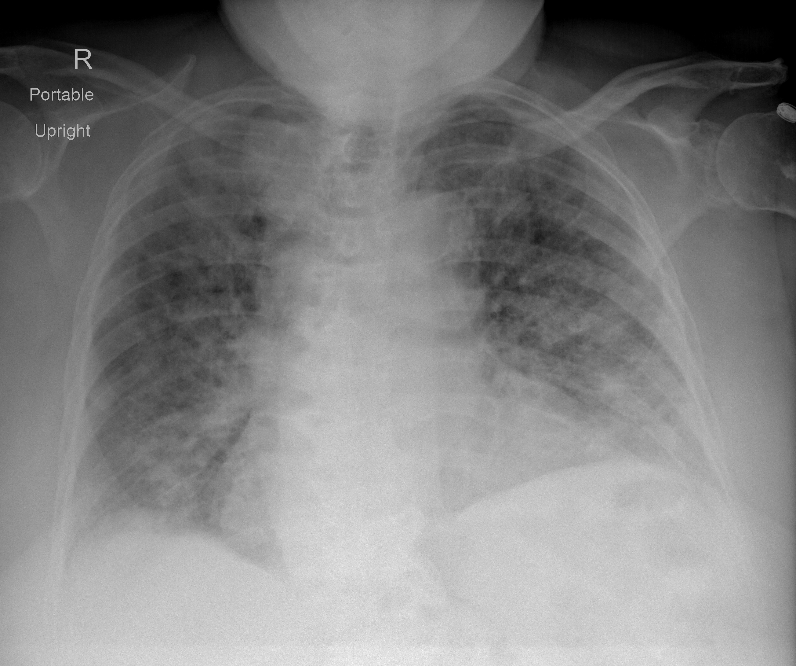

## 문제
73세 여자가 2일 전부터 심해진 호흡곤란으로 응급실에 왔다. 8일 전 비인두 검체의 SARS-CoV-2 핵산증폭검사가 양성이었다. 체온 38.2℃, 맥박 104회/분, 호흡 32회/분, 혈압 128/74 mmHg 이다. 비재호흡 마스크로 산소를 투여하는 중에도 산소포화도는 84 % 이고, 양쪽 폐에서 수포음이 들린다. 이 마스크를 쓴 상태의 동맥혈가스검사는 pH 7.46, PaCO2 33 mmHg, PaO2 58 mmHg 이다. 응급 심초음파에서 좌심실 크기와 수축 기능은 정상이다. 흉부 X선 사진은 그림과 같다. 저산소증의 주된 기전으로 가장 적절한 것은?

- A. 폐포 저환기
- B. 확산 장애
- C. 흡입 산소분압 저하
- D. 폐내 단락
- E. 환기-관류 불균형

_이동식 직립 흉부 전후면 X선, R·Portable·Upright 표지는 원본의 것, 크기 조정만 (The Cancer Imaging Archive, CC BY 4.0)_

## 정답 및 해설
> 정답: D

- **정답 핵심**: 흉부 X선에서 <b>양쪽 폐 전반에 반점상·융합성 음영</b>이 있어 폐포가 삼출물로 차 있다. 그 폐포를 지나는 혈액은 흡입 가스를 만나지 못해 정맥혈 산소량 그대로 좌심으로 돌아간다 — <b>단락</b>이다. 단락의 특징은 <b>고농도 산소(비재호흡 마스크)에도 PaO2 가 58 mmHg 에 머무는 것</b>이다. PaCO2 가 낮아 저환기가 아니고, 좌심실 기능이 정상이라 심인성 폐부종 가능성도 낮다.
- **원리**: <b>왜 단락에는 산소가 듣지 않는가</b>: 흡입 산소 농도를 올리면 환기되는 폐포의 산소분압만 오른다. 물이 찬 폐포에는 산소를 높일 가스가 없으므로 그 혈액은 정맥혈 산소량 그대로다. 환기되는 폐포를 지난 혈액은 이미 거의 포화되어 더 실을 수 없으므로 섞였을 때 모자란 산소를 메우지 못한다. 단락률이 약 30 % 를 넘으면 산소를 100 % 로 주어도 PaO2 가 거의 오르지 않는다.  <b>환기-관류 불균형은 왜 다른가</b>: 환기-관류 비가 낮은 폐포는 환기가 적을 뿐 가스가 드나든다. 고농도 산소를 마시면 결국 그 폐포의 산소분압도 올라 저산소증이 대부분 교정된다.  <b>치료로 이어지는 의미</b>: 단락은 산소를 더 주는 것만으로는 안 되고, 호기말양압·엎드린 자세로 닫힌 폐포를 다시 여는 것이 핵심이다.
- **비교**: <table><thead><tr><th style="width:24%">구분</th><th style="width:38%">폐내 단락 — 정답</th><th>환기-관류 불균형 — 가장 가까운 오답</th></tr></thead><tbody> <tr><td>폐포</td><td>관류되지만 <b>환기 없음</b>(물·허탈)</td><td>관류되고 환기가 적음</td></tr> <tr><td>100 % 산소 반응</td><td><b>PaO2 가 거의 오르지 않음</b></td><td>PaO2 가 크게 오름</td></tr> <tr><td>대표 원인</td><td>급성호흡곤란증후군, 엽성 폐렴, 무기폐</td><td>천식, 만성폐쇄폐질환, 폐색전증</td></tr> <tr><td>폐포-동맥 산소분압차</td><td colspan="2">둘 다 커진다 — 산소 반응이 둘을 가른다</td></tr> </tbody></table> 산소로 교정되면 환기-관류 불균형, 교정되지 않으면 단락을 떠올리고 물이 차거나 허탈된 폐포를 찾는다.
- **오답 이유**:
  - ① 폐포 저환기는 PaCO2 가 올라 있고 폐포-동맥 산소분압차가 정상인 아편유사제 중독·신경근 약화라면 정답이 된다.
  - ② 확산 장애는 간질성 폐섬유증에서 주로 운동 때 저산소증이 생기고 산소로 쉽게 교정된다면 주된 기전이 된다.
  - ③ 흡입 산소분압 저하는 고산지대에서 PaO2 와 PaCO2 가 함께 낮고 폐포-동맥 산소분압차가 정상이라면 정답이 된다.
  - ⑤ 환기-관류 불균형은 천식·만성폐쇄폐질환 악화처럼 기도가 좁아져 있고 산소를 주자 PaO2 가 크게 올랐다면 정답이 된다.
- **함정**: 저산소증의 가장 흔한 원인이라는 이유로 환기-관류 불균형을 고르는 것 — 고농도 산소에도 교정되지 않는다는 점이 단락을 가리킨다.
- **학습목표**: 폐포가 넓게 차 있어 고농도 산소에도 PaO2 가 오르지 않는 저산소증을 폐내 단락으로 설명하고 환기-관류 불균형·폐포 저환기와 가른다
- **근거·출처**: Loscalzo J, Fauci AS, Kasper DL, et al., eds. Harrison's Principles of Internal Medicine, 22nd ed. McGraw Hill; 2025. Chapter 296: Disturbances of Respiratory Function · Loscalzo J, Fauci AS, Kasper DL, et al., eds. Harrison's Principles of Internal Medicine, 22nd ed. McGraw Hill; 2025. Chapter 312: Acute Respiratory Distress Syndrome

## 출처
- COVID-19-AR, The Cancer Imaging Archive (CC BY 4.0) · series …03272875 · Creative Commons Attribution 4.0 International · https://www.cancerimagingarchive.net/data-usage-policies-and-restrictions/
