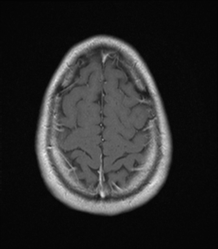

## 문제
29세 남자가 3주 전부터 아침에 심해지는 두통으로 왔다. 2일 전 처음으로 오른손이 1분 동안 떨렸다고 한다. 다른 병은 없고 먹는 약도 없다. 활력징후는 정상이고 신경학적 진찰에서 국소 이상은 없다. 혈청 전해질과 포도당은 참고치 이내이다. 종양 검사 프로토콜로 뇌 MRI 를 시행하였고, 정수리 부근의 축상 영상 하나는 그림과 같다. 이 영상의 촬영 기법으로 가장 적절한 것은?

- A. 비조영 T1 강조영상
- B. T2 강조영상
- C. FLAIR 영상
- D. 확산강조영상
- E. 조영 T1 강조영상

_축상 뇌 MRI 한 장(표준 임상 프로토콜), DICOM 변환만 — 크롭·보정 없음 (The Cancer Imaging Archive, CC BY 4.0)_

## 정답 및 해설
> 정답: E

- **정답 핵심**: 고랑의 <b>뇌척수액이 어둡고</b> 백색질이 회색질보다 조금 밝으며 두피 지방이 밝다 — T1 강조 대비다. 여기에 <b>대뇌낫을 따라 피질 정맥과 상시상정맥동이 점·선 모양으로 밝게</b> 보인다. 혈뇌장벽이 없는 정맥동·정맥은 가돌리늄이 들어가야 밝아지므로 조영 T1 강조영상이다. 이 단면에는 증강되는 종양이 보이지 않는다.
- **원리**: <b>왜 T1 에서 백색질이 밝은가</b>: T1 이완은 지질·거대분자가 많은 조직에서 빠르다. 수초가 많은 백색질은 세로 자화가 빨리 회복되어 회색질보다 밝고, 자유수(뇌척수액·부종)는 느리게 회복되어 어둡다. 지방은 매우 밝다.  <b>가돌리늄이 바꾸는 것</b>: 가돌리늄은 자신이 머무는 곳의 T1 을 짧게 해 밝게 만든다. 혈뇌장벽이 없는 정상 구조(정맥동·피질 정맥·맥락얼기·뇌하수체·경막)는 조영 뒤 밝아지고, 장벽이 깨진 고등급 신경교종·전이암은 불규칙한 증강 테두리를 보인다. 같은 위치의 조영 전 T1 과 비교해야 원래 밝은 피·지방과 진짜 증강을 구별할 수 있다.  <b>FLAIR 와의 차이</b>: FLAIR 는 뇌척수액 신호를 지운 T2 강조영상이다. 뇌척수액이 어두운 것은 같지만 회색질이 백색질보다 밝고 정맥이 밝게 증강되지 않는다.
- **비교**: <table><thead><tr><th style="width:24%">소견</th><th style="width:38%">조영 T1 — 정답</th><th>비조영 T1 — 가장 가까운 오답</th></tr></thead><tbody> <tr><td>뇌척수액</td><td>어둡다</td><td>어둡다</td></tr> <tr><td>백색질 대 회색질</td><td>백색질이 밝다</td><td>백색질이 밝다</td></tr> <tr><td>정맥동·피질 정맥·경막</td><td><b>밝다</b></td><td><b>밝지 않다</b></td></tr> <tr><td>고등급 종양</td><td>불규칙한 증강 테두리</td><td>저신호 또는 섞인 신호</td></tr> </tbody></table> 두 T1 영상은 회색질-백색질 대비가 같다 — 정상적으로 증강되는 구조가 밝은지만 보고 가른다.
- **오답 이유**:
  - ① 비조영 T1 강조영상은 대비는 같지만 대뇌낫 주위의 피질 정맥과 상시상정맥동이 밝지 않았다면 정답이 된다.
  - ② T2 강조영상은 고랑과 뇌실의 뇌척수액이 밝고 회색질이 백색질보다 밝았다면 정답이 된다.
  - ③ FLAIR 영상은 뇌척수액은 어둡지만 회색질이 백색질보다 밝고 부종·탈수초 병변이 밝게 보였다면 정답이 된다.
  - ④ 확산강조영상은 해상도가 낮고 전반적으로 흐린 영상에서 급성 경색·농양만 밝게 보였다면 정답이 된다.
- **함정**: 뇌척수액이 어두운 것만 보고 FLAIR 를 고르거나, 종양이 보이지 않는다고 조영 전 영상으로 판단하는 것 — 정상 정맥의 증강을 본다.
- **학습목표**: 축상 뇌 MRI 에서 뇌척수액이 어둡고 백색질이 회색질보다 밝으면서 피질 정맥·정맥동이 밝게 증강된 영상을 조영 T1 강조영상으로 읽고 비조영 T1·FLAIR 와 가른다
- **근거·출처**: Loscalzo J, Fauci AS, Kasper DL, et al., eds. Harrison's Principles of Internal Medicine, 22nd ed. McGraw Hill; 2025. Chapter 434: Neuroimaging in Neurologic Disorders · Loscalzo J, Fauci AS, Kasper DL, et al., eds. Harrison's Principles of Internal Medicine, 22nd ed. McGraw Hill; 2025. Chapter 95: Primary and Metastatic Tumors of the Nervous System

## 출처
- The Cancer Imaging Archive (CC BY 4.0) · series …97175784 · Creative Commons Attribution 4.0 International · https://www.cancerimagingarchive.net/data-usage-policies-and-restrictions/
