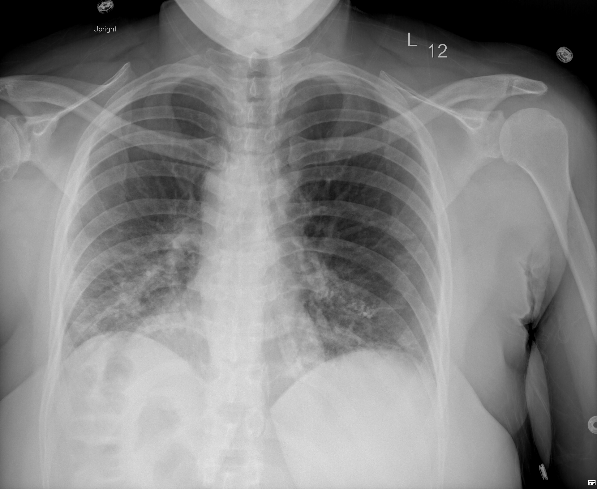

## 문제
A 58-year-old woman comes to the clinic because of fever, dry cough, and fatigue for 3 days. A home antigen test was positive for SARS-CoV-2 yesterday. She has type 2 diabetes mellitus and obesity (BMI 33 kg/m2). Her only medication is metformin. She has not received a COVID-19 vaccine in the past 2 years. Temperature is 38.1°C (100.6°F), pulse is 92/min, respirations are 18/min, and blood pressure is 132/80 mm Hg. Pulse oximetry shows an oxygen saturation of 96% on room air, and it stays at 95% after she walks in the hallway. A few crackles are heard at both lung bases. Serum creatinine and liver enzyme concentrations are within the reference ranges. A chest x-ray is shown. She is able to eat and drink and wishes to recover at home. Which of the following is the most appropriate pharmacotherapy?

- A. Amoxicillin-clavulanate plus azithromycin
- B. Oseltamivir
- C. Nirmatrelvir-ritonavir
- D. Oral dexamethasone
- E. Dexamethasone plus intravenous remdesivir

_Upright posteroanterior chest radiograph; the Upright and L markers are from the original, resized only (The Cancer Imaging Archive, CC BY 4.0)_

## 정답 및 해설
> 정답: C

- **정답 핵심**: The radiograph shows <b>bilateral, peripheral, lower-zone reticular and patchy ground-glass opacities</b> — viral pneumonia — but she <b>does not need oxygen (SpO2 95–96% at rest and with walking)</b>. She is within 5 days of symptom onset and has risk factors for progression (age, diabetes, obesity, no recent vaccination). The recommended treatment for such an outpatient is <b>nirmatrelvir-ritonavir</b>; metformin has no important interaction, and renal and hepatic function are normal.
- **원리**: <b>Why an antiviral now, and not later</b>: Early in COVID-19 the illness is driven by viral replication. Nirmatrelvir blocks the SARS-CoV-2 main protease (Mpro), which cuts the viral polyprotein into working parts; ritonavir only boosts nirmatrelvir by inhibiting CYP3A4. Given within 5 days, it reduced hospitalization and death in unvaccinated high-risk adults.  <b>Why not dexamethasone</b>: Later, severe disease is driven by the host inflammatory response, and that is where dexamethasone helps. In RECOVERY, dexamethasone lowered mortality in patients receiving oxygen or ventilation but showed <b>no benefit and a trend toward harm in those who did not need oxygen</b>. Opacities on a radiograph show where the virus is, not that inflammation is causing respiratory failure; oxygen requirement is the threshold.  <b>Practical check</b>: Because ritonavir inhibits CYP3A4, the medication list must be reviewed before prescribing.
- **비교**: <table><thead><tr><th style="width:24%">Feature</th><th style="width:38%">Nirmatrelvir-ritonavir (answer)</th><th>Dexamethasone (closest distractor)</th></tr></thead><tbody> <tr><td>Target</td><td>Viral replication (protease)</td><td>Host inflammation</td></tr> <tr><td>Who benefits</td><td><b>High-risk, no oxygen need, ≤ 5 days</b></td><td><b>Hypoxemic patients on oxygen or ventilation</b></td></tr> <tr><td>Without hypoxemia</td><td>Recommended</td><td>No benefit, possible harm</td></tr> <tr><td>Caution</td><td>CYP3A4 drug interactions, severe renal or hepatic impairment</td><td>Hyperglycemia, secondary infection</td></tr> </tbody></table> Decide by oxygen need, not by the radiograph: no oxygen — antiviral for the high-risk patient; oxygen — dexamethasone (with remdesivir in some).
- **오답 이유**:
  - (A) Amoxicillin-clavulanate plus azithromycin would be considered if she had a lobar consolidation, purulent sputum, or a procalcitonin level suggesting bacterial pneumonia.
  - (B) Oseltamivir would be correct if the test had shown influenza; it has no activity against SARS-CoV-2.
  - (D) Oral dexamethasone would be appropriate if her oxygen saturation fell below 94% and she required supplemental oxygen.
  - (E) Dexamethasone plus remdesivir would be correct for a hospitalized patient who needs conventional supplemental oxygen.
- **함정**: Seeing pneumonia on the radiograph and reaching for dexamethasone — without an oxygen requirement corticosteroids do not help.
- **학습목표**: Treat high-risk outpatients with COVID-19 who do not need supplemental oxygen with nirmatrelvir-ritonavir within 5 days of symptom onset, and recognize that radiographic pneumonia without hypoxemia is not an indication for dexamethasone
- **근거·출처**: Loscalzo J, Fauci AS, Kasper DL, et al., eds. Harrison's Principles of Internal Medicine, 22nd ed. McGraw Hill; 2025. Chapter 205: SARS-CoV-2 and COVID-19 · NIH COVID-19 Treatment Guidelines Panel. Therapeutic management of nonhospitalized adults with COVID-19 (final version, 2024) · RECOVERY Collaborative Group. Dexamethasone in hospitalized patients with Covid-19. N Engl J Med. 2021;384(8):693-704

## 출처
- COVID-19-AR, The Cancer Imaging Archive (CC BY 4.0) · series …38796755 · Creative Commons Attribution 4.0 International · https://www.cancerimagingarchive.net/data-usage-policies-and-restrictions/
