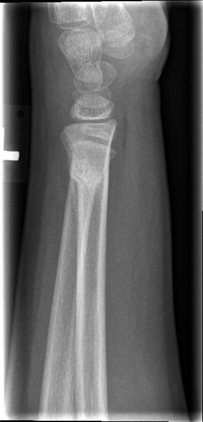

## 문제
A 6-year-old girl is brought to the clinic because of left wrist pain. Two weeks ago, she fell from a swing onto her outstretched left hand. She cried briefly, and her parents applied ice; the pain improved, so they did not seek care. She still avoids leaning on the hand and has mild pain when carrying her school bag. She has had no fever, and she is otherwise healthy. The parents' account is consistent, and she has no other bruises or injuries. Temperature is 36.8°C (98.2°F). There is mild swelling and tenderness over the distal radius without deformity, erythema, or warmth. Finger movement, sensation, and capillary refill are normal. Leukocyte count is 7,800/mm3, and C-reactive protein concentration is within the reference range. A lateral x-ray of the left wrist is shown. Which of the following is the most appropriate next step in management?

- A. Intravenous antibiotics for osteomyelitis
- B. Skeletal survey for suspected physical abuse
- C. Immobilization in a short-arm cast or splint without reduction
- D. Closed reduction under sedation followed by a long-arm cast
- E. MRI of the wrist to evaluate for a bone tumor

_Lateral radiograph of the left wrist and distal forearm, unaltered apart from scaling (GRAZPEDWRI-DX, figshare, CC BY 4.0)_

## 정답 및 해설
> 정답: C

- **정답 핵심**: The lateral view shows a <b>transverse sclerotic band in the distal radial metaphysis</b> with an angular bend of the cortex and <b>thin, smooth periosteal new bone</b> along the cortex next to it. The physis is open and not involved, and alignment is preserved. Smooth periosteal new bone and sclerosis at a fracture site appear 7–14 days after injury, so this is a <b>healing fracture whose age matches the 2-week history</b>. An aligned metaphyseal fracture in a child is treated with immobilization alone; the remaining pain settles as it consolidates.
- **원리**: <b>Why bone appears along the cortex</b>: A child's periosteum is thick, loosely attached, and highly cellular. After a fracture, it lifts away from the cortex and its inner layer begins laying down woven bone within about 1–2 weeks. On a radiograph this appears as a thin, smooth layer parallel to the cortex — callus — and the fracture line itself becomes a sclerotic band as new bone fills it.  <b>Why this does not suggest tumor or infection</b>: Aggressive lesions produce interrupted, layered or spiculated periosteal reaction with bone destruction, and osteomyelitis comes with fever, warmth and raised inflammatory markers. Here the reaction is smooth and confined to a known fracture site, and the markers are normal.  <b>Why no reduction</b>: Metaphyseal fractures near an open physis remodel rapidly in young children, and this one is aligned; manipulation would add sedation risk without benefit.
- **비교**: <table><thead><tr><th style="width:24%">Feature</th><th style="width:38%">Healing fracture (answer)</th><th>Bone tumor or osteomyelitis (closest distractors)</th></tr></thead><tbody> <tr><td>History</td><td>Fall 2 weeks ago, improving pain</td><td>No trauma or trivial trauma, worsening night pain or fever</td></tr> <tr><td>Periosteal reaction</td><td><b>Thin, smooth, continuous, at fracture site</b></td><td>Lamellated, interrupted, or spiculated</td></tr> <tr><td>Bone</td><td>Sclerotic healing line, no destruction</td><td>Lytic destruction, permeative margins</td></tr> <tr><td>Labs</td><td>Normal</td><td>Raised CRP and leukocytes in infection</td></tr> </tbody></table> Match the periosteal reaction to the history: smooth new bone 1–2 weeks after a known fall is healing; aggressive reaction without a matching history needs further imaging.
- **오답 이유**:
  - (A) Intravenous antibiotics would be correct if she had fever, warmth, and raised CRP and leukocytes suggesting osteomyelitis.
  - (B) A skeletal survey would be correct for a child younger than 2 years, or if the history were inconsistent with the injury or other unexplained injuries were present.
  - (D) Closed reduction would be correct if the distal fragment were angulated beyond acceptable limits for her age or displaced with a visible deformity.
  - (E) MRI for a bone tumor would be correct if the periosteal reaction were layered or spiculated with lytic destruction and no matching history of trauma.
- **함정**: Periosteal reaction sounds like tumor or infection — when it is smooth, at a fracture site, and its age matches the history, it is callus.
- **학습목표**: Recognize smooth periosteal new bone and a sclerotic band at a distal radial metaphyseal fracture as normal healing 2 weeks after injury, and manage the aligned healing fracture with immobilization rather than reduction or evaluation for tumor or infection
- **근거·출처**: Nagy E, Janisch M, Hržić F, Sorantin E, Tschauner S. A pediatric wrist trauma X-ray dataset (GRAZPEDWRI-DX) for machine learning. Sci Data. 2022;9:222 · Waters PM, Skaggs DL, Flynn JM, eds. Rockwood and Wilkins' Fractures in Children, 9th ed. Wolters Kluwer; 2020 — distal radius and ulna fractures

## 출처
- GRAZPEDWRI-DX (figshare, CC BY 4.0) · Creative Commons Attribution 4.0 International · https://creativecommons.org/licenses/by/4.0/
