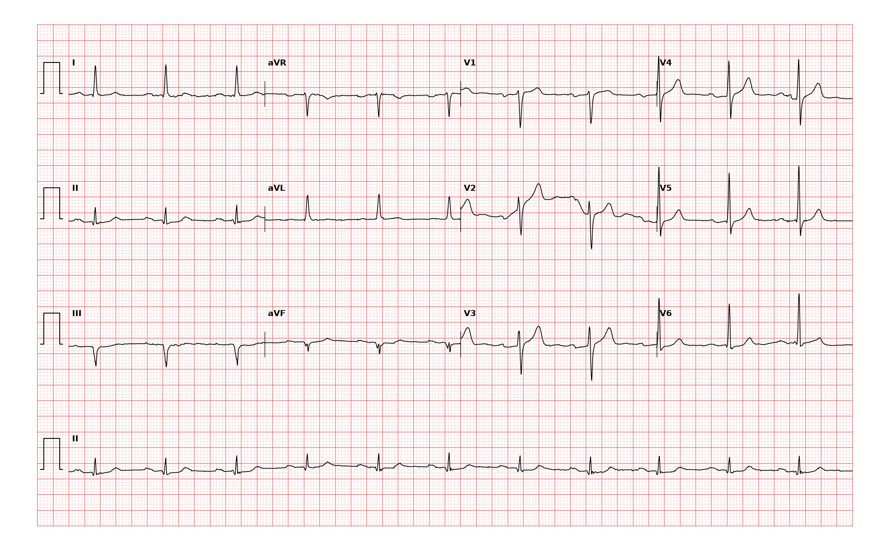

## 문제
75세 남자가 탈장 수술 전 검사로 찍은 심전도에서 이상이 있다는 말을 듣고 왔다. 5년 전 가슴이 짓눌리는 통증이 몇 시간 이어진 적이 있으나 병원에 가지 않았다. 지금은 가슴 통증이나 호흡곤란이 없다. 고혈압과 당뇨병으로 약을 먹고 있다. 혈압 136/80 mmHg, 맥박 66회/분이고 심잡음은 없다. 고감도 트로포닌 I 는 참고치 이내이다. 심초음파에서 국소 벽운동 이상이 있고 좌심실 박출률은 50 % 이다. 12유도 심전도는 그림과 같다. 심전도 판독으로 가장 적절한 것은?

- A. 후벽 심근경색
- B. 좌각차단
- C. 하벽 심근경색
- D. 전중격 심근경색
- E. 측벽 심근경색

_12유도 심전도, 25 mm/s · 10 mm/mV, 3×4 + II 리듬 스트립 (PTB-XL ECG dataset, PhysioNet, CC BY 4.0 — 원신호 그대로 작도)_

## 정답 및 해설
> 정답: C

- **정답 핵심**: 동리듬이고 QRS 는 좁다. <b>III 에 깊은 QS, aVF 에 작은 q 와 낮은 R</b> 이 있어 하벽 유도(II·III·aVF)에 병적 Q파가 있고, <b>ST 상승은 없다</b>. 트로포닌이 정상이고 5년 전 오래 이어진 흉통이 있었으므로 급성이 아닌 <b>오래된 하벽 심근경색</b>이다. V1~V3 의 R파 진행은 보존되어 전중격 경색이 아니고, I·aVL·V5·V6 에 Q파가 없다.
- **원리**: <b>왜 Q파가 남는가</b>: 심근이 전층으로 괴사해 흉터가 되면 그 부위는 전기적으로 침묵한다. 그 위의 유도는 「창문」을 통해 반대편 벽이 멀어지는 흥분을 보게 되어 처음부터 음성인 큰 Q파(폭 40 ms 이상 또는 R 의 1/4 이상)를 그린다. ST 상승·T파 변화는 몇 주 안에 돌아오지만 Q파는 수년 남는다.  <b>왜 하벽인가</b>: II·III·aVF 는 전두면에서 아래쪽을 바라보므로 좌심실 하벽(대개 우관상동맥, 일부 좌회선지)의 상태를 보여 준다. III 하나의 Q파는 정상인에서도 호흡에 따라 보일 수 있으므로, aVF 에도 Q파가 함께 있는지 확인해야 경색으로 읽는다.  <b>임상 의미</b>: 증상 없이 발견된 Q파 경색(미인지 경색)은 당뇨병 환자·노인에서 흔하고, 향후 심혈관 사건 위험이 높아 이차 예방(항혈소판제·스타틴)이 필요하다.
- **비교**: <table><thead><tr><th style="width:24%">경색 부위</th><th style="width:38%">Q파가 보이는 유도</th><th>주로 막힌 혈관</th></tr></thead><tbody> <tr><td><b>하벽 — 정답</b></td><td><b>II · III · aVF</b></td><td>우관상동맥(또는 좌회선지)</td></tr> <tr><td>전중격 — 가장 가까운 오답</td><td>V1 ~ V3(R파 진행 소실)</td><td>좌전하행지</td></tr> <tr><td>측벽</td><td>I · aVL · V5 · V6</td><td>좌회선지·대각지</td></tr> <tr><td>후벽</td><td>V1·V2 의 큰 R(거울상)</td><td>우관상동맥·좌회선지</td></tr> </tbody></table> Q파가 어느 유도 묶음에 몰려 있는지 보고 그 유도가 바라보는 벽을 떠올리면 된다.
- **오답 이유**:
  - ① 후벽 심근경색은 V1·V2 에 R 이 S 보다 큰 키 큰 R파와 똑바른 T파(앞쪽 유도의 거울상)가 있었다면 정답이 된다.
  - ② 좌각차단은 QRS 가 120 ms 이상 넓고 I·V6 에 넓은 끝이 패인 R, V1 에 깊은 QS 가 있었다면 정답이 된다.
  - ④ 전중격 심근경색은 V1~V3 에 QS 파가 있고 R파가 자라지 않았다면(R파 진행 소실) 정답이 된다.
  - ⑤ 측벽 심근경색은 I·aVL·V5·V6 에 병적 Q파가 있었다면 정답이 된다 — 이 심전도에서 그 유도들은 큰 R 을 보인다.
- **함정**: III 하나의 Q파만 보고 판단하는 것 — aVF 에도 Q파가 함께 있고 ST 상승이 없는지(오래된 경색) 같이 확인한다.
- **학습목표**: III·aVF 의 병적 Q파와 ST 상승이 없는 심전도를 오래된 하벽 심근경색으로 판독하고 전벽·측벽·후벽 경색과 가른다
- **근거·출처**: Loscalzo J, Fauci AS, Kasper DL, et al., eds. Harrison's Principles of Internal Medicine, 22nd ed. McGraw Hill; 2025. Chapter 247: Electrocardiography · Thygesen K, Alpert JS, Jaffe AS, et al. Fourth universal definition of myocardial infarction (2018). Circulation. 2018;138(20):e618-e651 · Wagner P, Strodthoff N, Bousseljot RD, et al. PTB-XL, a large publicly available electrocardiography dataset. Sci Data. 2020;7:154

## 출처
- PTB-XL ECG dataset v1.0.3 (PhysioNet, CC BY 4.0) · record 2719 · Creative Commons Attribution 4.0 International · https://physionet.org/content/ptb-xl/1.0.3/LICENSE.txt
