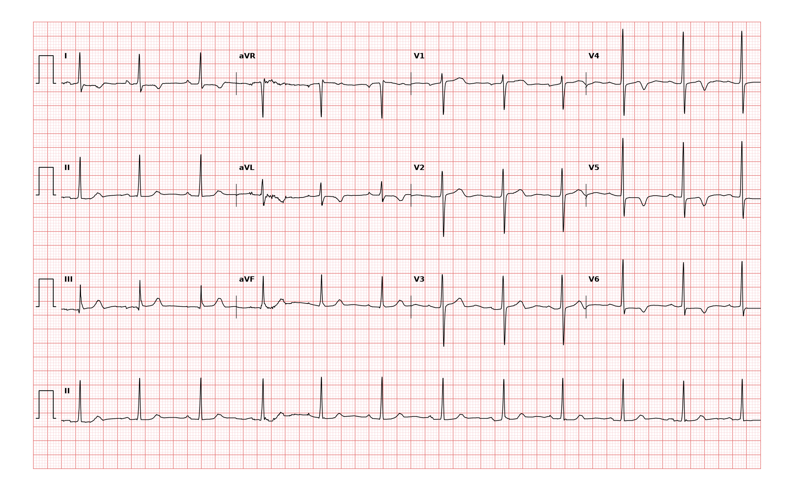

## 문제
72세 여자가 4시간 전 쉬던 중 시작된 가슴 조임으로 응급실에 왔다. 통증은 40분 동안 이어지다 저절로 사라졌고 지금은 편하다. 고혈압과 이상지질혈증으로 약을 먹고 있다. 혈압 138/82 mmHg, 맥박 72회/분, 호흡 16회/분, 산소포화도 97 % 이고 폐 청진에서 수포음은 없다. 고감도 트로포닌 I 는 도착 때 참고치 상한의 4배였고 1시간 뒤 더 올랐다. 크레아티닌은 0.8 mg/dL 이다. 아스피린과 P2Y12 억제제, 항응고제를 투여하였다. 12유도 심전도는 그림과 같다. 다음 처치로 가장 적절한 것은?

- A. 관상동맥 CT 조영술 뒤 결정
- B. 24시간 이내 침습적 관상동맥조영술
- C. 즉시 정맥 혈전용해제 투여
- D. 운동부하검사 뒤 외래 추적
- E. 2시간 이내 응급 관상동맥조영술

_12유도 심전도, 25 mm/s · 10 mm/mV, 3×4 + II 리듬 스트립 (PTB-XL ECG dataset, PhysioNet, CC BY 4.0 — 원신호 그대로 작도)_

## 정답 및 해설
> 정답: B

- **정답 핵심**: 심전도는 동리듬에 좁은 QRS 이고 <b>V4~V6 에서 수평형 ST 하강과 T파 역위</b>(I·aVL 에도 경미)가 있으며 <b>ST 상승은 없다</b>. 트로포닌이 오르내리므로 비ST분절상승 심근경색이다. 진단 자체가 고위험 기준이므로 <b>24시간 이내 침습적 관상동맥조영술</b>을 한다. 지금 통증이 없고 혈역학·심전도가 안정되어 2시간 이내 응급 조영술의 초고위험 기준에는 들지 않는다.
- **원리**: <b>왜 혈전용해제를 쓰지 않는가</b>: 비ST분절상승 급성 관상동맥증후군의 혈전은 혈소판이 많고 관상동맥을 완전히 막지 않는다. 혈전용해제는 피브린을 녹이지만 혈소판 활성을 오히려 높이고 출혈만 늘려, 무작위 시험에서 사망을 줄이지 못했다. 혈전용해제는 완전 폐색으로 ST 가 올라간 경우에만 이득이 있다.  <b>왜 24시간 이내인가</b>: 트로포닌이 오른 비ST분절상승 심근경색은 재경색·사망 위험이 높다. 조기 조영술로 책임 병변을 찾아 혈관을 넓히면 재발 허혈과 입원 기간이 줄고, 위험이 높은 환자일수록 이득이 크다.  <b>2시간 이내가 필요한 경우</b>: 혈역학적 불안정·심인성 쇼크, 약물에 반응하지 않는 반복 흉통, 생명을 위협하는 부정맥, 기계적 합병증, 급성 심부전, 반복되는 동적 ST 변화(특히 간헐적 ST 상승)는 완전 폐색에 준해 즉시 조영술을 한다.
- **비교**: <table><thead><tr><th style="width:24%">구분</th><th style="width:38%">24시간 이내 — 정답</th><th>2시간 이내 응급 조영술 — 가장 가까운 오답</th></tr></thead><tbody> <tr><td>대상</td><td><b>비ST분절상승 심근경색 진단(트로포닌 상승)</b>, 동적 ST-T 변화</td><td>쇼크, 난치성 흉통, 치명적 부정맥, 급성 심부전, 기계적 합병증</td></tr> <tr><td>지금 상태</td><td><b>통증 없음, 혈역학 안정</b></td><td>불안정</td></tr> <tr><td>목적</td><td>재경색·재발 허혈 예방</td><td>진행 중인 허혈의 즉시 해소</td></tr> </tbody></table> 트로포닌이 오르면 「24시간」, 환자가 불안정하면 「2시간」, 위험 표지가 없으면 비침습 평가를 고른다.
- **오답 이유**:
  - ① 관상동맥 CT 조영술은 트로포닌과 심전도가 정상이거나 애매한 저~중간 위험 흉통에서 관상동맥질환을 배제하려 한다면 정답이 된다.
  - ③ 정맥 혈전용해제는 인접한 두 유도 이상에서 ST 가 올라간 ST분절상승 심근경색이고 일차 관상동맥중재술이 120분 안에 불가능하다면 정답이 된다.
  - ④ 운동부하검사 뒤 외래 추적은 같은 흉통이라도 트로포닌이 반복 측정에서 정상이고 심전도 변화가 없는 저위험 환자라면 정답이 된다.
  - ⑤ 2시간 이내 응급 조영술은 지금도 흉통이 이어지거나 저혈압·심부전·심실빈맥이 있는 초고위험 환자라면 정답이 된다.
- **함정**: 트로포닌 상승을 보고 응급 재관류(혈전용해제·2시간 내 조영술)로 가는 것 — ST 상승이 없고 안정되어 있으면 24시간 이내 조영술이다.
- **학습목표**: ST 하강·T파 역위와 트로포닌 상승이 있는 안정된 비ST분절상승 심근경색에 24시간 이내 침습적 관상동맥조영술을 정하고 혈전용해제를 쓰지 않는 이유를 안다
- **근거·출처**: Loscalzo J, Fauci AS, Kasper DL, et al., eds. Harrison's Principles of Internal Medicine, 22nd ed. McGraw Hill; 2025. Chapter 285: Non-ST-Segment Elevation Acute Coronary Syndrome (Non-ST-Segment Elevation Myocardial Infarction and Unstable Angina) · Byrne RA, Rossello X, Coughlan JJ, et al. 2023 ESC Guidelines for the management of acute coronary syndromes. Eur Heart J. 2023;44(38):3720-3826 · Wagner P, Strodthoff N, Bousseljot RD, et al. PTB-XL, a large publicly available electrocardiography dataset. Sci Data. 2020;7:154

## 출처
- PTB-XL ECG dataset v1.0.3 (PhysioNet, CC BY 4.0) · record 2109 · Creative Commons Attribution 4.0 International · https://physionet.org/content/ptb-xl/1.0.3/LICENSE.txt
