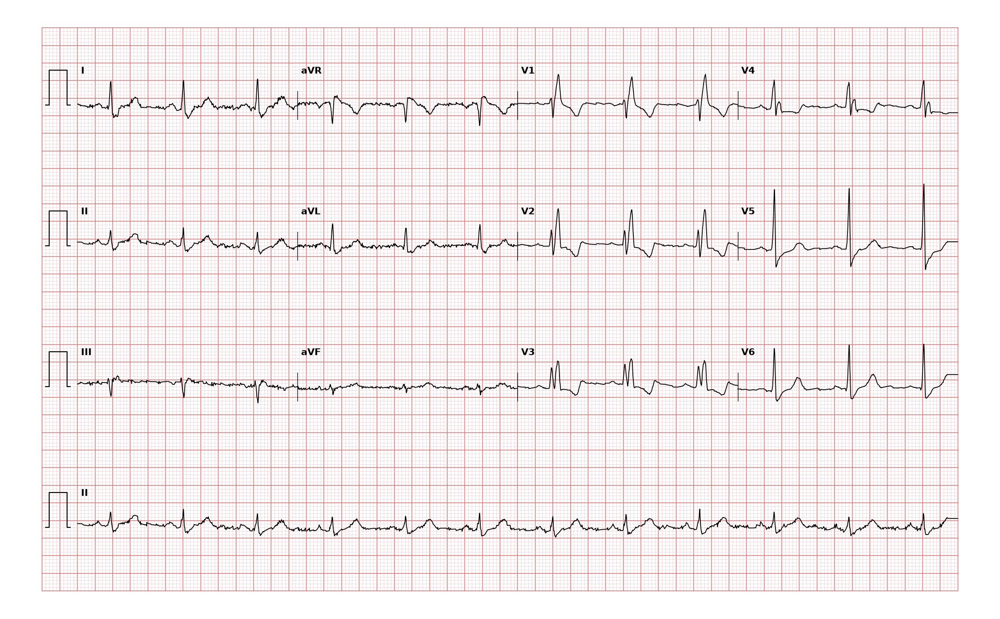

## 문제
A 53-year-old man comes to the clinic for preoperative evaluation before elective knee arthroscopy. He walks 3 km daily without chest pain, dyspnea, palpitations, or syncope. He has no history of heart disease, and there is no family history of sudden death. He takes no medications. Pulse is 70/min and blood pressure is 128/78 mm Hg. Cardiac examination shows a widely split S2 that persists with expiration; there are no murmurs. Echocardiography shows normal chamber sizes, normal valves, and normal pulmonary artery pressure. A 12-lead ECG is shown. Which of the following is the most likely ECG diagnosis?

- A. Complete right bundle branch block
- B. Brugada pattern
- C. Complete left bundle branch block
- D. Left anterior fascicular block
- E. Ventricular preexcitation

_12-lead ECG, 25 mm/s, 10 mm/mV, 3×4 + lead II rhythm strip (PTB-XL, PhysioNet, CC BY 4.0; raw signal, no filtering)_

## 정답 및 해설
> 정답: A

- **정답 핵심**: The rhythm is sinus at about 70/min. The QRS is <b>wide (about 130 ms)</b>, with an <b>rsR′ (M-shaped) complex in V1 and V2</b> and <b>broad, slurred S waves in I, V5 and V6</b>. The T waves in V1–V3 are inverted, opposite to the terminal R′ — a secondary repolarization change. This is complete right bundle branch block. Delayed right ventricular activation also explains the widely split S2 (late pulmonic closure).
- **원리**: <b>Why the right ventricle is late</b>: When the right bundle is blocked, the septum and left ventricle depolarize normally through the left bundle, so the first part of the QRS is unchanged. The right ventricle is then activated slowly, cell to cell, from the left side. That late, unopposed rightward and anterior force produces the terminal R′ in V1 and the broad S in leads facing leftward (I, V6), and the slow muscle-to-muscle conduction widens the QRS to 120 ms or more.  <b>Why the T waves invert in V1–V3</b>: Repolarization follows the delayed depolarization, so the ST-T vector points away from the late R′. These secondary changes need no further explanation and do not by themselves indicate ischemia.  <b>Clinical meaning</b>: Isolated right bundle branch block in an asymptomatic adult with a normal heart carries little risk and needs no treatment or preoperative pacing; the echocardiogram here rules out right ventricular overload.
- **비교**: <table><thead><tr><th style="width:24%">Feature</th><th style="width:38%">Right bundle branch block (answer)</th><th>Brugada pattern (closest distractor)</th></tr></thead><tbody> <tr><td>V1–V2</td><td>rsR′ with a <b>sharp terminal R′</b></td><td><b>Coved ST elevation ≥ 2 mm</b> descending into an inverted T</td></tr> <tr><td>Lateral leads (I, V6)</td><td><b>Broad, slurred S</b></td><td>No wide S wave</td></tr> <tr><td>QRS width</td><td>≥ 120 ms</td><td>Often normal or slightly prolonged</td></tr> <tr><td>Meaning</td><td>Usually benign conduction delay</td><td>Sodium channelopathy, risk of ventricular fibrillation</td></tr> </tbody></table> Look at leads I and V6: a wide terminal S confirms right bundle branch block, while Brugada changes are confined to V1–V2 and lack it.
- **오답 이유**:
  - (B) Brugada pattern would be correct if V1–V2 showed coved ST elevation of at least 2 mm sloping into inverted T waves without a wide S wave in I and V6.
  - (C) Complete left bundle branch block would be correct if V1 showed a deep QS and I and V6 showed broad notched R waves without Q waves.
  - (D) Left anterior fascicular block would be correct if the QRS were narrow with left axis deviation beyond −45°, qR in I and aVL, and rS in II, III and aVF.
  - (E) Ventricular preexcitation would be correct if the PR interval were shorter than 120 ms with a slurred delta wave at the QRS onset.
- **함정**: Seeing a positive terminal deflection with T-wave inversion in V1–V2 and calling it Brugada — check the wide S in I and V6 and the sharp R′.
- **학습목표**: Read a wide QRS with rsR′ in V1–V2 and broad slurred S waves in I and V6 as complete right bundle branch block, and distinguish it from Brugada pattern and left bundle branch block
- **근거·출처**: Loscalzo J, Fauci AS, Kasper DL, et al., eds. Harrison's Principles of Internal Medicine, 22nd ed. McGraw Hill; 2025. Chapter 247: Electrocardiography · Surawicz B, Childers R, Deal BJ, Gettes LS. AHA/ACCF/HRS recommendations for the standardization and interpretation of the electrocardiogram: part III: intraventricular conduction disturbances. J Am Coll Cardiol. 2009;53(11):976-981 · Wagner P, Strodthoff N, Bousseljot RD, et al. PTB-XL, a large publicly available electrocardiography dataset. Sci Data. 2020;7:154

## 출처
- PTB-XL ECG dataset v1.0.3 (PhysioNet, CC BY 4.0) · record 17679 · Creative Commons Attribution 4.0 International · https://physionet.org/content/ptb-xl/1.0.3/LICENSE.txt
