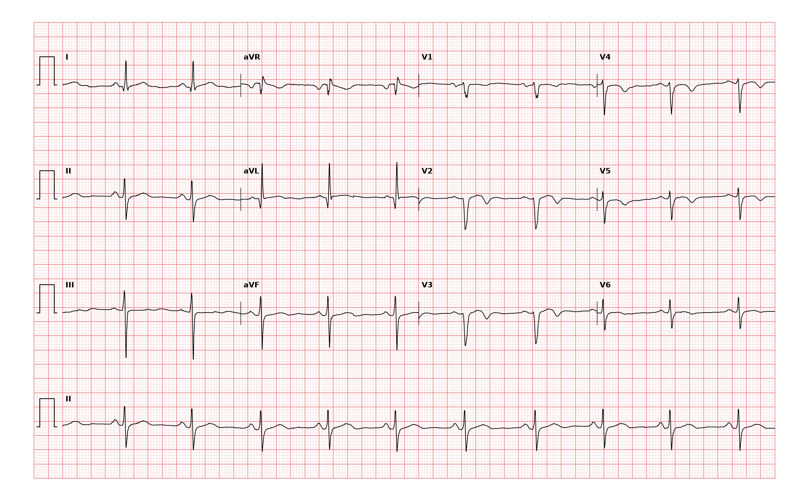

## 문제
63세 남자가 3개월 전부터 계단을 오를 때 숨이 차서 왔다. 4개월 전 저녁에 가슴을 짓누르는 통증이 3시간 넘게 지속되었으나 병원에 가지 않았고 이후 통증은 없었다. 고혈압과 당뇨병이 있고 30갑년의 흡연력이 있다. 혈압 132/80 mmHg, 맥박 70회/분 이다. 고감도 트로포닌 I 는 참고치 이내이다. 심초음파에서 좌심실 앞벽과 심실중격 앞쪽의 운동이 없고 좌심실 박출률은 40 % 이다. 12유도 심전도는 그림과 같다. 막혔던 관상동맥으로 가장 가능성이 높은 것은?

- A. 우관상동맥의 후하행지
- B. 좌전하행지
- C. 좌회선지
- D. 우관상동맥
- E. 좌주간지

_12유도 심전도, 25 mm/s · 10 mm/mV, 3×4 + II 리듬 스트립 (PTB-XL ECG dataset, PhysioNet, CC BY 4.0 — 원신호 그대로 작도)_

## 정답 및 해설
> 정답: B

- **정답 핵심**: 심전도에서 <b>V1~V3 에 R파 없이 QS형 병적 Q파</b>가 있고 V2~V4 의 T파가 얕게 뒤집혀 있으며 ST 상승은 없다 — 오래된 <b>전중격 경색</b>이다. 또 II·III·aVF 의 깊은 S파로 <b>좌축편위(좌전속지차단)</b>가 있는데, 좌전속지는 좌전하행지의 중격지에서 혈액을 받는다. 심초음파의 앞벽·앞쪽 중격 무운동까지 모두 <b>좌전하행지</b> 영역이다. 트로포닌이 정상이라 지금은 급성 경색이 아니다.
- **원리**: <b>왜 Q파가 남는가</b>: 경색으로 괴사한 심근은 섬유화되어 전기적으로 죽은 「창」이 된다. 그 위에 놓인 전극은 반대쪽 벽의 탈분극이 멀어지는 것만 보게 되어 첫 굴절이 아래로 향한다 — 병적 Q파(또는 R파가 전혀 없는 QS)다. 그래서 Q파는 경색 뒤 수개월~수년 남아 「오래된 경색」의 표지가 된다.  <b>왜 V1~V3 이 중격·앞벽인가</b>: V1·V2 는 심실중격을, V3·V4 는 앞벽을 마주 본다. 이 영역과 심첨부는 좌전하행지와 그 대각지·중격지가 공급한다.  <b>좌축편위가 더해 주는 정보</b>: 좌각의 앞쪽 가지(좌전속지)는 가늘고 대부분 좌전하행지의 중격지에서 혈액을 받는다. 앞쪽 중격 경색에 좌전속지차단(좌축편위, II·III·aVF 의 rS)이 함께 있으면 막힌 곳이 좌전하행지의 근위부, 중격지 이전일 가능성이 높아진다.
- **비교**: <table><thead><tr><th style="width:24%">구분</th><th style="width:38%">좌전하행지 — 정답</th><th>좌회선지 — 가장 가까운 오답</th></tr></thead><tbody> <tr><td>Q파가 생기는 유도</td><td><b>V1~V4</b>(중격·앞벽)</td><td>I·aVL·V5·V6(옆벽), 뒤벽이면 V1·V2 의 큰 R</td></tr> <tr><td>심초음파 무운동</td><td>앞벽·앞쪽 중격·심첨부</td><td>옆벽·뒤옆벽</td></tr> <tr><td>전도 장애</td><td>좌전속지차단·우각차단(중격지)</td><td>드묾</td></tr> </tbody></table> V1~V3 은 「좌전하행지」, II·III·aVF 는 「우관상동맥(대개)」, I·aVL·V5·V6 는 「좌회선지」로 짝지어 두면 경색 부위를 어느 방향으로 물어도 동맥으로 옮길 수 있다.
- **오답 이유**:
  - ① 후하행지는 하벽과 심실중격 아래쪽이 손상된 하벽 경색이라면 답이 되며, 앞쪽 중격과 앞벽은 공급하지 않는다.
  - ③ 좌회선지는 Q파와 벽운동 이상이 I·aVL·V5·V6 의 옆벽에 있거나 V1·V2 의 큰 R파로 뒤벽 경색이 보였다면 정답이 된다.
  - ④ 우관상동맥은 II·III·aVF 에 병적 Q파가 있고 하벽 무운동이 있었다면 가장 가능성이 높은 동맥이 된다.
  - ⑤ 좌주간지는 앞벽과 옆벽이 함께 넓게 손상되었거나 aVR ST 상승과 광범위 ST 하강이 급성기에 있었다면 떠올린다 — 이 범위로 살아남은 경우는 드물다.
- **함정**: 좌축편위를 하벽 경색(II·III·aVF 의 Q)으로 오인해 우관상동맥을 고르는 것 — II·III·aVF 는 Q가 아니라 r 뒤의 깊은 S(rS)다.
- **학습목표**: V1~V3 의 QS형 병적 Q파와 좌축편위(좌전속지차단)를 함께 보이는 오래된 전중격 경색에서 막힌 관상동맥을 좌전하행지로 찾는다
- **근거·출처**: Loscalzo J, Fauci AS, Kasper DL, et al., eds. Harrison's Principles of Internal Medicine, 22nd ed. McGraw Hill; 2025. Chapter 247: Electrocardiography · Loscalzo J, Fauci AS, Kasper DL, et al., eds. Harrison's Principles of Internal Medicine, 22nd ed. McGraw Hill; 2025. Chapter 286: ST-Segment Elevation Myocardial Infarction

## 출처
- PTB-XL ECG dataset v1.0.3 (PhysioNet, CC BY 4.0) · record 7790 · Creative Commons Attribution 4.0 International · https://physionet.org/content/ptb-xl/1.0.3/LICENSE.txt
