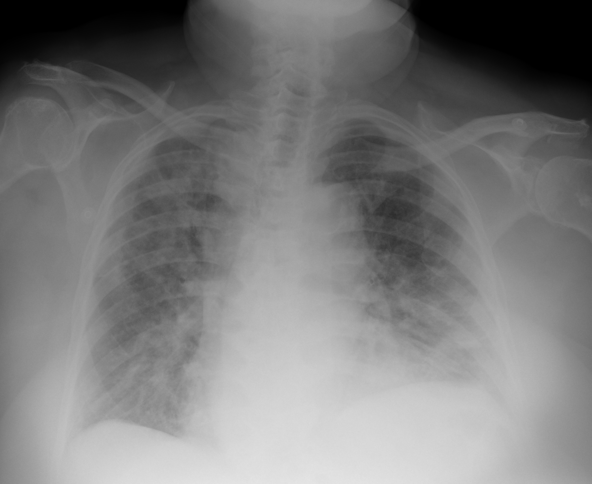

## 문제
A 73-year-old woman is admitted to the hospital because of fever, cough, and progressive shortness of breath for 6 days. A nasopharyngeal swab is positive for SARS-CoV-2 by RT-PCR. On admission, she required 3 L/min of oxygen by nasal cannula and was started on intravenous dexamethasone. Over the next 24 hours, her oxygen requirement increased, and she now requires high-flow nasal oxygen at 40 L/min with an FiO2 of 0.6 to maintain an oxygen saturation of 92%. Temperature is 38.3°C (100.9°F), pulse is 104/min, respirations are 28/min, and blood pressure is 126/72 mm Hg. She is alert. Serum C-reactive protein concentration is 160 mg/L (N<8), and serum procalcitonin concentration is within the reference range. Blood cultures show no growth. A chest x-ray is shown. In addition to continuing dexamethasone, which of the following is the most appropriate pharmacotherapy?

- A. Ivermectin
- B. Piperacillin-tazobactam
- C. Tocilizumab
- D. Nirmatrelvir-ritonavir
- E. Hydroxychloroquine

_Supine anteroposterior chest radiograph, resized only (The Cancer Imaging Archive, CC BY 4.0)_

## 정답 및 해설
> 정답: C

- **정답 핵심**: The radiograph shows <b>bilateral patchy ground-glass and consolidative opacities, predominantly in the lower and peripheral zones</b>, consistent with COVID-19 pneumonia. She is <b>rapidly escalating to high-flow oxygen within 24 hours despite dexamethasone</b> and has a high CRP — the inflammatory phase of the illness. For this group, adding an immunomodulator, <b>tocilizumab</b> (or baricitinib), to dexamethasone reduces mortality. Normal procalcitonin and sterile cultures make bacterial superinfection less likely.
- **원리**: <b>Why immunomodulation, not antivirals, at this stage</b>: In the first days of COVID-19, viral replication drives disease, so antivirals help. After about a week, viral load is falling and lung injury is driven by the host's inflammatory response — interleukin-6 and other cytokines cause capillary leak and alveolar flooding. A patient whose oxygen needs climb rapidly at this stage has a hyperinflammatory picture, reflected in a high CRP (an IL-6–driven acute-phase protein).  <b>Why tocilizumab</b>: Tocilizumab blocks the IL-6 receptor. In large randomized trials, adding it to dexamethasone in hypoxemic patients with high CRP or rapidly increasing oxygen needs reduced mortality and progression to mechanical ventilation. Baricitinib (a JAK inhibitor) is an alternative; the two are not combined.  <b>Cautions</b>: It suppresses the CRP response and raises infection risk, so active bacterial or fungal infection should be considered first — here procalcitonin and cultures are reassuring.
- **비교**: <table><thead><tr><th style="width:24%">Feature</th><th style="width:38%">Tocilizumab (answer)</th><th>Nirmatrelvir-ritonavir (closest distractor)</th></tr></thead><tbody> <tr><td>Target</td><td>IL-6 receptor — host inflammation</td><td>Viral 3CL protease — replication</td></tr> <tr><td>Best phase</td><td><b>Hospitalized, rising O2 need despite steroids</b></td><td>Early, within 5 days of symptoms</td></tr> <tr><td>Oxygen status</td><td>High-flow or rapidly increasing O2</td><td>Outpatient, no new O2 requirement</td></tr> <tr><td>Marker</td><td>CRP ≥ 75 mg/L supports use</td><td>Risk factors for progression</td></tr> </tbody></table> Antivirals early, outside the hospital; steroids for anyone needing oxygen; add tocilizumab or baricitinib when oxygen needs keep climbing.
- **오답 이유**:
  - (A) Ivermectin would be appropriate for strongyloidiasis — for example, before steroids in a patient from an endemic area with eosinophilia — not for COVID-19.
  - (B) Piperacillin-tazobactam would be correct if procalcitonin were high, cultures grew a gram-negative organism, or hospital-acquired bacterial pneumonia were suspected.
  - (D) Nirmatrelvir-ritonavir would be correct for a high-risk outpatient within 5 days of symptom onset who does not need supplemental oxygen.
  - (E) Hydroxychloroquine showed no benefit in randomized trials; it would be appropriate only for an unrelated indication such as lupus or malaria prophylaxis.
- **함정**: Choosing an antiviral because the infection is viral — by day 6 with rising oxygen needs, inflammation, not replication, drives the lung injury.
- **학습목표**: Add an IL-6 receptor antagonist (tocilizumab) to dexamethasone for a hospitalized patient with COVID-19 pneumonia whose oxygen requirement is rapidly increasing despite corticosteroids and whose inflammatory markers are high
- **근거·출처**: Loscalzo J, Fauci AS, Kasper DL, et al., eds. Harrison's Principles of Internal Medicine, 22nd ed. McGraw Hill; 2025. Chapter 205: SARS-CoV-2 and COVID-19 · RECOVERY Collaborative Group. Tocilizumab in patients admitted to hospital with COVID-19 (RECOVERY): a randomised, controlled, open-label, platform trial. Lancet. 2021;397(10285):1637-1645

## 출처
- COVID-19-AR, The Cancer Imaging Archive (CC BY 4.0) · series …08510874 · Creative Commons Attribution 4.0 International · https://www.cancerimagingarchive.net/data-usage-policies-and-restrictions/
