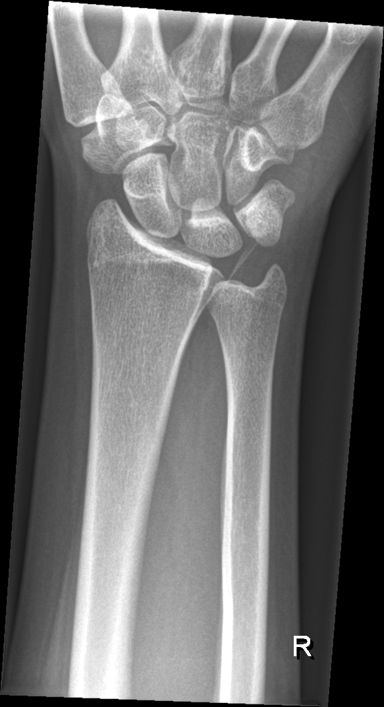

## 문제
A 16-year-old girl is brought to the emergency department 3 hours after falling onto her outstretched right hand while playing basketball. She has pain at the radial side of the right wrist. She has no other injuries and is otherwise healthy. Vital signs are within normal limits. Examination shows mild swelling on the radial side of the wrist without deformity. There is tenderness in the anatomic snuffbox and pain with axial loading of the thumb. There is no tenderness over the distal ulna. Capillary refill, sensation, and finger movement are normal. A posteroanterior x-ray of the right wrist is shown; lateral and dedicated scaphoid views are read as showing no fracture. Which of the following is the most appropriate next step in management?

- A. Corticosteroid injection into the first dorsal compartment
- B. Thumb spica immobilization and repeat imaging in 10 to 14 days
- C. Elastic bandage and return only if pain persists beyond 6 weeks
- D. Closed reduction under sedation and long-arm cast
- E. Open reduction and internal fixation

_Posteroanterior radiograph of the right wrist and distal forearm; the R marker is from the original, unaltered apart from scaling (GRAZPEDWRI-DX, figshare, CC BY 4.0)_

## 정답 및 해설
> 정답: B

- **정답 핵심**: The radiograph shows <b>no fracture line, cortical break, or displacement in the scaphoid or distal radius</b>. However, after a fall on an outstretched hand, <b>anatomic snuffbox tenderness and pain with axial loading of the thumb</b> suggest a scaphoid fracture, and up to a fifth of scaphoid fractures are invisible on initial films. Because a missed fracture can progress to nonunion or avascular necrosis, she should be <b>immobilized in a thumb spica</b> and re-imaged in 10–14 days (or have MRI if available).
- **원리**: <b>Why initial films miss it</b>: A nondisplaced scaphoid waist fracture is a hairline crack in a curved bone that sits obliquely to the x-ray beam. After 1–2 weeks, bone resorption along the fracture line widens it enough to see. MRI shows marrow edema immediately and is the most sensitive early test.  <b>Why it matters</b>: Most of the scaphoid's blood supply enters distally (dorsal carpal branch of the radial artery) and flows backward to the proximal pole. A waist or proximal fracture can cut off the proximal fragment, leading to nonunion and avascular necrosis, and later to wrist arthritis. Immobilization until the diagnosis is excluded prevents displacement of an occult crack.  <b>Why the skeletally mature patient</b>: In younger children, the same fall usually fractures the distal radial metaphysis (buckle fracture). Near skeletal maturity the scaphoid becomes the weak link, as in adults.
- **비교**: <table><thead><tr><th style="width:24%">Feature</th><th style="width:38%">Thumb spica + repeat imaging (answer)</th><th>Elastic bandage only (closest distractor)</th></tr></thead><tbody> <tr><td>Clinical signs</td><td><b>Snuffbox tenderness, painful thumb axial loading</b></td><td>Diffuse mild tenderness, no scaphoid signs</td></tr> <tr><td>Radiograph</td><td>Normal (fracture not excluded)</td><td>Normal</td></tr> <tr><td>Risk if wrong</td><td>Brief unnecessary splinting</td><td><b>Nonunion, avascular necrosis</b></td></tr> </tbody></table> A normal radiograph does not exclude a scaphoid fracture: let the clinical signs decide whether to immobilize, and let repeat imaging or MRI decide whether to continue.
- **오답 이유**:
  - (A) A corticosteroid injection would be appropriate for de Quervain tenosynovitis with a positive Finkelstein test and no trauma history.
  - (C) An elastic bandage alone would be acceptable for a wrist sprain without snuffbox tenderness or pain on thumb axial loading.
  - (D) Closed reduction and a long-arm cast would be correct for a displaced or angulated distal radius fracture visible on the radiograph.
  - (E) Open reduction and internal fixation would be correct for a scaphoid fracture displaced by more than 1 mm or involving the proximal pole on imaging.
- **함정**: Discharging the patient because the radiograph is normal — snuffbox tenderness after a fall means the scaphoid is fractured until proven otherwise.
- **학습목표**: Suspect an occult scaphoid fracture when anatomic snuffbox tenderness follows a fall on an outstretched hand despite a normal initial radiograph, and immobilize in a thumb spica with repeat imaging
- **근거·출처**: Nagy E, Janisch M, Hržić F, Sorantin E, Tschauner S. A pediatric wrist trauma X-ray dataset (GRAZPEDWRI-DX) for machine learning. Sci Data. 2022;9:222 · Tornetta P III, Ricci WM, Ostrum RF, et al., eds. Rockwood and Green's Fractures in Adults, 9th ed. Wolters Kluwer; 2020 — carpus fractures and dislocations

## 출처
- GRAZPEDWRI-DX (figshare, CC BY 4.0) · Creative Commons Attribution 4.0 International · https://creativecommons.org/licenses/by/4.0/
