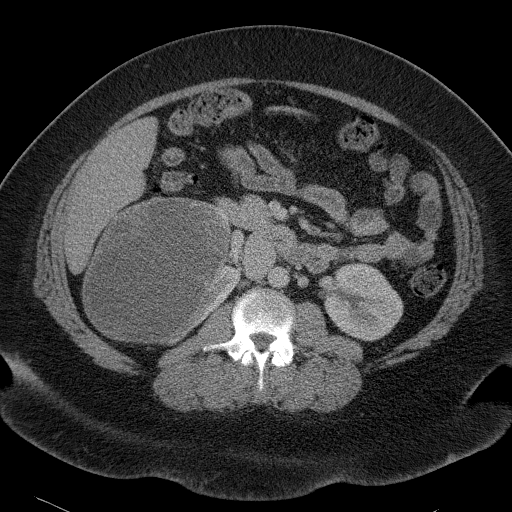

## 문제
53세 여자가 2개월 전부터 생긴 오른쪽 옆구리의 둔한 통증으로 왔다. 2주 전 한 차례 소변이 붉었다. 흡연력은 없고 코골이나 낮 졸림은 없으며 수면다원검사에서 무호흡이 없었다. 혈압 134/84 mmHg, 맥박 78회/분 이고 얼굴이 붉다. 비장은 만져지지 않는다. 혈액검사 결과는 다음과 같다. 혈색소 18.1 g/dL, 적혈구용적률 54 %, 백혈구 7,400/mm³, 혈소판 248,000/mm³, 혈청 크레아티닌 0.9 mg/dL, 혈청 에리스로포이에틴 상승. 실내 공기에서 동맥혈 산소포화도는 97 % 이다. 복부 조영증강 CT 는 그림과 같다. 혈색소 상승의 기전으로 가장 적절한 것은?

- A. 만성 저산소증에 대한 콩팥의 에리스로포이에틴 증가
- B. 탈수로 인한 혈장량 감소
- C. 종양의 부갑상샘호르몬 관련 단백 분비
- D. 종양의 에리스로포이에틴 분비
- E. JAK2 변이에 의한 조혈모세포의 자율 증식

_조영증강 복부 CT, 동맥기 축상 단면 1장, 연부조직 창, 표준 표시 방향 (TCIA, CC BY 3.0 — 크롭·보정·분할 표시 없음)_

## 정답 및 해설
> 정답: D

- **정답 핵심**: CT 에서 <b>오른쪽 콩팥에서 생겨 신실질을 밀어내는 약 13 cm 의 큰 종괴</b>가 있다 — 옆구리 통증·혈뇨와 함께 신세포암으로 보아야 한다. 여자에서 혈색소 18.1 g/dL 인데 <b>에리스로포이에틴이 높고 산소포화도는 정상</b>이며 백혈구·혈소판과 비장이 정상이다. 저산소 자극 없이 에리스로포이에틴이 높으므로 <b>종양이 에리스로포이에틴을 만드는 부종양 적혈구증가증</b>이다.
- **원리**: <b>에리스로포이에틴은 어디서 왜 나오는가</b>: 정상에서는 콩팥 피질의 세관 주위 간질세포가 산소 분압을 감지해 에리스로포이에틴을 만든다. 산소가 부족하면 HIF(저산소유도인자)가 분해되지 않고 쌓여 에리스로포이에틴 유전자를 켠다.  <b>왜 신세포암이 만드는가</b>: 투명세포 신세포암의 대부분은 VHL 유전자 기능을 잃어, 산소가 충분해도 HIF 가 분해되지 않는다. 그래서 산소와 무관하게 에리스로포이에틴과 VEGF 가 계속 만들어진다(다른 조직형도 종양 자체·주변 허혈로 만들 수 있다). 종양을 떼면 혈색소가 정상으로 돌아오는 것이 진단을 뒷받침한다.  <b>감별의 축</b>: 에리스로포이에틴이 낮으면 골수의 자율 증식(진성 적혈구증가증), 높으면 이차성이다. 이차성 가운데 산소포화도가 낮으면 저산소성(만성폐쇄폐질환·고지대·수면무호흡), 정상이면 종양(신세포암·간세포암·혈관모세포종·자궁근종)이나 콩팥 허혈을 찾는다.
- **비교**: <table><thead><tr><th style="width:24%">구분</th><th style="width:38%">종양의 에리스로포이에틴 분비 — 정답</th><th>JAK2 변이(진성 적혈구증가증) — 가장 가까운 오답</th></tr></thead><tbody> <tr><td>혈청 에리스로포이에틴</td><td><b>높음</b></td><td>낮음(음성 되먹임)</td></tr> <tr><td>백혈구·혈소판</td><td>정상</td><td>자주 함께 증가</td></tr> <tr><td>비장</td><td>정상</td><td>비장 비대 흔함</td></tr> <tr><td>영상</td><td>콩팥(간) 종괴</td><td>종괴 없음</td></tr> </tbody></table> 에리스로포이에틴이 낮으면 골수, 높으면 「산소포화도」를 보고 저산소인지 종양인지 가른다 — 이 순서면 어느 방향으로 물어도 답을 찾는다.
- **오답 이유**:
  - ① 저산소성 증가는 만성폐쇄폐질환이나 수면무호흡으로 산소포화도가 92 % 미만으로 낮았다면 정답이 된다.
  - ② 혈장량 감소는 이뇨제·설사로 혈색소가 올랐으나 수액 뒤 정상으로 돌아오고 에리스로포이에틴이 정상이었다면 정답이 된다.
  - ③ 부갑상샘호르몬 관련 단백은 신세포암의 다른 부종양 증후군으로, 혈청 칼슘이 높고 인이 낮았다면 그 기전이 정답이 된다.
  - ⑤ JAK2 변이는 에리스로포이에틴이 낮고 백혈구·혈소판 증가와 비장 비대, 수인성 가려움이 있었다면 정답이 된다.
- **함정**: 적혈구증가증을 보면 진성 적혈구증가증부터 떠올리는 것 — 에리스로포이에틴이 높으면 골수의 자율 증식이 아니다.
- **학습목표**: 콩팥 고형 종괴와 함께 생긴 이차성 적혈구증가증을 종양의 에리스로포이에틴 분비로 설명하고 진성 적혈구증가증·저산소성 적혈구증가증과 가른다
- **근거·출처**: Loscalzo J, Fauci AS, Kasper DL, et al., eds. Harrison's Principles of Internal Medicine, 22nd ed. McGraw Hill; 2025. Chapter 90: Renal Cell Carcinoma · Loscalzo J, Fauci AS, Kasper DL, et al., eds. Harrison's Principles of Internal Medicine, 22nd ed. McGraw Hill; 2025. Chapter 98: Paraneoplastic Syndromes: Endocrinologic/Hematologic · Loscalzo J, Fauci AS, Kasper DL, et al., eds. Harrison's Principles of Internal Medicine, 22nd ed. McGraw Hill; 2025. Chapter 66: Anemia and Polycythemia

## 출처
- The Cancer Imaging Archive (CC BY 3.0) · KiTS-00056 · Creative Commons Attribution 3.0 Unported · https://www.cancerimagingarchive.net/data-usage-policies-and-restrictions/
