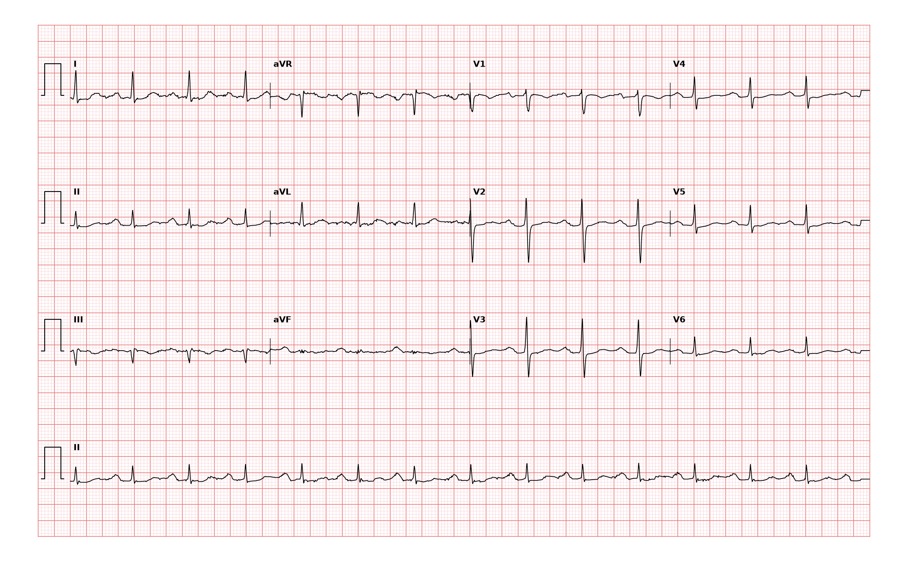

## 문제
63세 여자가 건강검진에서 심전도 이상이 있다는 말을 듣고 왔다. 어지럼, 실신, 가슴 통증은 없고 계단을 오를 때 숨이 차지 않는다. 고혈압으로 암로디핀을 먹고 있으며 베타차단제나 디곡신은 먹지 않는다. 혈압 128/78 mmHg, 맥박 84회/분이고 규칙적이다. 혈청 칼륨 4.2 mEq/L, 갑상샘자극호르몬은 참고치 이내이다. 12유도 심전도는 그림과 같다. 심전도 판독으로 가장 적절한 것은?

- A. 1도 방실차단
- B. 모비츠 I형 방실차단
- C. 모비츠 II형 방실차단
- D. 완전 방실차단
- E. 방실접합부 리듬

_12유도 심전도, 25 mm/s · 10 mm/mV, 3×4 + II 리듬 스트립 (PTB-XL ECG dataset, PhysioNet, CC BY 4.0 — 원신호 그대로 작도)_

## 정답 및 해설
> 정답: A

- **정답 핵심**: 리듬 스트립(II)에서 RR 이 약 0.70초로 일정한 <b>동리듬 약 85회/분</b>이다. <b>모든 P파 뒤에 QRS 가 따라오고 빠진 박동이 없으며</b>, P 시작에서 QRS 시작까지가 큰 칸 한 개를 넘어 <b>약 0.24초로 매 박동 같다</b>. QRS 는 좁다. PR 이 0.20초를 넘으면서 일정하고 모든 P가 전도되므로 <b>1도 방실차단</b>이다.
- **원리**: <b>PR 간격이 재는 것</b>: PR 간격은 심방 탈분극이 시작해 방실결절·히스속·각지를 지나 심실이 흥분하기 시작할 때까지의 시간이다. 이 가운데 가장 오래 걸리는 곳이 방실결절(일부러 전도를 늦춰 심방 수축이 끝나게 한다)이므로, PR 연장은 대개 방실결절의 전도 지연이다.  <b>「차단」이지만 막히지 않는다</b>: 1도 방실차단은 이름과 달리 모든 흥분이 전도되고 단지 늦게 도착할 뿐이다. 그래서 박동이 빠지지 않고 맥박은 규칙적이다. 2도부터는 일부 P가 심실로 가지 못하고, 3도는 심방과 심실이 따로 뛴다.  <b>임상 의미</b>: 좁은 QRS 의 단독 1도 방실차단은 대개 무증상이며 치료가 필요 없다. 방실결절을 늦추는 약(베타차단제·비디하이드로피리딘 칼슘통로차단제·디곡신)·고칼륨혈증·갑상샘저하증 같은 가역 원인을 확인하고, PR 이 0.30초를 넘어 증상이 있거나 넓은 QRS 와 함께 있으면 더 자세히 본다.
- **비교**: <table><thead><tr><th style="width:24%">구분</th><th style="width:38%">1도 방실차단 — 정답</th><th>2도 모비츠 I형 — 가장 가까운 오답</th></tr></thead><tbody> <tr><td>PR 간격</td><td><b>0.20초 넘게 길지만 매 박동 같다</b></td><td>박동마다 점점 길어진다</td></tr> <tr><td>빠진 박동</td><td><b>없음</b> — 모든 P 뒤 QRS</td><td>주기적으로 P 뒤 QRS 가 빠진다</td></tr> <tr><td>RR 간격</td><td>규칙적</td><td>무리 지어 뛴다(그룹 박동)</td></tr> </tbody></table> 「PR 이 길다」만 보고 끝내지 말고 「빠진 P가 있는가, PR 이 변하는가」를 리듬 스트립 끝까지 따라가면 1도·2도를 어느 방향으로 물어도 가를 수 있다.
- **오답 이유**:
  - ② 모비츠 I형은 PR 이 박동마다 점점 길어지다가 P 뒤의 QRS 하나가 빠지는 주기가 리듬 스트립에 반복되었다면 정답이 된다.
  - ③ 모비츠 II형은 PR 이 일정하다가 예고 없이 P 뒤의 QRS 가 갑자기 빠지고 흔히 QRS 가 넓다면 정답이 된다.
  - ④ 3도 방실차단은 P파와 QRS 가 서로 무관하게 각자의 일정한 간격으로 뛰고 심실 박동이 느리다면 정답이 된다.
  - ⑤ 방실접합부 리듬은 QRS 앞의 P파가 없거나 QRS 뒤에 역행성 P파가 보이고 박동수가 40~60회/분이었다면 정답이 된다.
- **함정**: PR 연장을 보고 바로 모비츠 I형으로 가는 것 — 리듬 스트립 끝까지 빠진 QRS 가 없고 PR 이 변하지 않으면 1도다.
- **학습목표**: 모든 P파 뒤에 QRS 가 오고 PR 간격이 0.20초를 넘어 일정하게 길면 1도 방실차단으로 판독하고 2도 방실차단(모비츠 I·II)과 가른다
- **근거·출처**: Loscalzo J, Fauci AS, Kasper DL, et al., eds. Harrison's Principles of Internal Medicine, 22nd ed. McGraw Hill; 2025. Chapter 252: The Bradyarrhythmias: Disorders of the Atrioventricular Node · Loscalzo J, Fauci AS, Kasper DL, et al., eds. Harrison's Principles of Internal Medicine, 22nd ed. McGraw Hill; 2025. Chapter 247: Electrocardiography · Wagner P, Strodthoff N, Bousseljot RD, et al. PTB-XL, a large publicly available electrocardiography dataset. Sci Data. 2020;7:154

## 출처
- PTB-XL ECG dataset v1.0.3 (PhysioNet, CC BY 4.0) · record 4440 · Creative Commons Attribution 4.0 International · https://physionet.org/content/ptb-xl/1.0.3/LICENSE.txt
