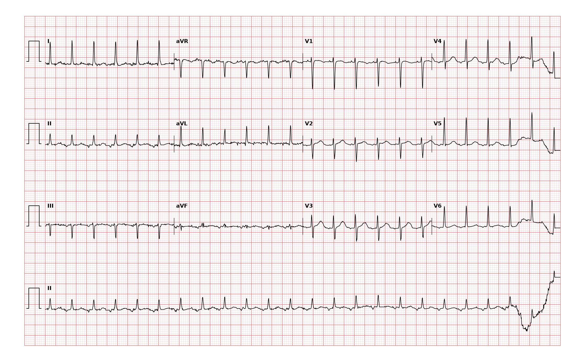

## 문제
71세 남자가 40분 전 TV 를 보다가 갑자기 시작된 두근거림으로 응급실에 왔다. 비슷한 일이 1년에 두세 번 있었으나 몇 분 안에 저절로 멈췄다고 한다. 가슴 통증과 호흡곤란은 없고 의식은 명료하다. 천식은 없다. 혈압 124/76 mmHg, 맥박 140회/분, 호흡 18회/분, 산소포화도 98 % 이다. 폐음은 깨끗하다. 변형 발살바법을 두 번 시행했으나 리듬이 바뀌지 않았다. 12유도 심전도는 그림과 같다. 다음 처치로 가장 적절한 것은?

- A. 디곡신 정맥 주사
- B. 경정맥 심박조율
- C. 아데노신 급속 정맥 주사
- D. 동기화 심장율동전환
- E. 아미오다론 정맥 주사

_12유도 심전도, 25 mm/s · 10 mm/mV, 3×4 + II 리듬 스트립 (PTB-XL ECG dataset, PhysioNet, CC BY 4.0 — 원신호 그대로 작도)_

## 정답 및 해설
> 정답: C

- **정답 핵심**: 심전도에서 <b>RR 이 일정한 약 140회/분의 좁은 QRS 빈맥</b>이고 QRS 앞에 뚜렷한 P파가 보이지 않는다 — 발작성 상심실빈맥(대개 방실결절 재진입)이다. 갑자기 시작되고 갑자기 멈추던 과거력도 맞다. <b>혈압·의식이 유지되어 안정</b>하고 <b>변형 발살바법이 실패</b>했으므로 다음은 <b>아데노신 급속 정주</b>다.
- **원리**: <b>왜 아데노신이 듣는가</b>: 방실결절 재진입빈맥과 방실 회귀빈맥은 회로의 한 고리로 방실결절을 쓴다. 아데노신은 방실결절 세포의 A1 수용체에 붙어 칼륨 통로를 열고 칼슘 유입을 줄여, 몇 초 동안 방실결절 전도를 막는다. 고리가 한 번만 끊겨도 재진입이 멈춘다.  <b>왜 급속 정주인가</b>: 적혈구·내피세포가 아데노신을 매우 빨리 흡수해 반감기가 10초 미만이다. 그래서 심장에 가까운 굵은 정맥으로 빠르게 넣고 곧바로 식염수로 밀어야 한다(6 mg, 안 되면 12 mg).  <b>진단 도구로서</b>: 심방조동·심방빈맥처럼 방실결절이 회로에 없는 리듬이라면 아데노신이 리듬을 끊지 못하고 심실 반응만 잠시 줄여 숨은 조동파·P파를 드러낸다. 천식 환자는 기관지 수축을 일으킬 수 있어 비디하이드로피리딘 칼슘통로차단제를 대신 쓴다.
- **비교**: <table><thead><tr><th style="width:24%">구분</th><th style="width:38%">아데노신 — 정답</th><th>동기화 심장율동전환 — 가장 가까운 오답</th></tr></thead><tbody> <tr><td>대상</td><td><b>혈역학 안정</b>, 미주신경 자극 실패</td><td><b>불안정</b>: 저혈압·의식 저하·허혈성 흉통·급성 심부전</td></tr> <tr><td>작용</td><td>방실결절 일시 차단으로 회로 단절</td><td>전기로 모든 회로를 한 번에 탈분극</td></tr> <tr><td>필요한 것</td><td>정맥로, 심전도 감시</td><td>진정, 패드</td></tr> </tbody></table> 같은 좁은 QRS 빈맥이라도 처치를 정하는 것은 리듬이 아니라 혈역학이다 — 안정하면 미주신경 → 아데노신, 불안정하면 곧바로 동기화 전기충격.
- **오답 이유**:
  - ① 디곡신은 효과가 몇 시간 걸려 재진입을 바로 끊지 못하며, 저혈압이 있는 심부전 환자의 심방세동 박동수 조절이라면 쓸 수 있다.
  - ② 경정맥 심박조율은 증상이 있는 서맥(완전 방실차단 등)이 약물에 반응하지 않았다면 정답이 된다 — 이 리듬은 빈맥이다.
  - ④ 동기화 심장율동전환은 저혈압·의식 저하·허혈성 흉통·급성 심부전이 있는 불안정 빈맥이거나 아데노신과 칼슘통로차단제가 모두 실패했다면 정답이 된다.
  - ⑤ 아미오다론은 혈역학적으로 안정한 단형 심실빈맥이나 구조적 심질환의 심방세동 박동수 조절이 필요했다면 선택지가 된다.
- **함정**: 고령이라는 이유로 처음부터 전기충격을 고르는 것 — 처치를 가르는 것은 나이가 아니라 혈압·의식·흉통·심부전 같은 불안정 징후다.
- **학습목표**: 혈역학적으로 안정한 규칙적 좁은 QRS 빈맥에서 미주신경 자극이 실패하면 아데노신을 급속 정주하고, 불안정할 때만 동기화 심장율동전환을 한다
- **근거·출처**: Loscalzo J, Fauci AS, Kasper DL, et al., eds. Harrison's Principles of Internal Medicine, 22nd ed. McGraw Hill; 2025. Chapter 256: Paroxysmal Supraventricular Tachycardias · Page RL, Joglar JA, Caldwell MA, et al. 2015 ACC/AHA/HRS guideline for the management of adult patients with supraventricular tachycardia. Circulation. 2016;133(14):e506-e574 · Wagner P, Strodthoff N, Bousseljot RD, et al. PTB-XL, a large publicly available electrocardiography dataset. Sci Data. 2020;7:154

## 출처
- PTB-XL ECG dataset v1.0.3 (PhysioNet, CC BY 4.0) · record 8461 · Creative Commons Attribution 4.0 International · https://physionet.org/content/ptb-xl/1.0.3/LICENSE.txt
