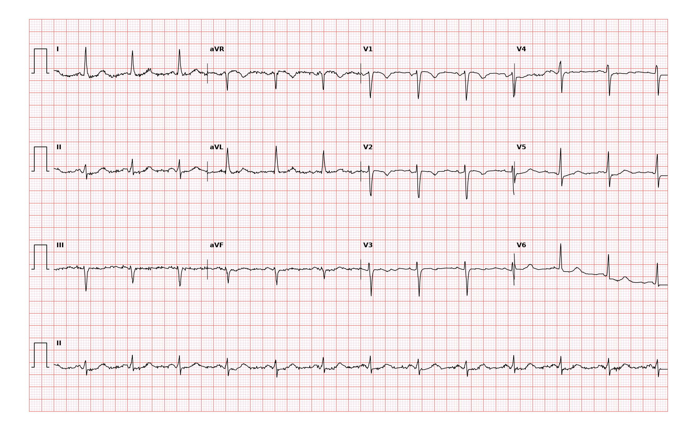

## 문제
A 78-year-old woman is brought to the emergency department because of substernal chest pressure that began 2 hours ago while she was watching television. The pain lasted about 30 minutes and has now partly subsided. She has hypertension and type 2 diabetes mellitus. She does not take digoxin. Blood pressure is 148/84 mm Hg, pulse is 78/min, and respirations are 18/min. The lungs are clear, and there is no murmur, rub, or jugular venous distention. High-sensitivity troponin I concentration is 64 ng/L (N<16) and rises to 210 ng/L 2 hours later. Echocardiography shows normal left ventricular wall thickness. A 12-lead ECG is shown. Which of the following is the most likely diagnosis?

- A. Digoxin-induced ST depression
- B. Non-ST-elevation myocardial infarction
- C. Acute anterior ST-elevation infarction
- D. Left ventricular hypertrophy with strain
- E. Acute viral pericarditis

_12-lead ECG, 25 mm/s, 10 mm/mV, 3×4 + lead II rhythm strip (PTB-XL, PhysioNet, CC BY 4.0; raw signal, no filtering)_

## 정답 및 해설
> 정답: B

- **정답 핵심**: The ECG shows sinus rhythm at about 78/min with <b>T-wave inversion in V1–V2</b>, <b>ST depression in V4–V6</b>, and QS complexes with poor R-wave progression in V1–V3, but <b>no ST elevation</b> in any lead. With rest chest pain and a <b>rising high-sensitivity troponin</b>, this is myocardial necrosis from ischemia without ST elevation — a <b>non-ST-elevation myocardial infarction</b>. QRS voltage is not increased and wall thickness is normal, so LVH strain is unlikely.
- **원리**: <b>Why ST depression means subendocardial ischemia</b>: The subendocardium is farthest from the epicardial coronary arteries and is compressed during systole, so it becomes ischemic first. Injured subendocardial cells have a less negative resting potential and shorter action potentials, creating a current of injury directed toward the cavity. Electrodes on the chest wall see this as ST depression; transmural (full-thickness) injury points the vector outward and produces ST elevation.  <b>Why troponin defines infarction</b>: The ECG cannot distinguish unstable angina from NSTEMI. A rise and/or fall of cardiac troponin with at least one value above the 99th percentile, in a setting of ischemia, means myocardial necrosis — infarction.  <b>Why poor R progression does not change the diagnosis</b>: QS complexes in V1–V3 may reflect prior septal damage or lead placement; they are a background finding. The acute decision rests on the absence of ST elevation plus a dynamic troponin.
- **비교**: <table><thead><tr><th style="width:24%">Feature</th><th style="width:38%">NSTEMI (answer)</th><th>LVH with repolarization abnormality (closest distractor)</th></tr></thead><tbody> <tr><td>QRS voltage</td><td>Normal</td><td><b>Increased</b> (e.g., S in V1 + R in V5/V6 ≥ 35 mm)</td></tr> <tr><td>ST-T pattern</td><td>New ST depression and/or T inversion in an ischemic distribution</td><td>Asymmetric ST depression and T inversion in leads with tall R (V5, V6, I, aVL)</td></tr> <tr><td>Troponin</td><td><b>Rising above the 99th percentile</b></td><td>Usually normal or stable</td></tr> <tr><td>Echo</td><td>Normal or regional wall motion abnormality</td><td>Increased wall thickness</td></tr> </tbody></table> ST depression has many causes; it becomes ischemia when the voltage does not explain it and the troponin moves.
- **오답 이유**:
  - (A) Digoxin effect would be correct in a patient taking digoxin with scooped ST depression in many leads and a stable troponin.
  - (C) Anterior STEMI would be correct if there were ST elevation of at least 2 mm in two contiguous precordial leads such as V2–V3.
  - (D) LVH with repolarization abnormality would be correct if QRS voltage met LVH criteria and echocardiography showed increased wall thickness with a stable troponin.
  - (E) Acute pericarditis would be correct if there were diffuse concave ST elevation with PR depression, pleuritic positional pain, and a friction rub.
- **함정**: Reading the QS complexes in V1–V3 as an acute anterior STEMI — without ST elevation, the acute diagnosis rests on ST depression plus a rising troponin.
- **학습목표**: Read precordial T-wave inversion and lateral ST depression without ST elevation in a patient with rest chest pain and rising troponin as non-ST-elevation acute coronary syndrome, and distinguish it from LVH with repolarization abnormality and anterior STEMI
- **근거·출처**: Loscalzo J, Fauci AS, Kasper DL, et al., eds. Harrison's Principles of Internal Medicine, 22nd ed. McGraw Hill; 2025. Chapter 285: Non-ST-Segment Elevation Acute Coronary Syndrome (Non-ST-Segment Elevation Myocardial Infarction and Unstable Angina) · Thygesen K, Alpert JS, Jaffe AS, et al. Fourth universal definition of myocardial infarction (2018). Circulation. 2018;138(20):e618-e651 · Wagner P, Strodthoff N, Bousseljot RD, et al. PTB-XL, a large publicly available electrocardiography dataset. Sci Data. 2020;7:154

## 출처
- PTB-XL ECG dataset v1.0.3 (PhysioNet, CC BY 4.0) · record 11030 · Creative Commons Attribution 4.0 International · https://physionet.org/content/ptb-xl/1.0.3/LICENSE.txt
