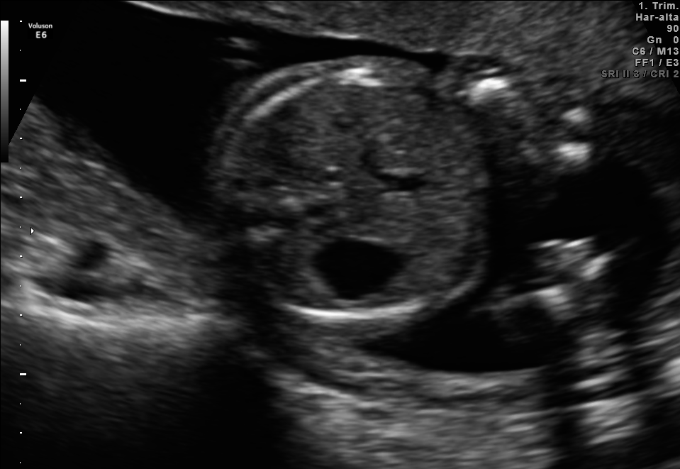

## 문제
A pregnant woman with gestational diabetes mellitus comes for a fetal growth ultrasound. She reports that her glucose has been poorly controlled despite diet therapy. Her blood pressure is 118/74 mm Hg. The fetal head and femur measurements are at the 50th percentile for gestational age. The biometric measurement obtained in the ultrasound plane shown is above the 97th percentile. This disproportion places the fetus at greatest risk for which of the following complications during vaginal delivery?

- A. Vasa previa rupture
- B. Shoulder dystocia
- C. Umbilical cord prolapse
- D. Placental abruption
- E. Breech presentation

_Fetal ultrasound still image; text at the upper right is machine settings — resized only (FETAL_PLANES_DB, Zenodo, CC BY 4.0) ※ The clinical scenario in the stem is an authoring assumption — the source dataset has no age or clinical history_

## 정답 및 해설
> 정답: B

- **정답 핵심**: The image is a <b>transverse section of the fetal abdomen</b>: a round trunk with an anechoic <b>stomach bubble</b>, homogeneous liver, and the echogenic spine — the plane used for <b>abdominal circumference (AC)</b>. An AC above the 97th percentile with a normal head and femur is the <b>asymmetric macrosomia</b> of maternal hyperglycemia: the trunk and shoulders are large relative to the head, so the head can deliver while the shoulders impact behind the pubic symphysis — <b>shoulder dystocia</b>.
- **원리**: <b>Why diabetes enlarges the trunk, not the head</b>: Maternal glucose crosses the placenta freely, but insulin does not. The fetal pancreas responds with hyperinsulinemia, and insulin is a growth hormone for insulin-sensitive tissues — fat, liver, and muscle. These are concentrated in the abdomen and shoulders, so the AC and shoulder width rise while head growth (driven mostly by genetics) stays near normal.  <b>Why that causes shoulder dystocia</b>: In a vaginal birth, the head is the largest part that must pass in a normally proportioned fetus. When the bisacromial diameter exceeds the head, the head delivers and then the anterior shoulder lodges behind the pubic symphysis — the risk of brachial plexus injury and hypoxia rises.  <b>Why AC is the plane that matters</b>: AC is the single measurement most sensitive to fetal nutrition, so it detects both growth restriction (small) and diabetic overgrowth (large) earliest.
- **비교**: <table><thead><tr><th style="width:24%">Feature</th><th style="width:38%">Shoulder dystocia (answer)</th><th>Umbilical cord prolapse (closest distractor)</th></tr></thead><tbody> <tr><td>Main risk factor</td><td><b>Macrosomia, especially diabetic (large AC)</b></td><td>Malpresentation, unengaged head, polyhydramnios</td></tr> <tr><td>Timing</td><td>After delivery of the head</td><td>After membrane rupture</td></tr> <tr><td>Mechanism</td><td>Anterior shoulder impacted behind symphysis</td><td>Cord passes ahead of presenting part</td></tr> </tbody></table> A large trunk relative to the head points to shoulder dystocia; a presenting part that does not fill the pelvis points to cord prolapse.
- **오답 이유**:
  - (A) Vasa previa rupture requires fetal vessels running across the internal os, seen on transvaginal color Doppler, independent of fetal size.
  - (C) Cord prolapse would be the main risk if the fetus were in a transverse or footling breech lie or the head were unengaged at membrane rupture.
  - (D) Placental abruption would be favored by hypertension, cocaine use, or abdominal trauma — not by a disproportionately large fetal abdomen.
  - (E) Breech presentation relates to prematurity, uterine anomalies, or placenta previa; fetal overgrowth of the trunk does not cause it.
- **함정**: Answering with a general diabetic-pregnancy complication instead of linking the specific measurement (abdominal circumference) to trunk-head disproportion.
- **제작 가정**: FETAL_PLANES_DB 는 표준 단면 분류만 있고 산모 나이·임신 주수·병력이 없다 — 임신성 당뇨병 임신부의 성장 초음파 상황을 가정했다(화면의 1. Trim. 은 기기 프리셋 이름이라 주수는 쓰지 않았다) (가정한 정보: A pregnant woman with gestational diabetes mellitus · her glucose has been poorly controlled despite diet therapy)
- **학습목표**: Identify the fetal abdominal transverse plane (stomach bubble, liver, spine) as the abdominal circumference plane and link a disproportionately large abdominal circumference in diabetic pregnancy to shoulder dystocia
- **근거·출처**: Loscalzo J, Fauci AS, Kasper DL, et al., eds. Harrison's Principles of Internal Medicine, 22nd ed. McGraw Hill; 2025. Chapter 491: Medical Disorders During Pregnancy · American College of Obstetricians and Gynecologists. Practice Bulletin No. 178: Shoulder Dystocia. Obstet Gynecol. 2017;129(5):e123-e133

## 출처
- FETAL_PLANES_DB (Zenodo 3904280, CC BY 4.0) · Patient01733_Plane2_1_of_1 · Creative Commons Attribution 4.0 International · https://creativecommons.org/licenses/by/4.0/
