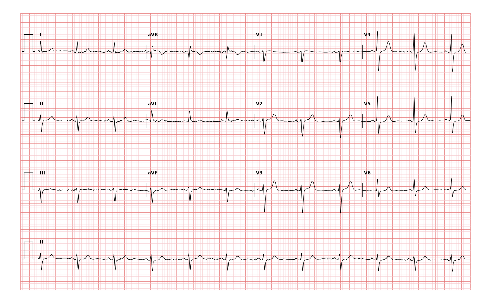

## 문제
68세 여자가 2시간 전부터 명치가 더부룩하고 불편해서 응급실에 왔다. 매운 음식을 먹은 뒤 시작되었고 지금은 많이 나아졌다. 고혈압과 이상지질혈증이 있다. 혈압 138/82 mmHg, 맥박 70회/분, 호흡 16회/분이다. 고감도 트로포닌 I 는 3시간 간격으로 2회 모두 참고치 이내이다. 흉부 X선은 정상이다. 12유도 심전도는 그림과 같다. 심전도 판독으로 가장 적절한 것은?

- A. 오래된 하벽 심근경색
- B. 좌후속지차단
- C. 완전좌각차단
- D. 급성 하벽 ST분절상승 심근경색
- E. 좌전속지차단

_12유도 심전도, 25 mm/s · 10 mm/mV, 3×4 + II 리듬 스트립 (PTB-XL ECG dataset, PhysioNet, CC BY 4.0 — 원신호 그대로 작도)_

## 정답 및 해설
> 정답: E

- **정답 핵심**: 리듬 스트립은 RR 이 일정한 <b>동리듬 약 70회/분</b>이고 QRS 는 좁다. <b>I·aVL 은 작은 q 뒤 큰 R(qR)</b>, <b>II·III·aVF 는 작은 r 뒤 깊은 S(rS)</b>라 QRS 축이 -45° 보다 왼쪽인 <b>좌축편위</b>다. 하벽 유도의 첫 굴절이 위로 향하는 r 이므로 병적 Q파가 아니고 ST 변화도 없다 — <b>좌전속지차단</b>이다. 트로포닌 2회 정상도 급성 경색 가능성을 낮춘다.
- **원리**: <b>좌각은 두 갈래다</b>: 좌각은 심실중격을 지나 앞위쪽으로 가는 가는 <b>좌전속지</b>와 뒤아래쪽으로 가는 굵은 좌후속지로 나뉜다. 좌전속지가 막히면 좌심실의 앞위쪽 벽이 늦게, 뒤아래쪽에서 시작한 흥분이 먼저 퍼진다.  <b>그래서 파형이 이렇게 된다</b>: 처음 흥분은 아래쪽(하벽 유도로 향함)이라 II·III·aVF 에 작은 r, I·aVL 에 작은 q 가 생긴다. 이어서 흥분이 위·왼쪽으로 크게 돌아가 하벽 유도에 깊은 S, I·aVL 에 큰 R 이 생긴다. 전체 축이 -45° 보다 왼쪽으로 기운다. 섬유 하나만 막혀 전도는 대부분 정상 경로로 가므로 QRS 는 0.12초 미만으로 좁다.  <b>임상 의미</b>: 단독 좌전속지차단은 대개 고혈압·노화에 따른 전도계 섬유화로 무증상이며 치료가 필요 없다. 우각차단과 함께 있으면(이섬유차단) 실신 여부를 묻고 추적한다.
- **비교**: <table><thead><tr><th style="width:24%">구분</th><th style="width:38%">좌전속지차단 — 정답</th><th>오래된 하벽 경색 — 가장 가까운 오답</th></tr></thead><tbody> <tr><td>II·III·aVF 첫 굴절</td><td><b>위로 향하는 작은 r</b> 뒤 깊은 S(rS)</td><td>아래로 향하는 넓은 Q(≥ 0.04초)</td></tr> <tr><td>I·aVL</td><td>qR</td><td>대개 정상, 하벽 경색의 거울상 없음(오래된 경우)</td></tr> <tr><td>축</td><td>-45° 보다 왼쪽</td><td>좌축일 수 있으나 Q파가 원인</td></tr> </tbody></table> 하벽 유도에서 음성 굴절을 보면 「맨 처음이 r 인가 Q 인가」부터 확인한다 — r 이면 전속지차단, Q 면 경색이다.
- **오답 이유**:
  - ① 오래된 하벽 심근경색은 II·III·aVF 의 첫 굴절이 0.04초 이상의 넓은 Q파였다면 정답이 된다 — 여기서는 작은 r 이 먼저 온다.
  - ② 좌후속지차단은 반대로 I·aVL 이 rS, II·III·aVF 가 qR 인 우축편위이고 우심실비대가 없을 때 정답이 된다.
  - ③ 완전좌각차단은 QRS 가 0.12초 이상으로 넓고 I·V6 에 넓게 갈라진 R, V1 에 깊은 QS 가 있다면 정답이 된다.
  - ④ 급성 하벽 ST분절상승 심근경색은 II·III·aVF 에서 ST 가 올라가고 I·aVL 에 거울상 하강이 있었다면 정답이 된다.
- **함정**: 명치 통증이라는 증상과 하벽 유도의 큰 음성 파형만 보고 하벽 경색을 고르는 것 — 첫 굴절은 r 이다.
- **학습목표**: II·III·aVF 의 작은 r 뒤 깊은 S(rS)와 I·aVL 의 qR, 좁은 QRS 를 좌전속지차단으로 판독하고 병적 Q파의 하벽 경색과 가른다
- **근거·출처**: Loscalzo J, Fauci AS, Kasper DL, et al., eds. Harrison's Principles of Internal Medicine, 22nd ed. McGraw Hill; 2025. Chapter 247: Electrocardiography

## 출처
- PTB-XL ECG dataset v1.0.3 (PhysioNet, CC BY 4.0) · record 7618 · Creative Commons Attribution 4.0 International · https://physionet.org/content/ptb-xl/1.0.3/LICENSE.txt
