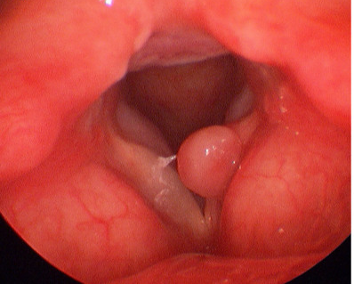

## 문제
64세 여자가 2개월 전부터 목소리가 쉬어서 왔다. 2개월 전 전신마취로 수술을 받았고 기관삽관은 5시간 유지되었다. 숨이 차거나 음식을 삼키기 어렵지는 않다. 흡연하지 않으며 목에 만져지는 덩이는 없다. 가끔 가슴이 쓰리다고 한다. 굴곡형 후두내시경 사진은 그림과 같고 양쪽 성대는 정상적으로 움직인다. 가장 적절한 초기 치료는?

- A. 방사선치료
- B. 기관절개술
- C. 성대 주입술
- D. 양성자펌프억제제 투여와 음성 휴식
- E. 후두미세수술로 즉시 절제

_굴곡형 후두내시경 정지 영상 — 학술지 그림의 한 패널, 패널 문자만 잘라냄 (PMC Open Access, CC BY)_

## 정답 및 해설
> 정답: D

- **정답 핵심**: 후두내시경에서 <b>한쪽 성대 뒤쪽(성대돌기 부위)</b>에 표면이 매끈하고 둥근 붉은 종괴가 있고 성대 앞쪽 막성부는 매끈하다. <b>기관삽관 2개월 뒤</b> 생긴 쉰 목소리, 비흡연, 정상 성대 운동과 함께 보면 <b>삽관 후 육아종</b>이다. 기도 폐쇄가 없으므로 첫 치료는 <b>역류 치료(양성자펌프억제제)와 음성 휴식</b>이다 — 절제는 재발이 잦아 보존 치료에 반응하지 않거나 기도를 막을 때 한다.
- **원리**: <b>왜 성대 뒤쪽인가</b>: 성대의 뒤 1/3 은 피부처럼 얇은 점막 아래 바로 피열연골의 성대돌기가 있다. 기관 튜브는 성문의 가장 넓은 뒤쪽에 놓이므로 이 부위 점막이 연골에 눌려 궤양이 생기고, 궤양이 낫는 과정에서 육아조직이 과하게 자란다. 반대로 노래·고함으로 생기는 결절·폴립은 진동이 가장 큰 막성부 앞·중 1/3 경계에 생긴다.  <b>왜 역류 치료인가</b>: 위산 역류는 후두 뒤쪽(피열 부위)을 계속 자극해 궤양이 아물지 못하게 한다. 양성자펌프억제제로 산 노출을 줄이고, 헛기침·큰 목소리를 줄이면 상당수가 수개월에 걸쳐 작아진다.  <b>왜 바로 자르지 않는가</b>: 원인(접촉·역류)이 남은 채 절제하면 같은 자리에 다시 자란다. 기도를 막을 정도이거나 보존 치료에 실패하면 절제와 보툴리눔 독소 주입 등을 고려한다.
- **비교**: <table><thead><tr><th style="width:24%">구분</th><th style="width:38%">삽관 후 육아종 — 정답</th><th>성대 폴립 — 가장 가까운 오답(즉시 절제를 떠올림)</th></tr></thead><tbody> <tr><td>위치</td><td><b>성대 뒤 1/3(성대돌기)</b></td><td>막성부 앞·중 1/3 경계 자유연</td></tr> <tr><td>원인</td><td>삽관 압박·위산 역류</td><td>목소리 남용·흡연</td></tr> <tr><td>첫 치료</td><td>양성자펌프억제제·음성 휴식</td><td>음성 치료 뒤 후두미세수술</td></tr> </tbody></table> 종괴의 「자리」가 원인을 말해 준다 — 연골 위(뒤쪽)면 접촉·역류, 진동하는 막성부(앞쪽)면 음성 남용이다.
- **오답 이유**:
  - ① 방사선치료는 생검에서 성문암(편평세포암)이 확인된 조기 병변이라면 정답이 될 수 있다 — 매끈한 둥근 종괴는 암의 모습이 아니다.
  - ② 기관절개술은 종괴가 성문을 막아 상기도 폐쇄로 호흡곤란이 진행할 때 응급으로 필요하다.
  - ③ 성대 주입술은 한쪽 성대가 움직이지 않는 성대마비로 성문이 닫히지 않을 때 정답이 된다 — 여기서는 양쪽이 잘 움직인다.
  - ⑤ 후두미세수술로 즉시 절제는 육아종이 성문을 거의 막아 숨이 차거나 수개월의 보존 치료에도 커질 때 고려한다.
- **함정**: 성대 종괴를 보면 바로 절제부터 떠올리는 것 — 삽관 후 육아종은 재발이 잦아 보존 치료가 먼저다.
- **학습목표**: 기관삽관 뒤 성대 뒤쪽(성대돌기)의 매끈한 둥근 종괴를 삽관 후 육아종으로 판단하고, 첫 치료로 즉시 절제가 아니라 역류 치료와 음성 휴식을 고른다
- **근거·출처**: Loscalzo J, Fauci AS, Kasper DL, et al., eds. Harrison's Principles of Internal Medicine, 22nd ed. McGraw Hill; 2025. Chapter 37: Upper Respiratory Symptoms, Including Earache, Sinus Symptoms, and Sore Throat · Karkos PD, George M, Van Der Veen J, et al. Vocal process granulomas: a systematic review of treatment. Ann Otol Rhinol Laryngol. 2014;123(5):314-320

## 출처
- Successful awake video-laryngoscopic intubation in a patient with a giant mobile vocal process granuloma causing dynamic glottic obstruction: A case report. Medicine (Baltimore). 2025 Dec 12;104(50):e46656. doi: 10.1097/MD.0000000000046656 (CC BY) — Figure 1. · CC BY · https://creativecommons.org/licenses/
