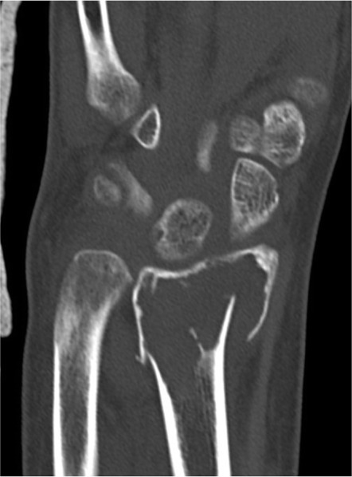

## 문제
A 32-year-old woman comes to the emergency department because of right wrist pain and swelling after falling onto her outstretched hand. She reports a dull ache in the same wrist for the past 3 months that was worse at night. She has no fever or weight loss. Examination shows swelling and tenderness over the distal radius. Serum calcium and alkaline phosphatase concentrations are within the reference ranges. A coronal CT scan of the right wrist is shown. Which of the following is the most likely diagnosis?

- A. Chondroblastoma
- B. Giant cell tumor of bone
- C. Aneurysmal bone cyst
- D. Unicameral bone cyst
- E. Osteosarcoma

_Coronal CT of the right wrist, bone window — one panel cropped from a published figure, no other change (PMC Open Access, CC BY)_

## 정답 및 해설
> 정답: B

- **정답 핵심**: The CT shows an <b>expansile, purely lytic lesion of the distal radius</b> with a thinned, eggshell-like cortex that is broken (pathologic fracture). It occupies the metaphysis and <b>extends to the subchondral bone beneath the articular surface</b>, without matrix mineralization. In a <b>skeletally mature 32-year-old</b> with months of pain, an epiphyseal-metaphyseal lytic lesion reaching the joint surface at the distal radius — a classic site — is <b>giant cell tumor of bone</b>.
- **원리**: <b>Why location and age decide</b>: Bone tumors sort by where they start. Giant cell tumor arises in the metaphysis after the growth plate closes and spreads into the epiphysis up to the subchondral bone — so it occurs at 20–40 years and abuts the joint. Its favorite sites are the distal femur, proximal tibia, and distal radius.  <b>Why it is lytic and expansile</b>: Neoplastic mononuclear stromal cells (driven by an H3F3A mutation) overexpress RANKL, which recruits osteoclast-like giant cells that resorb bone. The lesion therefore has no matrix, destroys trabeculae, and thins the cortex until it breaks — pathologic fracture is a common presentation.  <b>Why it matters</b>: It is locally aggressive and can recur or rarely metastasize to the lung; treatment is curettage with adjuvants, and denosumab (a RANKL antibody) is used for unresectable or difficult lesions — a direct application of its mechanism.
- **비교**: <table><thead><tr><th style="width:24%">Feature</th><th style="width:38%">Giant cell tumor (answer)</th><th>Aneurysmal bone cyst (closest distractor)</th></tr></thead><tbody> <tr><td>Age / physis</td><td><b>20–40 y, physis closed</b></td><td>Usually < 20 y, physis open</td></tr> <tr><td>Location</td><td><b>Epiphysis-metaphysis, to subchondral bone</b></td><td>Metaphysis, usually spares the epiphysis</td></tr> <tr><td>Imaging</td><td>Lytic, no sclerotic rim, no fluid levels</td><td>Blown-out cyst with fluid-fluid levels</td></tr> </tbody></table> A lytic lesion that touches the joint in an adult points to giant cell tumor; a blown-out metaphyseal cyst with fluid levels in a teenager points to aneurysmal bone cyst.
- **오답 이유**:
  - (A) Chondroblastoma would fit a lesion confined to the epiphysis in a patient with open physes, often with chondroid calcification and a sclerotic rim.
  - (C) Aneurysmal bone cyst would fit an adolescent with open physes and a metaphyseal, blown-out lesion with fluid-fluid levels sparing the epiphysis.
  - (D) Unicameral bone cyst would fit a child with a central metaphyseal cyst of the proximal humerus or femur and a fallen fragment sign.
  - (E) Osteosarcoma would fit an adolescent with a metaphyseal lesion producing cloud-like osteoid matrix, a Codman triangle, and a soft-tissue mass.
- **함정**: Choosing aneurysmal bone cyst because the lesion is expansile — age, closed physis, and extension to the subchondral bone favor giant cell tumor.
- **학습목표**: Recognize an expansile lytic lesion of the distal radius that extends from the metaphysis to the subchondral bone in a skeletally mature adult, with a pathologic fracture, as giant cell tumor of bone
- **근거·출처**: Loscalzo J, Fauci AS, Kasper DL, et al., eds. Harrison's Principles of Internal Medicine, 22nd ed. McGraw Hill; 2025. Chapter 96: Soft Tissue and Bone Sarcomas and Bone Metastases · WHO Classification of Tumours Editorial Board. Soft Tissue and Bone Tumours. 5th ed. IARC; 2020

## 출처
- The use of denosumab in the setting of acute pathological fracture through giant cell tumour of bone. World J Surg Oncol. 2021 Feb 2;19:37. doi: 10.1186/s12957-021-02143-3 (CC BY) — Fig. 1 · CC BY · https://creativecommons.org/licenses/
