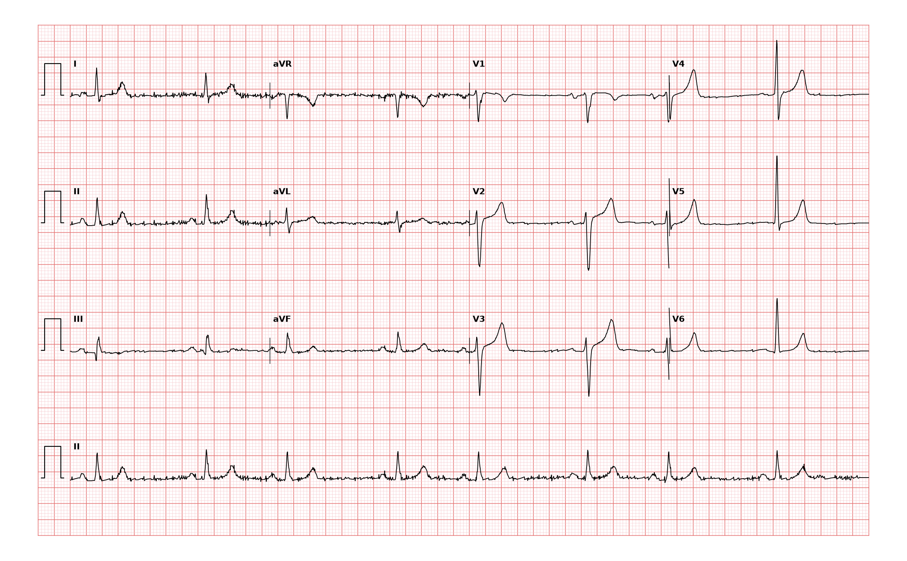

## 문제
66세 남자가 건강검진에서 맥박이 불규칙하다는 말을 듣고 왔다. 가끔 가슴이 한 번씩 덜컥 내려앉는 느낌이 있으나 어지럼이나 실신은 없다. 커피를 하루 4잔 마신다. 고혈압으로 약을 먹고 있으며 베타차단제나 디곡신은 먹지 않는다. 혈압 134/80 mmHg 이고 맥박은 둘씩 짝지어 뛴다. 혈청 칼륨 4.1 mEq/L, 갑상샘자극호르몬은 참고치 이내이다. 12유도 심전도는 그림과 같다. 심전도 판독으로 가장 적절한 것은?

- A. 모비츠 II형 방실차단
- B. 심방세동
- C. 심방조기수축 이단맥
- D. 심실조기수축 이단맥
- E. 모비츠 I형 방실차단

_12유도 심전도, 25 mm/s · 10 mm/mV, 3×4 + II 리듬 스트립 (PTB-XL ECG dataset, PhysioNet, CC BY 4.0 — 원신호 그대로 작도)_

## 정답 및 해설
> 정답: C

- **정답 핵심**: 리듬 스트립(II)에서 <b>좁은 QRS 가 둘씩 묶여</b> RR 이 약 1.0초(짧음)와 약 1.36초(긺)로 <b>번갈아</b> 반복된다. 짧은 간격 뒤의 박동도 <b>앞에 P파가 있고 QRS 모양이 같다</b> — 심방에서 일찍 생긴 박동이 정상 경로로 전도된 것이다. 긴 휴지 안에 <b>전도되지 않은 P파가 없어</b> 방실차단의 그룹 박동이 아니다. 정상 박동과 조기 박동이 1:1 로 번갈아 오므로 <b>심방조기수축 이단맥</b>이다.
- **원리**: <b>왜 둘씩 묶이는가</b>: 동결절 박동 하나마다 심방의 다른 곳(이소성 초점)에서 일찍 박동이 하나 생기면, 「정상 → 조기 → 휴지 → 정상 → 조기」가 반복되어 맥이 둘씩 짝지어 뛴다(이단맥). 조기 박동은 심방에서 생겼으므로 방실결절·히스-푸르키니에계를 정상으로 지나 QRS 가 좁고 정상 박동과 모양이 같다. 그 앞의 P파는 이소성 초점에서 생겨 정상 P 와 모양이 조금 다르다.  <b>왜 휴지가 따르는가</b>: 조기 심방 박동이 동결절로 거꾸로 들어가 동결절을 「재설정」하므로, 다음 동박동은 그 시점부터 한 주기 뒤에 온다. 그래서 대개 비보상 휴지가 생긴다.  <b>임상 의미</b>: 심방조기수축은 카페인·음주·스트레스·갑상샘항진증에서 흔하고 대개 양성이다. 원인을 줄이고, 증상이 심하면 베타차단제를 쓴다. 자주 나오면 나중에 심방세동이 생길 위험이 조금 높다.
- **비교**: <table><thead><tr><th style="width:24%">구분</th><th style="width:38%">심방조기수축 이단맥 — 정답</th><th>모비츠 I형 3:2 — 가장 가까운 오답</th></tr></thead><tbody> <tr><td>긴 휴지 안</td><td><b>P파 없음</b></td><td>전도되지 않은 P 가 하나 있다</td></tr> <tr><td>P-P 간격</td><td>조기 P 가 일찍 와서 불규칙</td><td>P-P 는 규칙적</td></tr> <tr><td>PR 간격</td><td>대체로 비슷</td><td>둘째 박동에서 길어진다</td></tr> </tbody></table> 그룹 박동을 보면 「긴 휴지 안에 숨은 P 가 있는가」부터 찾는다 — 있으면 방실차단, 없고 짧은 쪽 박동 앞 P 가 일찍 오면 조기수축이다.
- **오답 이유**:
  - ① 모비츠 II형은 PR 이 일정하다가 예고 없이 P 뒤 QRS 가 빠지고 그 P 가 휴지 안에 보였다면 정답이 된다.
  - ② 심방세동은 P파가 없고 RR 이 짝지은 규칙 없이 완전히 불규칙하게 변했다면 정답이 된다.
  - ④ 심실조기수축 이단맥은 짧은 간격 뒤 박동이 앞선 P파 없이 넓고(≥ 0.12초) 이상한 모양의 QRS 였다면 정답이 된다.
  - ⑤ 모비츠 I형은 P-P 가 규칙적이고 PR 이 점점 길어지다 긴 휴지 안에 전도되지 않은 P 가 하나 보였다면 정답이 된다.
- **함정**: 둘씩 묶인 박동을 보고 그룹 박동 = 웬케바흐로 판단하는 것 — 휴지 안에 숨은 P 가 없다.
- **학습목표**: 좁은 QRS 가 둘씩 묶여 짧은·긴 RR 이 번갈아 반복되고 모든 QRS 앞에 P 가 있으며 긴 휴지에 전도되지 않은 P 가 없으면 심방조기수축 이단맥으로 판독하고 모비츠 I형 3:2 전도와 가른다
- **근거·출처**: Loscalzo J, Fauci AS, Kasper DL, et al., eds. Harrison's Principles of Internal Medicine, 22nd ed. McGraw Hill; 2025. Chapter 253: Approach to Supraventricular Arrhythmias · Loscalzo J, Fauci AS, Kasper DL, et al., eds. Harrison's Principles of Internal Medicine, 22nd ed. McGraw Hill; 2025. Chapter 247: Electrocardiography · Wagner P, Strodthoff N, Bousseljot RD, et al. PTB-XL, a large publicly available electrocardiography dataset. Sci Data. 2020;7:154

## 출처
- PTB-XL ECG dataset v1.0.3 (PhysioNet, CC BY 4.0) · record 4262 · Creative Commons Attribution 4.0 International · https://physionet.org/content/ptb-xl/1.0.3/LICENSE.txt
