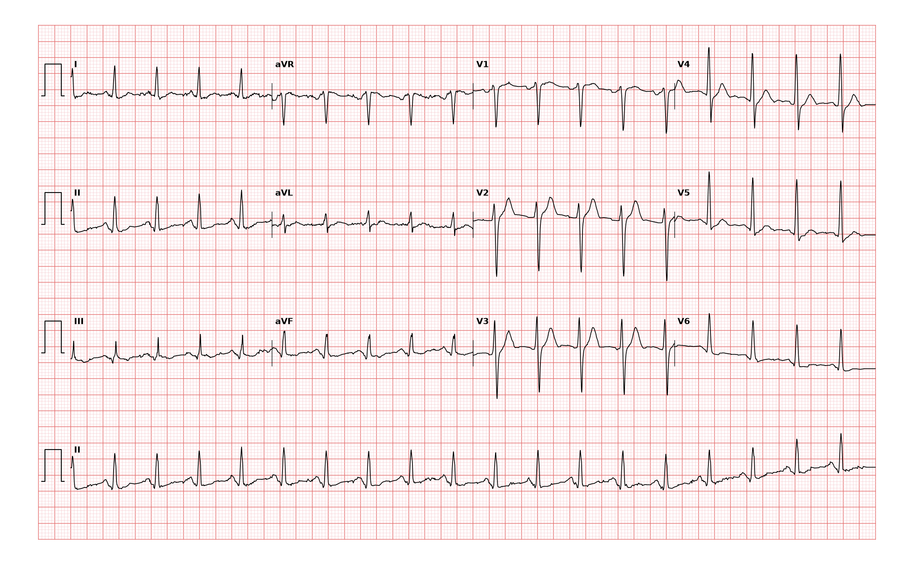

## 문제
40세 남자가 3일 전부터 하루 8~10번 물설사를 하고 일어설 때 어지러워 응급실에 왔다. 구토는 없고 열도 없다. 소변량이 줄었다. 누운 자세 혈압 108/68 mmHg, 맥박 112회/분이고, 일어서면 혈압 88/56 mmHg, 맥박 136회/분이다. 입안 점막이 말라 있다. 혈액요소질소 38 mg/dL, 크레아티닌 1.4 mg/dL, 칼륨 3.6 mEq/L, 혈청 나트륨 138 mEq/L 이다. 12유도 심전도는 그림과 같다. 다음 처치로 가장 적절한 것은?

- A. 경구 메토프롤롤 투여
- B. 생리식염수 급속 정맥 주입
- C. 아데노신 급속 정맥 주사
- D. 정맥 딜티아젬 투여
- E. 동기화 심장율동전환

_12유도 심전도, 25 mm/s · 10 mm/mV, 3×4 + II 리듬 스트립 (PTB-XL ECG dataset, PhysioNet, CC BY 4.0 — 원신호 그대로 작도)_

## 정답 및 해설
> 정답: B

- **정답 핵심**: 리듬 스트립에서 RR 이 약 0.53초로 일정한 <b>약 113회/분의 규칙적인 좁은 QRS 빈맥</b>이고, <b>모든 QRS 앞에 II 에서 양성인 P파가 일정한 PR</b> 로 온다 — <b>동빈맥</b>이다. 3일간의 물설사, 기립성 저혈압과 맥박 증가, 마른 점막, BUN/크레아티닌 비 상승은 <b>저혈량</b>이 원인임을 말한다. 동빈맥은 원인에 대한 보상 반응이므로 <b>수액으로 혈관 내 용적을 채우는 것</b>이 치료다.
- **원리**: <b>동빈맥은 「결과」다</b>: 순환 혈액량이 줄면 1회 박출량이 떨어지고, 압수용체가 이를 감지해 교감신경을 올려 동결절의 4기 탈분극을 빠르게 한다. 심박출량 = 1회 박출량 × 심박수이므로 빨라진 심박은 떨어진 박출량을 메우는 보상이다. 그래서 심박수를 약으로 억누르면 보상이 사라져 혈압이 더 떨어진다.  <b>심전도로 동빈맥을 확인하는 법</b>: P파가 II·III·aVF 에서 양성(동결절에서 아래로 내려가는 탈분극)이고 매 QRS 앞에 일정한 PR 로 오며, 박동수가 서서히 오르내린다. 갑자기 시작하고 끝나는 약 150회/분 이상의 규칙적 빈맥에서 P 가 안 보이면 상심실빈맥을 떠올린다.  <b>치료 원칙</b>: 원인(저혈량·발열·통증·빈혈·저산소증·갑상샘항진증·폐색전증)을 찾아 고친다. 여기서는 등장성 수액 급속 주입 뒤 기립성 활력징후·소변량·신기능을 다시 본다.
- **비교**: <table><thead><tr><th style="width:24%">구분</th><th style="width:38%">동빈맥 → 수액 — 정답</th><th>상심실빈맥 → 아데노신 — 가장 가까운 오답</th></tr></thead><tbody> <tr><td>P파</td><td><b>매 QRS 앞 II 양성 P</b>, PR 일정</td><td>보이지 않거나 QRS 바로 뒤 역행 P</td></tr> <tr><td>박동수</td><td>100~140회/분, 원인 따라 오르내림(기립 시 136)</td><td>대개 150~220회/분, 고정</td></tr> <tr><td>시작</td><td>서서히, 원인과 함께</td><td>갑자기 시작·끝</td></tr> </tbody></table> 누워서 112, 일어서서 136 처럼 상황에 따라 박동수가 변하면 동빈맥 — 원인을 고친다.
- **오답 이유**:
  - ① 메토프롤롤은 갑상샘항진증의 증상 조절이나 부적절 동빈맥에서 고려하며, 보상성 동빈맥을 누르면 쇼크가 깊어진다.
  - ③ 아데노신은 P파가 보이지 않는 갑자기 시작한 150회/분 이상의 고정된 좁은 QRS 빈맥(발작성 상심실빈맥)이었다면 정답이 된다.
  - ④ 정맥 딜티아젬은 혈압이 유지되는 빠른 심실 반응의 심방세동·조동에서 심박수 조절에 쓴다 — 저혈량에서는 혈압을 더 떨어뜨린다.
  - ⑤ 동기화 심장율동전환은 불안정한 상심실빈맥·심방조동처럼 재진입 빈맥일 때 쓴다 — 동빈맥에는 효과가 없다.
- **함정**: 빠른 맥을 보자마자 박동수를 낮추는 약을 고르는 것 — 동빈맥은 원인 교정이 치료다.
- **학습목표**: 매 QRS 앞에 II 양성 P 가 일정한 PR 로 오는 약 110회/분의 규칙적 빈맥을 동빈맥으로 판독하고, 설사로 인한 저혈량이 원인이면 수액으로 원인을 교정한다
- **근거·출처**: Loscalzo J, Fauci AS, Kasper DL, et al., eds. Harrison's Principles of Internal Medicine, 22nd ed. McGraw Hill; 2025. Chapter 254: Physiologic and Nonphysiologic Sinus Rhythm · Loscalzo J, Fauci AS, Kasper DL, et al., eds. Harrison's Principles of Internal Medicine, 22nd ed. McGraw Hill; 2025. Chapter 56: Fluid and Electrolyte Disturbances · Wagner P, Strodthoff N, Bousseljot RD, et al. PTB-XL, a large publicly available electrocardiography dataset. Sci Data. 2020;7:154

## 출처
- PTB-XL ECG dataset v1.0.3 (PhysioNet, CC BY 4.0) · record 17882 · Creative Commons Attribution 4.0 International · https://physionet.org/content/ptb-xl/1.0.3/LICENSE.txt
