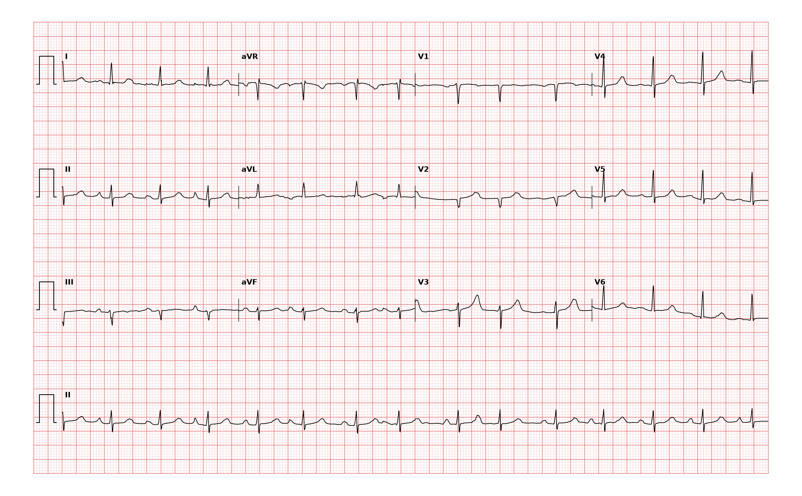

## 문제
A 70-year-old woman comes to the physician because of shortness of breath on exertion for 2 months. One year ago, she had severe chest pressure for several hours that she attributed to indigestion and did not seek care. She has hypertension and type 2 diabetes mellitus. Pulse is 84/min and regular, and blood pressure is 128/76 mm Hg. Lungs are clear. Serum troponin concentration is within the reference range. A 12-lead ECG is shown. Echocardiography is most likely to show hypokinesis of which of the following regions of the left ventricle?

- A. Anterior wall and interventricular septum
- B. Inferior wall
- C. Lateral wall
- D. Posterior wall
- E. Right ventricular free wall

_12-lead ECG, 25 mm/s, 10 mm/mV, 3×4 + lead II rhythm strip (PTB-XL, PhysioNet, CC BY 4.0; raw signal, no filtering)_

## 정답 및 해설
> 정답: A

- **정답 핵심**: The rhythm is <b>sinus at about 85/min</b> with narrow QRS complexes. <b>V1 is a QS complex and V2 has only a tiny r wave</b>, so the R wave fails to grow across the precordium (<b>poor R-wave progression</b>), and there is <b>no ST elevation</b>. With a history of a prolonged chest-pain episode a year ago, normal troponin, and new exertional dyspnea, this is an <b>old anteroseptal infarction</b>; V1–V2 face the septum and anterior wall, so echocardiography should show <b>anterior wall and septal hypokinesis</b>.
- **원리**: <b>Why the R wave disappears</b>: Normally the initial septal depolarization moves left to right and toward V1–V2, producing a small r wave that grows across V3–V4 as more left ventricular muscle lies under the electrodes. Infarcted, scarred myocardium generates no electrical force, so the electrode over it sees only depolarization moving away — a QS complex — and R-wave growth is lost.  <b>Why it maps to the anterior wall and septum</b>: V1–V2 overlie the interventricular septum and V3–V4 the anterior wall, both supplied by the left anterior descending artery and its septal and diagonal branches. Scar in that territory does not contract, so echocardiography shows hypokinesis or akinesis there.  <b>Why the ST segment matters</b>: Acute transmural injury lifts the ST segment; once the scar matures, ST returns to baseline while Q waves persist. Persistent ST elevation weeks later suggests a ventricular aneurysm.
- **비교**: <table><thead><tr><th style="width:24%">Feature</th><th style="width:38%">Anterior wall and septum (answer)</th><th>Inferior wall (closest distractor)</th></tr></thead><tbody> <tr><td>Leads with Q/QS</td><td><b>V1–V3(V4)</b></td><td>II, III, aVF</td></tr> <tr><td>Usual artery</td><td>Left anterior descending</td><td>Right coronary (most)</td></tr> <tr><td>Here</td><td>V1 QS, tiny r in V2, poor R progression</td><td>II, III, aVF begin with an r wave</td></tr> </tbody></table> Translate leads to walls: V1–V4 anterior/septal, II/III/aVF inferior, I/aVL/V5–V6 lateral, tall R in V1–V2 posterior.
- **오답 이유**:
  - (B) The inferior wall would be expected if pathologic Q waves appeared in II, III, and aVF rather than in the anterior precordial leads.
  - (C) The lateral wall would be expected if Q waves or lost R waves appeared in I, aVL, V5, and V6 from circumflex disease.
  - (D) The posterior wall would be expected with tall, broad R waves and ST depression in V1–V2, the mirror image of posterior Q waves.
  - (E) The right ventricular free wall would be expected with an inferior infarction plus ST elevation in right-sided lead V4R.
- **함정**: Focusing on the risk factors and dyspnea rather than localizing the QS complexes — the lead groups, not the symptoms, define the wall.
- **학습목표**: Read QS complexes in V1-V2 with poor R-wave progression and no ST elevation as an old anteroseptal infarction and predict anterior-septal wall motion abnormality on echocardiography
- **근거·출처**: Loscalzo J, Fauci AS, Kasper DL, et al., eds. Harrison's Principles of Internal Medicine, 22nd ed. McGraw Hill; 2025. Chapter 247: Electrocardiography · Loscalzo J, Fauci AS, Kasper DL, et al., eds. Harrison's Principles of Internal Medicine, 22nd ed. McGraw Hill; 2025. Chapter 286: ST-Segment Elevation Myocardial Infarction · Wagner P, Strodthoff N, Bousseljot RD, et al. PTB-XL, a large publicly available electrocardiography dataset. Sci Data. 2020;7:154

## 출처
- PTB-XL ECG dataset v1.0.3 (PhysioNet, CC BY 4.0) · record 4946 · Creative Commons Attribution 4.0 International · https://physionet.org/content/ptb-xl/1.0.3/LICENSE.txt
