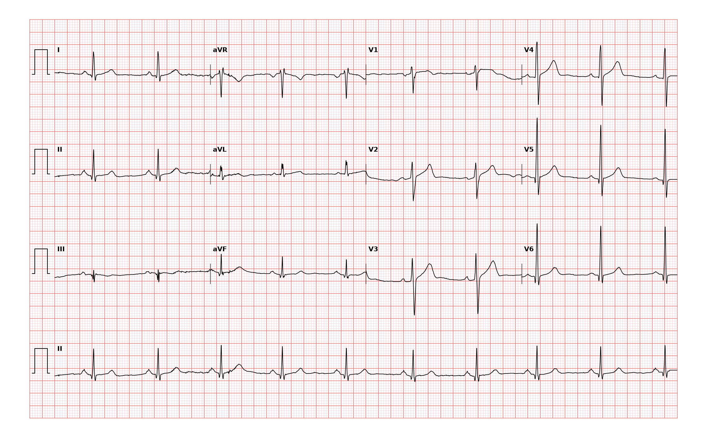

## 문제
A 47-year-old man comes to the office because of 3 months of substernal chest pressure that occurs when he walks uphill and resolves within 5 minutes of rest. He has never had pain at rest. He smokes one pack of cigarettes daily and has hyperlipidemia. He walks 5 km several times a week without limitation in his legs. His blood pressure is 128/80 mm Hg and pulse is 60/min. Heart and lung examinations show no abnormalities. Serum troponin is within the reference range. A 12-lead ECG obtained at rest is shown. Which of the following is the most appropriate next step in diagnosis?

- A. Upper gastrointestinal endoscopy
- B. Exercise treadmill ECG testing
- C. Adenosine myocardial perfusion imaging
- D. Invasive coronary angiography
- E. 24-hour ambulatory ECG monitoring

_12-lead ECG, 25 mm/s, 10 mm/mV, 3×4 + lead II rhythm strip (PTB-XL, PhysioNet, CC BY 4.0; raw signal, no filtering)_

## 정답 및 해설
> 정답: B

- **정답 핵심**: The resting ECG shows <b>sinus rhythm at about 60/min with normal PR, QRS, and QT intervals, a normal axis, and no ST-segment or T-wave abnormality</b> — a normal, <b>interpretable baseline</b>. His exertional pressure relieved by rest is typical angina with an intermediate pretest probability. Because he <b>can exercise</b> and the baseline ST segments can be read during stress, an <b>exercise ECG test</b> is the appropriate first functional test.
- **원리**: <b>Why the resting ECG decides the type of stress test</b>: Exercise testing detects ischemia as new horizontal or downsloping ST depression during exertion. That signal can only be read if the ST segment is normal at rest. Left bundle branch block, ventricular pacing, pre-excitation, digoxin effect, or ≥ 1 mm baseline ST depression already distort the ST segment, so an imaging test must be added (perfusion imaging or echocardiography).  <b>Why the ability to exercise matters</b>: Exercise reproduces the patient's own symptoms and gives prognostic data (exercise capacity, blood pressure and heart rate response). Pharmacologic stress with adenosine or dobutamine is reserved for patients who cannot reach an adequate workload.  <b>Why not go straight to angiography</b>: Invasive angiography is for high-risk features — rest pain, heart failure, or high-risk stress results. A stable patient with normal troponin is first stratified noninvasively.
- **비교**: <table><thead><tr><th style="width:24%">Feature</th><th style="width:38%">Exercise ECG (answer)</th><th>Adenosine perfusion imaging (closest distractor)</th></tr></thead><tbody> <tr><td>Resting ECG</td><td><b>Normal, interpretable ST segment</b></td><td>LBBB, paced rhythm, baseline ST changes</td></tr> <tr><td>Exercise capacity</td><td><b>Can exercise adequately</b></td><td>Cannot exercise (arthritis, deconditioning)</td></tr> <tr><td>Ischemia signal</td><td>ST depression with exertion</td><td>Perfusion defect on imaging</td></tr> </tbody></table> Two questions pick the test: can the patient exercise, and can the resting ST segment be read? Yes to both means exercise ECG; no to either means add imaging or use pharmacologic stress.
- **오답 이유**:
  - (A) Upper endoscopy would be considered for burning pain related to meals or recumbency rather than pain triggered by walking uphill.
  - (C) Adenosine perfusion imaging would be chosen if he could not exercise or if his resting ECG showed LBBB or a paced rhythm.
  - (D) Invasive coronary angiography would be next if he had rest angina, heart failure, or a high-risk result on noninvasive testing.
  - (E) Ambulatory ECG monitoring suits intermittent palpitations or syncope, not exertional chest pressure that is reproducible with effort.
- **함정**: Assuming a normal resting ECG rules out coronary disease — most patients with stable angina have a normal ECG at rest.
- **학습목표**: Choose exercise ECG testing for suspected stable angina when the resting ECG is interpretable and the patient can exercise, and distinguish it from pharmacologic stress imaging
- **근거·출처**: Loscalzo J, Fauci AS, Kasper DL, et al., eds. Harrison's Principles of Internal Medicine, 22nd ed. McGraw Hill; 2025. Chapter 284: Ischemic Heart Disease · Loscalzo J, Fauci AS, Kasper DL, et al., eds. Harrison's Principles of Internal Medicine, 22nd ed. McGraw Hill; 2025. Chapter 247: Electrocardiography · Gulati M, Levy PD, Mukherjee D, et al. 2021 AHA/ACC/ASE/CHEST/SAEM/SCCT/SCMR Guideline for the Evaluation and Diagnosis of Chest Pain. Circulation. 2021;144(22):e368-e454

## 출처
- PTB-XL ECG dataset v1.0.3 (PhysioNet, CC BY 4.0) · record 2975 · Creative Commons Attribution 4.0 International · https://physionet.org/content/ptb-xl/1.0.3/LICENSE.txt
