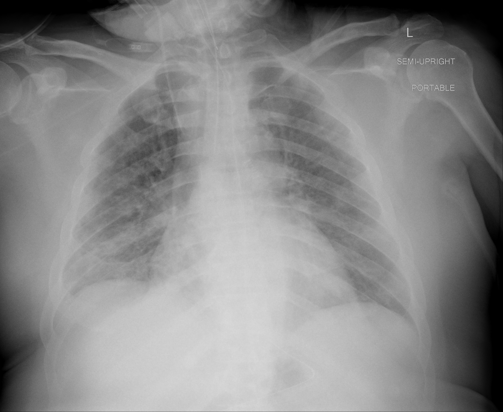

## 문제
55세 남자가 코로나바이러스감염증-19 확진 6일째에 숨찬 것이 급격히 심해져 응급실에 왔다. 고유량 산소에도 산소포화도가 85 % 로 떨어져 기관 삽관 후 기계환기를 시작하였다. 심부전이나 판막질환의 병력은 없다. 환기 설정은 PEEP 10 cmH2O, 흡입산소분율 0.6 이고, 이때 동맥혈 산소분압은 90 mmHg 이다. 심초음파에서 좌심실 박출률은 60 % 이고 좌심방 확장은 없다. 삽관 후 촬영한 흉부 X선 사진은 그림과 같다. 이 환자의 상태로 가장 적절한 것은?

- A. 경도 급성호흡곤란증후군
- B. 중증 급성호흡곤란증후군
- C. 심인성 폐부종
- D. 양쪽 대량 흉막삼출
- E. 중등도 급성호흡곤란증후군

_이동식 반좌위 흉부 전후면 X선, L·SEMI-UPRIGHT·PORTABLE 표지는 원본의 것, 크기 조정만 (The Cancer Imaging Archive, CC BY 4.0 — 크롭·창 조절 없음)_

## 정답 및 해설
> 정답: E

- **정답 핵심**: 흉부 X선은 기관내관·비위관·중심정맥관과 함께 <b>양쪽 폐문 주위·하폐야 우세의 미만성 간유리·경화 음영</b>을 보이고 큰 흉수는 없다. 발병 1주 이내, 양쪽 음영, <b>좌심실 기능 정상</b>(심인성으로 설명되지 않음)이므로 급성호흡곤란증후군이다. PEEP 10 cmH2O 에서 <b>PaO2/FiO2 = 90/0.6 = 150</b> 으로 100 초과 200 이하라 <b>중등도</b>다.
- **원리**: <b>베를린 정의의 네 조건</b>: ① 원인 손상이나 새 호흡기 증상 뒤 1주 이내 ② 흉부 영상에서 흉수·무기폐·결절로 다 설명되지 않는 양쪽 음영 ③ 심부전·수액 과다로 다 설명되지 않는 호흡부전(위험 인자가 없으면 심초음파로 확인) ④ PEEP(또는 CPAP) 5 cmH2O 이상에서 측정한 산소화 장애.  <b>왜 PEEP 조건이 붙는가</b>: 같은 폐라도 PEEP 를 높이면 닫힌 폐포가 열려 PaO2 가 오른다. 조건 없이 비를 재면 환기 설정에 따라 중증도가 들쭉날쭉해진다 — 그래서 최소 PEEP 를 정해 두고 비를 잰다.  <b>중증도의 의미</b>: 경도 200~300, 중등도 100~200, 중증 100 이하. 중증도가 높을수록 사망률이 높고, 중증에서는 복와위 환기·근이완제 같은 추가 치료를 고려한다. 기본 치료(예측 체중 6 mL/kg 의 저일회호흡량, 고원압 30 cmH2O 이하)는 중증도와 관계없이 같다.
- **비교**: <table><thead><tr><th style="width:24%">구분</th><th style="width:38%">중등도 ARDS — 정답</th><th>심인성 폐부종 — 가장 가까운 오답</th></tr></thead><tbody> <tr><td>좌심실 기능</td><td><b>박출률 정상, 좌심방 확장 없음</b></td><td>박출률 저하 또는 판막질환, 좌심방 확장</td></tr> <tr><td>음영 분포</td><td>양쪽 반점상·말초도 침범</td><td>폐문 중심 박쥐날개, 커리 B선, 흉수</td></tr> <tr><td>산소화</td><td>PEEP 10 에서 P/F 150</td><td>이뇨제·혈관확장제로 빠르게 호전</td></tr> </tbody></table> 양쪽 음영만으로는 둘을 가를 수 없다. 심장 기능이 정상이고 폐 손상 원인(폐렴)이 있으면 ARDS 로 보고, P/F 비로 중증도를 붙인다.
- **오답 이유**:
  - ① 경도 급성호흡곤란증후군은 같은 PEEP 에서 PaO2/FiO2 가 200 초과 300 이하였다면(예: PaO2 150 mmHg) 정답이 된다.
  - ② 중증 급성호흡곤란증후군은 PaO2/FiO2 가 100 이하였다면(예: 흡입산소분율 0.6 에서 PaO2 55 mmHg) 정답이 된다.
  - ③ 심인성 폐부종은 좌심실 박출률이 낮거나 좌심방이 커져 있고 이뇨제로 음영이 빠르게 줄었다면 정답이 된다.
  - ④ 양쪽 대량 흉막삼출은 늑골횡격막각이 둔해지고 아래 폐야가 위로 오목한 균일한 음영으로 덮였다면 정답이 된다.
- **함정**: 산소포화도 85 % 나 높은 흡입산소분율만 보고 중증으로 짐작하는 것 — 중증도는 PEEP 조건에서의 PaO2/FiO2 비로 정한다.
- **학습목표**: 양쪽 폐 음영과 PEEP 5 이상에서의 PaO2/FiO2 비로 급성호흡곤란증후군을 진단하고 중증도(경도·중등도·중증)를 가르며 심인성 폐부종과 감별한다
- **근거·출처**: Loscalzo J, Fauci AS, Kasper DL, et al., eds. Harrison's Principles of Internal Medicine, 22nd ed. McGraw Hill; 2025. Chapter 312: Acute Respiratory Distress Syndrome · Loscalzo J, Fauci AS, Kasper DL, et al., eds. Harrison's Principles of Internal Medicine, 22nd ed. McGraw Hill; 2025. Chapter 205: SARS-CoV-2 and COVID-19 · ARDS Definition Task Force; Ranieri VM, Rubenfeld GD, Thompson BT, et al. Acute respiratory distress syndrome: the Berlin Definition. JAMA. 2012;307(23):2526-2533

## 출처
- COVID-19-AR, The Cancer Imaging Archive (CC BY 4.0) · series …29506461 · Creative Commons Attribution 4.0 International · https://www.cancerimagingarchive.net/data-usage-policies-and-restrictions/
