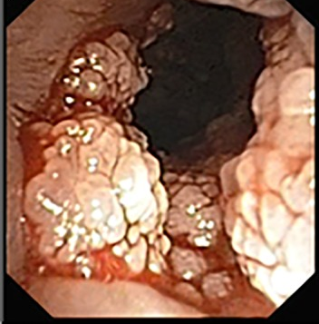

## 문제
A 42-year-old man comes to the clinic because of progressive shortness of breath on exertion and noisy breathing over the past 2 months. He has had a hoarse voice since he was a toddler and has undergone repeated surgical removal of laryngeal growths since the age of 20 months. He has never smoked and does not drink alcohol. Inspiratory stridor is heard over the neck. Flexible bronchoscopy is performed; the image shown is from the airway immediately below the vocal cords. Biopsy shows fronds of squamous epithelium around fibrovascular cores without invasion. Which of the following is the most likely cause of this condition?

- A. Mycobacterium tuberculosis
- B. Human papillomavirus types 6 and 11
- C. Human papillomavirus types 16 and 18
- D. Epstein-Barr virus
- E. Herpes simplex virus type 1

_Flexible bronchoscopic still image — one panel of a published figure, panel letter cropped, no other change (PMC Open Access, CC BY)_

## 정답 및 해설
> 정답: B

- **정답 핵심**: The bronchoscopic image shows <b>multiple exophytic, grape-like (cauliflower) papillary masses</b> around the lumen just below the vocal cords, narrowing the airway by more than half. With <b>hoarseness since early childhood</b>, <b>repeated excisions since 20 months of age</b>, and biopsy showing <b>squamous fronds around fibrovascular cores without invasion</b>, this is <b>recurrent respiratory papillomatosis</b>, caused by low-risk <b>HPV types 6 and 11</b>, usually acquired at birth from the mother's genital tract.
- **원리**: <b>Why papillomas recur</b>: HPV 6 and 11 infect basal cells of the airway epithelium, especially at squamociliary junctions such as the vocal cords and the subglottis. Excision removes the visible papilloma, but latent viral DNA remains in the surrounding normal-appearing mucosa, so new lesions regrow — hence the dozens of operations over decades.  <b>Why low-risk types cause growth but rarely cancer</b>: The E6 and E7 proteins of HPV 6/11 bind p53 and Rb weakly, so they drive benign epithelial proliferation (warts, papillomas) without the strong inactivation of tumor suppressors that HPV 16/18 achieve. Malignant transformation is uncommon.  <b>How the disease spreads</b>: Juvenile-onset disease is acquired perinatally; extension into the trachea and lungs occurs in a minority and worsens prognosis. Quadrivalent/9-valent HPV vaccination of mothers' generation lowers incidence; adjuvant therapies (bevacizumab, cidofovir) are used for frequent recurrences.
- **비교**: <table><thead><tr><th style="width:24%">Feature</th><th style="width:38%">HPV 6/11 — papillomatosis (answer)</th><th>HPV 16/18 — squamous carcinoma (closest distractor)</th></tr></thead><tbody> <tr><td>Onset</td><td><b>Childhood (perinatal)</b> or young adult</td><td>Middle age, oropharynx more than larynx</td></tr> <tr><td>Course</td><td>Multiple recurrences over years</td><td>Progressive single invasive mass</td></tr> <tr><td>Biopsy</td><td><b>Benign fronds, no invasion</b></td><td>Invasive keratinizing or basaloid carcinoma</td></tr> </tbody></table> Both are HPV-related. Childhood onset with many benign recurrences points to the low-risk types; an invasive tumor in an adult points to the high-risk types.
- **오답 이유**:
  - (A) Tuberculosis of the larynx would cause ulcerated or granular lesions with caseating granulomas on biopsy, usually with lung disease.
  - (C) HPV 16 and 18 would be the answer if the biopsy showed invasive squamous cell carcinoma, typically of the oropharynx in an adult.
  - (D) Epstein-Barr virus would be favored by a nasopharyngeal mass with undifferentiated carcinoma or by infectious mononucleosis.
  - (E) Herpes simplex virus type 1 causes painful vesicles and shallow ulcers of the lips and mouth, not exophytic papillary masses.
- **함정**: Choosing the high-risk HPV types because HPV is linked to head and neck cancer — the benign biopsy and lifelong recurrences point to types 6 and 11.
- **학습목표**: Recognize recurrent respiratory papillomatosis from childhood-onset recurrent hoarseness and exophytic papillary airway lesions and identify low-risk human papillomavirus types 6 and 11 as the cause
- **근거·출처**: Loscalzo J, Fauci AS, Kasper DL, et al., eds. Harrison's Principles of Internal Medicine, 22nd ed. McGraw Hill; 2025. Chapter 203: Human Papillomavirus Infections · Derkay CS, Wiatrak B. Recurrent respiratory papillomatosis: a review. Laryngoscope. 2008;118(7):1236-1247 · Recurrent respiratory papillomatosis: the role of cidofovir. Respirol Case Rep. 2018;6(8):e00371. doi:10.1002/rcr2.371

## 출처
- Recurrent respiratory papillomatosis: the role of cidofovir. Respirol Case Rep. 2018 Oct 2;6(8):e00371. doi: 10.1002/rcr2.371 (CC BY) — Figure 1 · CC BY · https://creativecommons.org/licenses/
