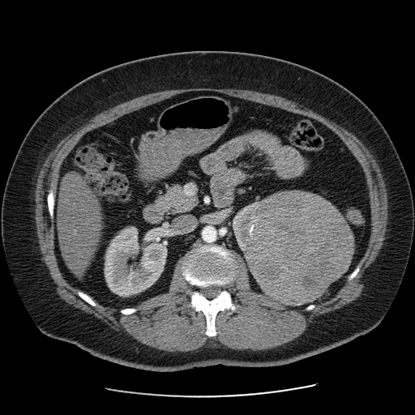

## 문제
51세 여자가 건강검진 복부 초음파에서 왼쪽 콩팥 종괴가 발견되어 왔다. 옆구리 통증, 육안적 혈뇨, 체중 감소는 없다. 기침이나 뼈 통증, 두통, 신경학적 이상은 없다. 혈압 128/78 mmHg 이고 복부 진찰에서 만져지는 종괴는 없다. 혈색소 13.1 g/dL, 혈청 크레아티닌 0.8 mg/dL, 칼슘 9.4 mg/dL, ALP 72 U/L 이다. 소변검사는 정상이다. 조영증강 복부 CT 사진은 그림과 같고, 콩팥정맥과 하대정맥 안에 혈전은 없으며 커진 림프절도 없다. 근치적 신장절제술 전에 시행할 검사로 가장 적절한 것은?

- A. 전신 뼈스캔
- B. 뇌 자기공명영상
- C. FDG 양전자방출단층촬영
- D. 흉부 CT
- E. 경피적 콩팥 종괴 생검

_조영증강 복부 CT, 동맥기 축상 단면 1장, 연부조직 창, 표준 표시 방향 (TCIA, CC BY 3.0 — 크롭·보정·분할 표시 없음)_

## 정답 및 해설
> 정답: D

- **정답 핵심**: CT 에서 <b>왼쪽 콩팥에서 바깥으로 자란 약 10 cm 의 불균질하게 조영 증강되는 고형 종괴</b>가 있고 <b>육안적 지방이 없다</b> — 혈관근지방종이 아닌 <b>신세포암</b>을 먼저 생각하며, 수술할 환자에게 생검은 필요 없다. 신세포암이 가장 흔히 전이하는 곳은 <b>폐</b>이므로 수술 전 병기 결정에 <b>흉부 CT</b>를 한다. 뼈 통증·ALP·칼슘이 정상이고 신경 증상이 없어 뼈스캔·뇌 MRI 는 필요 없다.
- **원리**: <b>조영 증강이 가르는 것</b>: 콩팥 종괴에서 조영 전후 CT 값이 20 HU 이상 오르면 혈관이 있는 고형 종괴이고, 육안적 지방(−10 HU 이하)이 없으면 혈관근지방종이 아니어서 대부분 신세포암이다. 영상만으로 진단의 정확도가 높고 생검은 위음성이 있으며, 결과가 어떻든 큰 종괴는 수술하므로 생검이 치료를 바꾸지 않는다.  <b>왜 흉부 CT 인가</b>: 신세포암은 혈관을 따라 퍼지는 종양이라 폐 전이가 가장 흔하고(전이의 약 절반 이상), 그 다음이 뼈·림프절·간·뇌다. 폐 결절이 있으면 수술 범위와 전신 치료 여부가 달라지므로 모든 환자에서 흉부 영상을 찍는다.  <b>왜 뼈·뇌는 선택적인가</b>: 증상과 혈액검사(뼈 통증·ALP·칼슘 상승, 두통·신경 결손)가 없으면 뼈스캔·뇌 MRI 의 양성률이 매우 낮다. FDG PET 은 투명세포 신세포암의 포도당 섭취가 낮고 콩팥으로 배설되는 추적자가 원발 병소를 가려 표준 병기 검사가 아니다.
- **비교**: <table><thead><tr><th style="width:24%">구분</th><th style="width:38%">흉부 CT — 정답</th><th>경피적 생검 — 가장 가까운 오답</th></tr></thead><tbody> <tr><td>답하는 질문</td><td><b>전이가 있는가</b>(폐 — 가장 흔함)</td><td>무슨 조직인가</td></tr> <tr><td>치료를 바꾸는가</td><td>폐 전이가 있으면 계획이 달라진다</td><td>조영 증강 고형 종괴는 어차피 수술</td></tr> <tr><td>필요한 경우</td><td><b>모든 신세포암 의심 환자</b></td><td>림프종·전이암 의심, 수술하지 않을 환자, 능동 감시 전</td></tr> </tbody></table> 지방 없는 조영 증강 고형 종괴는 영상으로 신세포암이라 판단하고 수술하며, 병기는 흉부 CT 로 정한다. 생검은 결과가 치료를 바꿀 때만 한다.
- **오답 이유**:
  - ① 전신 뼈스캔은 뼈 통증이 있거나 ALP·칼슘이 올라 있는 신세포암 환자라면 병기 검사로 정답이 된다.
  - ② 뇌 자기공명영상은 두통·경련·신경 결손처럼 뇌 전이를 시사하는 증상이 있을 때 병기 검사로 정답이 된다.
  - ③ FDG 양전자방출단층촬영은 신세포암 표준 병기 검사가 아니며, 다른 영상으로 판단이 어려운 재발 평가 등에서 보조로 쓴다.
  - ⑤ 경피적 생검은 림프종·다른 암의 전이가 의심되거나 수술 대신 감시·국소 소작을 고려하는 작은 종괴라면 정답이 된다.
- **함정**: 종괴의 조직 진단이 먼저라고 생각해 생검을 고르는 것 — 조영 증강 고형 종괴는 수술하며, 남은 질문은 전이 여부다.
- **학습목표**: 조영 증강되는 지방 없는 큰 콩팥 고형 종괴를 신세포암으로 판단해 생검 없이 수술 계획을 세우고, 가장 흔한 전이 부위인 폐를 흉부 CT 로 병기 결정하며 뼈·뇌 검사는 증상·검사 이상이 있을 때만 한다
- **근거·출처**: Loscalzo J, Fauci AS, Kasper DL, et al., eds. Harrison's Principles of Internal Medicine, 22nd ed. McGraw Hill; 2025. Chapter 90: Renal Cell Carcinoma · Campbell SC, Clark PE, Chang SS, et al. Renal mass and localized renal cancer: evaluation, management, and follow-up: AUA guideline: part I. J Urol. 2021;206(2):199-208

## 출처
- The Cancer Imaging Archive (CC BY 3.0) · KiTS-00025 · Creative Commons Attribution 3.0 Unported · https://www.cancerimagingarchive.net/data-usage-policies-and-restrictions/
