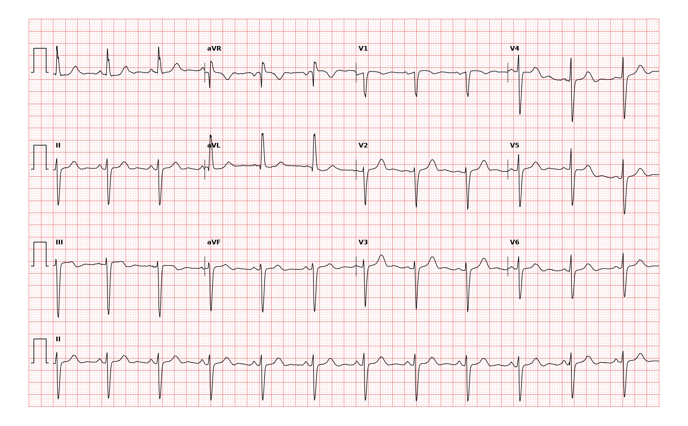

## 문제
85세 여자가 백내장 수술 전 검사를 위해 왔다. 고혈압으로 20년째 약을 먹고 있다. 가슴 통증, 숨참, 어지럼, 실신은 없고 계단 두 층을 쉬지 않고 오른다. 혈압 142/78 mmHg, 맥박 70회/분이다. 심잡음은 없고 다리 부종도 없다. 혈청 칼륨 4.3 mEq/L 이다. 12유도 심전도는 그림과 같다. 심전도 판독으로 가장 적절한 것은?

- A. 좌전속지차단
- B. 좌후속지차단
- C. 완전좌각차단
- D. 완전우각차단
- E. 오래된 하벽 심근경색

_12유도 심전도, 25 mm/s · 10 mm/mV, 3×4 + II 리듬 스트립 (PTB-XL ECG dataset, PhysioNet, CC BY 4.0 — 원신호 그대로 작도)_

## 정답 및 해설
> 정답: A

- **정답 핵심**: RR 이 일정한 <b>동리듬 약 70회/분</b>이고 <b>QRS 는 좁다</b>(0.12초 미만). <b>I·aVL 은 작은 q 뒤 큰 R(qR)</b>, <b>II·III·aVF 는 작은 r 뒤 깊은 S(rS)</b>로 축이 −45° 보다 왼쪽인 <b>좌축편위</b>다. 하벽 유도의 첫 굴절이 위로 향하는 r 이라 병적 Q파가 아니다 — <b>좌전속지차단</b>이다.
- **원리**: <b>좌각의 앞가지가 막히면</b>: 좌각은 앞위쪽으로 가는 가는 좌전속지와 뒤아래쪽으로 가는 굵은 좌후속지로 나뉜다. 좌전속지가 막히면 흥분이 먼저 뒤아래쪽 벽에서 시작해(하벽 유도에 작은 r, I·aVL 에 작은 q), 그다음 늦게 앞위·왼쪽 벽으로 크게 돌아간다(I·aVL 에 큰 R, 하벽 유도에 깊은 S). 그래서 전체 축이 왼쪽 위로 기운다.  <b>왜 QRS 가 좁은가</b>: 섬유 하나만 막혔고 나머지 전도계는 빠르게 전도하므로 지연이 짧다 — 각 전체가 막혀 심근을 통해 천천히 퍼지는 각차단과 다르다.  <b>고령자에서의 의미</b>: 고혈압·노화에 따른 전도계 섬유화가 흔한 원인이고, 단독이면 증상이 없고 치료가 필요 없다. 우각차단과 함께(이섬유차단) 실신이 있으면 고도 방실차단을 의심한다.
- **비교**: <table><thead><tr><th style="width:24%">구분</th><th style="width:38%">좌전속지차단 — 정답</th><th>좌후속지차단 — 가장 가까운 오답</th></tr></thead><tbody> <tr><td>축</td><td><b>좌축편위(−45° 보다 왼쪽)</b></td><td>우축편위(+90° 보다 오른쪽)</td></tr> <tr><td>I·aVL</td><td><b>qR</b></td><td>rS</td></tr> <tr><td>II·III·aVF</td><td><b>rS</b></td><td>qR</td></tr> <tr><td>진단 조건</td><td>다른 좌축 원인 없음</td><td>우심실비대·폐질환을 먼저 배제</td></tr> </tbody></table> 두 속지차단은 거울상이다. I 이 크게 양성이고 하벽 유도가 음성이면 앞가지, I 이 음성이고 하벽 유도가 양성이면 뒷가지다.
- **오답 이유**:
  - ② 좌후속지차단은 I·aVL 이 rS, II·III·aVF 가 qR 인 우축편위이고 우심실비대가 없을 때 정답이 된다.
  - ③ 완전좌각차단은 QRS 가 0.12초 이상으로 넓고 I·V6 에 넓게 갈라진 R, V1 에 깊은 QS 가 있다면 정답이 된다.
  - ④ 완전우각차단은 QRS 가 0.12초 이상이고 V1 에 rsR′, I·V6 에 넓고 둔한 S파가 있다면 정답이 된다.
  - ⑤ 오래된 하벽 경색은 II·III·aVF 의 첫 굴절이 0.04초 이상의 넓은 Q파였다면 정답이 된다.
- **함정**: 하벽 유도의 큰 음성 파형을 보고 하벽 경색의 Q파로 읽는 것 — 첫 굴절은 위로 향하는 작은 r 이다.
- **학습목표**: 좁은 QRS 의 좌축편위에서 I·aVL 의 qR 과 II·III·aVF 의 rS 를 좌전속지차단으로 판독하고 좌후속지차단·완전좌각차단과 가른다
- **근거·출처**: Loscalzo J, Fauci AS, Kasper DL, et al., eds. Harrison's Principles of Internal Medicine, 22nd ed. McGraw Hill; 2025. Chapter 247: Electrocardiography · Wagner P, Strodthoff N, Bousseljot RD, et al. PTB-XL, a large publicly available electrocardiography dataset. Sci Data. 2020;7:154

## 출처
- PTB-XL ECG dataset v1.0.3 (PhysioNet, CC BY 4.0) · record 15903 · Creative Commons Attribution 4.0 International · https://physionet.org/content/ptb-xl/1.0.3/LICENSE.txt
